# Inverse oscillating boundary layer: a verified baseline and a diagnosed PINN limitation

**MAE 598 Project 3**

Team members: Luc Andreassi, Micah Kawamura, Nicholas Cheng, Sivan Garteiz, Andrew Coverston. 
Researcher: Dr. Kiran Ramesh, PhD.

## Executive Summary

For this one-parameter, single-frequency problem, we recommend the conventional finite-difference inverse fit. The specialized PINN estimates viscosity with comparable accuracy, but its median training time is **88.2 times** the baseline's median inverse-fit time on the same machine (1.15 s versus 0.013 s). Our original derivative diagnostics measure the wall velocity gradient $g=u_y(0,t)$. Physical wall stress also depends on the inferred viscosity; Section 6.3 reports both quantities. A small neural training loss does not guarantee an accurate wall derivative or stress.

The thin-layer controls expose a specific failure mode: **coordinate scaling without adequate near-wall physics enforcement can produce a small sampled objective and unreliable derivatives.** At $\delta/L=0.01$, adding near-wall collocation to the scaled network reduces the median held-out near-wall PDE RMS by **19.2 times** and the median wall-gradient amplitude error by **3.75 times**. Longer training on fixed points then exposes residual overfitting, including in the combined model. Five residual-adaptive refinement rounds reduce median held-out near-wall PDE RMS by **12 times** relative to longer-trained vanilla; an independent dense-grid audit confirms an **11.4-times** reduction. These are local improvements in physics enforcement, not evidence that the PINN is generally more accurate or economical than the conventional inverse fit.

## 1. Outreach log and research problem brief


### 1.1 Outreach log

Researchers contacted, in chronological order (all dates 2026). 
Researchers found through previous student work, the Ira A Fulton Researcher website, and personal connections to the professors.

| Date | Researcher | Action | Outcome | Reason for Contact |
|---|---|---|---|---|
| 7 Oct | Prof. Spring Bermann | Email requesting a research interview | No response, Followed up 10/10, no response | On project recommendation list|
| 12 Oct | Prof. Yulia Peet | Email requesting a research interview | No Response |  On project recommendation list |
| 17 Oct | Dr. Kiran Ramesh | Email requesting a research interview | Accepted; interview scheduled for 18 Oct | Several team members knew of his research and it aligned with the project|
| 18 Oct | Dr. Ramesh | First interview (Zoom, 6 PM), prepared with the team's interview guide (`Interview_Question.md`) and a review of his publications (`ramesh-research-review.md`). | Research context and candidate problems discussed |
| 19 Oct | Dr. Ramesh| Second interview (Zoom) to choose the problem | Project secured: oscillating boundary-layer inverse problem with a PINN |

**Consent.** Dr. Ramesh consented during the Zoom meetings to being recorded and to being named and reported on in this project.

**Interview findings.** The following summary combines the 18 and 19 October interviews.

- *Research objective.* Dr. Ramesh is developing an unsteady version of XFOIL. Like XFOIL, it uses viscous–inviscid interaction: the problem is split into a potential-flow solution and an integral boundary-layer solution.
- *Where the difficulty lies.* Integral boundary-layer methods collapse the wall-normal dimension, which leaves more unknowns than equations, so closure models must supply the missing information. Extending these methods to unsteady flow requires new unsteady integral boundary-layer formulations and new unsteady closure models. This is his current research focus.
- *Data and solvers.* He is using OpenFOAM to generate CFD data for building unsteady closure models. That work is at an early stage and outside this project's scope.
- *Role of this problem.* He described the oscillating boundary-layer inverse problem (estimating viscosity and wall shear stress from noisy sensor data with a PINN) as a demonstration: it has an exact solution, so it validates the method rather than serving as a production application.

**Preparation materials:** [Interview questions](Interview_Question.md) and [research review](ramesh-research-review.md).


### 1.2 Problem brief

**The scientific problem.** When the flow outside a boundary layer oscillates, the skin friction at the wall does not follow the outer flow in step: it peaks earlier. This happens on a pitching airfoil, in a gust, and on a rotor blade in forward flight. Dr. Ramesh's group is developing unsteady boundary-layer models for exactly these flows, as part of an unsteady version of XFOIL. Like XFOIL, it couples a potential-flow solution for the outer flow to an integral boundary-layer model of the thin viscous layer. That keeps it fast enough for design, where full CFD is not. The integral equations in (s, t) need closure models, most importantly for the wall shear. Steady closures exist; unsteady ones are the open research problem. As the task card states, predicting the unsteady wall shear, including its phase, is the basic requirement for these models.

**The physics that makes it hard.** The simplest case is an oscillating boundary layer over a stationary flat wall under the outer stream $U_e(t)=U_0\cos(\omega t)$, with no mean flow. The flow is laminar, depends only on wall distance $y$ and time $t$, and obeys

$$
\frac{\partial u}{\partial t}=\frac{dU_e}{dt}+\nu\frac{\partial^2 u}{\partial y^2},\qquad u(0,t)=0,\qquad u\to U_e(t)\ \text{far from the wall}.
$$

Its exact periodic solution has thickness $\delta=\sqrt{2\nu/\omega}$ and wall stress $\tau_w=(\sqrt{2}\mu U_0/\delta)\cos(\omega t+\pi/4)$, which **leads the outer velocity by $45^\circ$**. The stress traces a hysteresis loop against outer velocity over a cycle. A quasi-steady relation proportional to instantaneous outer velocity misses this phase behavior. Integrating the equation across the half-space gives $d(U_e\delta^*)/dt=\tau_w/\rho$, where $\delta^*$ is displacement thickness. This identifies wall stress as a quantity an unsteady closure must supply.

**The inverse problem.** Treat $\nu$ as unknown. From three noisy velocity probes at $y=\{0.5\delta,\delta,2\delta\}$, sampled $N_t$ times per cycle, infer viscosity and the wall gradient, then reconstruct physical stress using the inferred viscosity. Compare the PINN with a conventional solver-based fit. Raising frequency thins the layer, with $\delta/L$ ranging from $1/6$ to $1/100$. Observation noise from 0–10% of $U_0$ and $N_t\in\{64,16,8\}$ are secondary knobs. The known exact solution permits independent scoring.

**Current approach and cost.** The conventional alternative is a finite-difference solver inside a scalar optimizer, which the task card prescribes as the baseline. For Dr. Ramesh's research version, the closure data will come from OpenFOAM CFD, an effort at an early stage. High-fidelity runs are far more expensive than integral boundary-layer solves, and closures must be calibrated across many conditions, so the training data will be expensive and sparse. The per-run cost and hardware were not established in our interviews.

**How this supports Dr. Ramesh's research.** The study answers three questions his unsteady closure work will face:

1. *Can a PINN reliably extract wall shear and its phase from sparse, noisy data?* This is the core quantity of an unsteady closure, and we measure the achievable amplitude and phase accuracy against an exact answer.
2. *Can the training loss be trusted in thin layers?* We test whether a small physics loss guarantees an accurate wall derivative. If it does not, we identify a check (held-out near-wall residuals) and remedies (near-wall collocation, coordinate scaling by the current δ estimate, residual-adaptive points) that carry over to closure training.
3. *Where is a neural method worth its cost?* We compare the PINN's training cost and accuracy with a verified conventional fit, to show whether neural methods should replace conventional solvers for known physics or be reserved for unknown closure terms.

## 2. Complete mathematical formulation

### 2.1 Dimensional problem

Let $y$ denote distance from a stationary wall, and impose the outer velocity $U_e(t)=U_0\cos(\omega t)$. For incompressible, unidirectional laminar flow, $u=u(y,t)$ and the streamwise convective terms vanish, leaving

$$
u_t=\frac{dU_e}{dt}+\nu u_{yy},\qquad u(0,t)=0,\qquad u(y,t)\to U_e(t)\text{ as }y\to\infty.
$$

The outer flow supplies the pressure gradient, $-\rho^{-1}\partial p/\partial x=dU_e/dt$. The kinematic viscosity $\nu$ is constant and unknown to both inverse methods.

### 2.2 Nondimensional variables, domain and unknown

Define $\hat y=y/L$, $\hat t=\omega t$, $\hat u=u/U_0$ and $\kappa=\nu/(\omega L^2)$, and drop the hats below. The computational domain is $y\in[0,1]$ and $t\in[0,2\pi)$, representing one periodic cycle:

$$
u_t=-\sin t+\kappa u_{yy},\qquad u(0,t)=0,\quad u(1,t)=\cos t,\quad u(y,t+2\pi)=u(y,t).
$$

The inverse unknown is $\kappa>0$, with dimensional viscosity $\nu=\kappa\omega L^2$. We study the periodic state after startup transients have decayed, so no separate initial condition is imposed. Both inverse methods constrain $\kappa$ to $[10^{-8},0.2]$, which contains every tested truth.

### 2.3 Exact reference, wall shear and finite-domain consistency

The half-space (Stokes second problem) reference supplied in the task card is

$$
u_\infty(y,t)=\cos t-e^{-y/\delta}\cos(t-y/\delta),\qquad \delta=\sqrt{2\kappa},
$$

Here $\delta$ denotes the nondimensional thickness $\delta/L$. The wall velocity gradient is

$$
g(t)=u_y(0,t)=\frac{\sqrt{2}}{\delta}\cos(t+\pi/4).
$$

Its amplitude is $G=\sqrt{2}/\delta$, with a $45^\circ$ phase lead over outer velocity. The dimensional stress is $\tau_w=\rho\nu(U_0/L)g$. Under the viscosity-independent stress scale $\rho\omega L U_0$, the normalized stress is $S=\kappa g$. Consequently, the stress-amplitude error uses both the fitted viscosity and the fitted gradient:

$$
E_{\tau}=\left|\frac{\widehat\kappa}{\kappa_{\mathrm{true}}}\frac{\widehat G}{G_{\mathrm{true}}}-1\right|.
$$

The saved `shear_amplitude_relative_error` metric scores **wall-gradient amplitude**, not physical stress. We retain its original meaning and report physical stress error separately. Positive viscosity leaves gradient and stress phase identical, but their amplitude errors and method rankings can differ.

The half-space field does not equal cos t exactly at y = 1. The discrepancy is bounded by exp(-1/delta): 2.48e-3 U0 at delta = 1/6, 4.54e-5 U0 at delta = 0.1, 2.1e-9 U0 at delta = 0.05 and negligible for the thinner cases. We keep the task-card half-space reference for generating data and for scoring, and both inverse methods enforce the approximate far-field condition u(1,t) = cos t. Separately, we verify the discretization against the **boundary-consistent finite-domain analytic amplitude**

$$
a_F(y)=1-\frac{\sinh[q(1-y)]}{\sinh q},\qquad q=(1+i)/\delta,\qquad u_F=\Re[a_F e^{it}].
$$

The code evaluates this in an equivalent exponential form to avoid overflow for small delta. The finite-domain expression is used only to verify the solver, never to fit measurements. The truncation is an explicitly bounded model discrepancy, not a coding error or a PINN pathology.
### 2.4 Difficulty knobs and experimental design

The primary knob is $\delta/L\in\{1/6,1/10,1/20,1/50,1/100\}$, or equivalently $L/\delta\in\{6,10,20,50,100\}$ increasing with difficulty. At fixed dimensional $\nu$ and $L$, increasing $\omega$ produces thinner layers. In the nondimensional formulation, $\kappa=\delta^2/2$.

Secondary knobs are $\sigma/U_0\in\{0,0.01,0.02,0.05,0.10\}$ and $N_t\in\{64,16,8\}$. Each varies individually about $\delta/L=0.1$, $\sigma/U_0=0.02$ and $N_t=16$. Removing duplicate reference settings gives 11 settings; seeds 17, 29 and 41 give 33 datasets.

The 117 primary runs comprise baseline, vanilla and combined on all 33 datasets (99 runs), sampling-only and scaling-only at $\delta/L=0.1$ and $0.01$ (12 runs), and the supervised and known-viscosity oracle controls at $\delta/L=0.01$ (6 runs). Supplementary studies add nine longer-budget controls and 15 adaptive fits (five rounds for each of three seeds). The design does not characterize interactions between knobs.

Probe heights are $y=\{0.5\delta,\delta,2\delta\}$. Their positions move with the true thickness between synthetic experiments, but remain fixed during each inverse fit. This ensures that probes lie inside each layer; it does not test fixed physical instruments that move outside a thinning layer.

## 3. Reproducibility and implementation map

### 3.1 Run instructions

Run these commands from the repository root:

```bash
cd "Project 3"
python -m venv .venv
# Activate .venv for your operating system, then:
python -m pip install -r requirements.txt
python -m unittest -v test_numerics.py
python oscillating_bl.py --suite full --seeds 17 29 41 --width 16 --collocation 160 --max-nfev 600 --threads 1 --output final_results
python budget_controls.py --results final_results
python adaptive_fix.py --results final_results --rounds 5
python audit_submission.py --results final_results
python report_updates.py --results final_results --output report_figures
```

For a two-setting smoke test, use `--suite pilot --seeds 17 --output pilot_results` for the main numerical script. The full audit and report postprocessor expect the complete study. To resume an interrupted main study, repeat its identical command with `--resume`; resumption is refused if its code hash or settings changed. Original per-model training times are preserved. `make_report.py` is an optional draft generator that overwrites `REPORT.md`; it is not required for reproducing the study. Preserve the completed report before using it.

### 3.2 Main functions and data flow

| Stage | Function(s) | Inputs -> outputs |
|---|---|---|
| Reference and noise | exact_amplitude, exact_velocity, make_measurements | Truth, probe positions, seed -> clean and noisy samples |
| Numerical forward solver | grid_operator, fd_periodic | Candidate kappa -> numerical periodic velocity amplitude |
| Time-integration check | mol_check | Numerical periodic state -> BDF-integrated cycle |
| Conventional inverse fit | fit_baseline | Fixed noisy probes -> fitted kappa |
| Neural representation | Jet2, neural_fields | Weights and y -> A, B and their spatial derivatives |
| Physics training | residual_jacobian, train_pinn | Data and collocation points -> network weights and kappa |
| Scoring | evaluate, field_metrics | Trained model plus withheld exact reference -> errors and timings |
| Report postprocessing | report_updates.py | Archived CSVs, histories and fields -> stress metrics and revised figures in report_figures/; no retraining |
| Diagnostics | p1_verification, plot_summary, plot_case, plot_diagnosis | Saved results -> P1–P5 and Path B figures |
| Longer-budget control | budget_controls.py | Thin-case data -> 6,000-evaluation vanilla/scaling/combined fits |
| Residual-adaptive refinement | adaptive_fix.py (refine) | Combined models and PDE residual monitor -> five refinement rounds |
| Independent audit | audit_submission.py | Saved fields and models -> recomputed error, dense residual audit, supplementary figures |
| Report draft | make_report.py | Saved CSV/JSON results -> first draft of this report |

### 3.3 Files and audit trail

- oscillating_bl.py: complete numerical study and figure generation.
- test_numerics.py: six scientific verification tests.
- requirements.txt: exact package versions.
- budget_controls.py: nine tenfold-budget controls, kept separate from the primary runs.
- adaptive_fix.py: five fixed residual-adaptive refinement rounds for each thin-case seed.
- audit_submission.py: independent field-error audit, dense residual audit and supplementary figures.
- make_report.py: generated the first draft of this report from measured results.
- final_results/data/: all 33 clean/noisy measurement datasets, with their standard Gaussian draws and probe coordinates.
- final_results/models/: every fitted model with its per-run metrics and optimizer status.
- final_results/histories/: per-evaluation objective components, elapsed time and kappa for every neural run.
- final_results/metrics.csv: all 117 primary method/case records, including every seed and negative outcomes.
- final_results/budget_metrics.csv and adaptive_metrics.csv: the longer-budget controls and every refinement round.
- final_results/baseline_grid_convergence.csv and mol_verification.json: independent baseline verification.
- final_results/dense_residual_audit.csv and verification_audit.json: audit outputs (Sections 8.3 and 11).
- final_results/fields/: seven representative full fields used in the plots.
- final_results/figures/: original experimental diagnostic PNGs.
- report_figures/: revised presentation figures and derived stress/summary metrics from report_updates.py; no training is performed during this postprocessing.
- final_results/environment.json (plus budget_ and adaptive_environment.json): original command, versions, hardware, thread settings and source hashes. report_figures/postprocessing_provenance.json records the later reporting script and its inputs separately.

To keep the archive compact, full field arrays are included only for the six plotted baseline/vanilla/combined runs (seed 17, delta = 0.1 and 0.01) and the seed-17 final adaptive field. Every model, measurement dataset, loss history and summary metric is included, and the commands above regenerate all other field arrays. The assignment and task-card PDFs are not redistributed.

Source SHA-256 at experiment execution: `567777beb993db101a9ade366ad1180b6f76d36a02b9561fd4324d60a24d7f20`.

## 4. P1: conventional forward and inverse baseline

### 4.1 Spatial discretization

The baseline uses the fixed stretched grid $y_j=\sinh(6j/N)/\sinh(6)$, with $N=400$ intervals for inverse fitting. It is chosen without knowledge of true $\kappa$. With $h_m=y_j-y_{j-1}$ and $h_p=y_{j+1}-y_j$, the second derivative is approximated by

$$
(D_2u)_j=\frac{2u_{j-1}}{h_m(h_m+h_p)}-\frac{2u_j}{h_m h_p}+\frac{2u_{j+1}}{h_p(h_m+h_p)}.
$$

Boundary values enter through the right-hand side. The smooth stretching clusters points at the wall while still covering the whole domain: the first spacing is 7.4e-5, and 96 of the 400 intervals lie inside y <= 0.01, the thinnest tested layer thickness.

### 4.2 Periodic solver and time-integration check

Because the PDE and boundary conditions are linear with a known forcing frequency, substituting $u=\operatorname{Re}[a(y)e^{it}]$ into the discretized PDE gives

$$
(\kappa D_2-iI)a=-i\mathbf1,
$$

with a(0) = 0 and a(1) = 1. One complex tridiagonal (banded) solve produces the numerical periodic state; the exact spatial formula is never inserted. This is an efficient conventional solver for exactly the PDE under comparison, not a weakened baseline.

**Departure from the task card's time-marching recipe.** The inverse baseline solves the periodic finite-difference system directly. A separate BDF `solve_ivp` integration checks that system over one cycle, initialized from its numerical periodic state ($N=200$, all five viscosity truths). The largest relative $L^2$ difference is **$1.37\times10^{-7}$**. This verifies agreement between harmonic and time-domain solutions, not convergence from uniform startup. The slowest transient mode decays approximately as $\exp(-\kappa\pi^2t)$; reducing it by $10^{-6}$ takes about 17 cycles at $\delta/L=1/6$ and 4,456 cycles at $\delta/L=0.01$. Direct periodic solution avoids this unnecessary transient cost.

Grid refinement with $N\in\{100,200,400,800\}$ is checked against the finite-domain analytic amplitude. At $N=400$, the largest tested relative $L^2$ amplitude error is **$1.3\times10^{-5}$**. Each grid doubling reduces error by approximately four, consistent with second-order convergence, which is also checked by a unit test.

*Figure 1. P1: finite-domain forward-solver verification for all five thicknesses. Errors decrease approximately quadratically under grid refinement.*
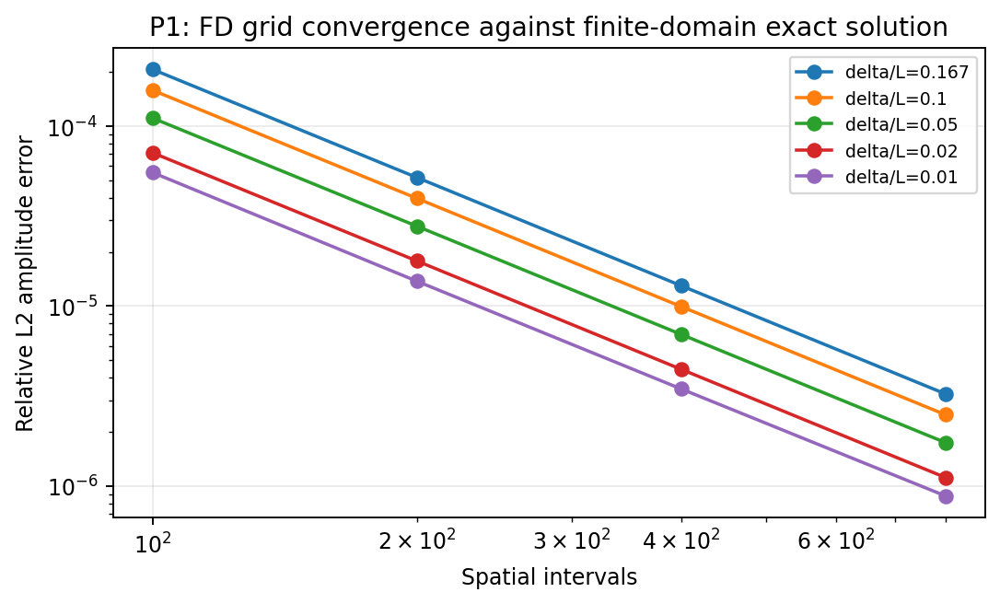

### 4.3 Conventional inverse fit

For each candidate kappa, the baseline solves the finite-difference system, interpolates the complex amplitude to the fixed probe heights, and computes the mean squared velocity mismatch against the same noisy measurements the PINN uses. It optimizes log(kappa) over the shared bounds. A 61-point coarse scan in log(kappa) comes first; then bounded scalar minimization refines each of the three best scan points within its neighboring scan interval, and the best of the three is kept. The global scan matters because trial layers much thinner than all three probes produce an almost flat misfit, and a single bounded search over the full range can stall there.

The reported inverse time includes the coarse scan, forward solves used by the objective, interpolation and scalar optimization; it excludes one final forward solve used to reconstruct the fitted field. Exact reference values never enter the objective. A noiseless unit test recovers $\kappa$ to within 0.1% on an $N=800$ grid; the default $N=400$ grid gives a relative error of about $3\times10^{-6}$ for that case.

## 5. Synthetic measurements and the PINN

### 5.1 Measurement generation

Each probe is sampled at $t_j=2\pi j/N_t$, $j=0,\ldots,N_t-1$; the duplicate periodic endpoint is omitted. Observations are

$$
u^{obs}_{ij}=u_\infty(y_i,t_j;\kappa_{true})+\sigma\epsilon_{ij},\qquad\epsilon_{ij}\sim\mathcal N(0,1).
$$

Sigma is a fraction of U0, not of the instantaneous velocity, so zero crossings do not create a relative-noise singularity. Noise is added only to the observations; the reference, PDE and boundary conditions stay clean. The clean samples and the standard Gaussian draws are saved, and every method in a pairing uses the identical dataset.

The standard Gaussian draws depend only on the seed, so a given seed reuses the same draws at every thickness and noise level. Because the probes also scale with delta, the baseline faces an almost self-similar problem across the thickness sweep, which is why its kappa error barely changes (Section 6.2). The seed also sets the neural initialization and the collocation points. The three replications therefore combine measurement and initialization variability rather than estimating either one independently.

### 5.2 Trainable neural representation and its scope

The network is a fully trainable multilayer perceptron with one hidden layer of 16 tanh units and two outputs:

$$
z_j(y)=\tanh(w_j y/s+b_j),\quad A(y)=\sum_jv^A_jz_j+c_A,\quad B(y)=\sum_jv^B_jz_j+c_B,
$$

$$u_\theta(y,t)=A(y)\cos t+B(y)\sin t.$$

The coordinate scale is $s=1$ for raw-coordinate variants and $s=\delta_0$ for scaled variants (Section 8.1). All hidden/output weights and biases and $\log\kappa$ are optimized, giving $4(16)+2+1=67$ trainable parameters. Periodicity is exact by construction. Neither $A(y)$ nor $B(y)$ is supplied the Stokes exponential spatial form.

**Departure from a generic MLP with inputs (y, cos t, sin t):** the harmonic output form builds in the known single-frequency linear response, restricting the time dependence. This makes it a specialized PINN that has more physical information than a generic space-time network. Both neural variants and the numerical baseline use the same known forcing frequency. Our conclusions therefore say nothing about how a generic space-time PINN (for example in PyTorch) would train, or how nonlinear or multi-frequency airfoil flows would behave.

First and second spatial derivatives are propagated with a minimal forward-mode automatic differentiator (Jet2) built from affine and tanh rules. The Jacobians with respect to the optimizer parameters are analytic. Unit tests verify, by complex-step differentiation, every column of the residual Jacobian and the second spatial derivatives, in both raw and scaled coordinates. The PINN never takes finite differences of noisy observations.

### 5.3 Loss, optimizer and initialization

For the harmonic trial function, the PDE residual is

$$
r(y,t)=[B-\kappa A'']\cos t+[1-A-\kappa B'']\sin t.
$$

The PDE loss integrates its square **exactly in time**, which gives

$$
L_{PDE}=\frac1{2N_c}\sum_{j=1}^{N_c}\left[(B_j-\kappa A_j'')^2+(1-A_j-\kappa B_j'')^2\right].
$$

The data term is mean squared velocity error at the probes. The boundary term is the mean of $A(0)^2$, $B(0)^2$, $[A(1)-1]^2$ and $B(1)^2$. The objective is $\mathcal L=\mathcal L_{\mathrm{data}}+\mathcal L_{\mathrm{PDE}}+\mathcal L_{\mathrm{BC}}$ with equal weights and no initial-condition term. Boundary conditions are soft penalties.

Training uses SciPy's trust-region reflective nonlinear least-squares method with the full analytic Jacobian, float64 arithmetic, ftol = xtol = gtol = 1e-9 and at most 600 function evaluations. This choice suits a small residual-based inverse problem; it is not an Adam experiment. Wall time is reported as well, because equal evaluation counts do not imply equal compute cost.

Initialization deliberately starts away from the truth: seeds 17 and 41 start with kappa at 5 times the true value and seed 29 at 0.2 times, following the task card's synthetic initialization check. This is a controlled benchmark, not a procedure for choosing a starting viscosity from unknown real data; a deployment claim would need an extra experiment with a data-selected starting value. Within each seed, every PINN variant starts from the same initial weights and kappa estimate. The two oracle controls are the exception: they are given the true kappa.

**Stopping status:** all 84 primary neural runs (vanilla and combined on 33 datasets, plus 6 sampling, 6 scaling and 6 oracle runs) stopped at the 600-evaluation limit rather than at a convergence tolerance. Their errors are valid finite-budget results, and we make no claim of fully converged or globally optimal fits. Each run's status, final objective and optimality measure are saved.

## 6. P2--P5 diagnostics and measured results

### 6.1 P2: separate loss histories

Every neural run records its data, PDE and boundary losses separately at every objective evaluation. These histories include trust-region trial steps that were rejected, so the curves need not decrease monotonically. For the supervised oracle control, the optimized history is its supervised field loss, not a physics-training history; its final physics residual is scored separately.

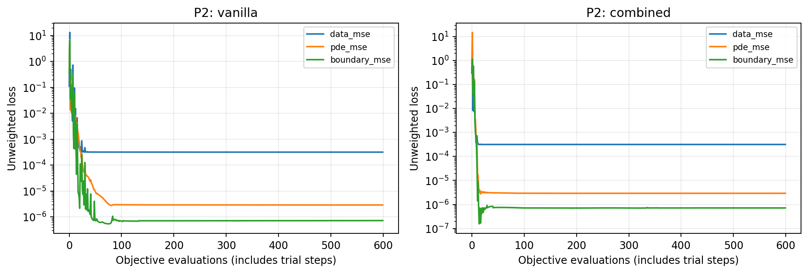

*Figure 2. P2: vanilla and combined loss components at $\delta/L=0.1$, $\sigma/U_0=0.02$, $N_t=16$, seed 17. The logarithmic curves include rejected trust-region trial evaluations.*

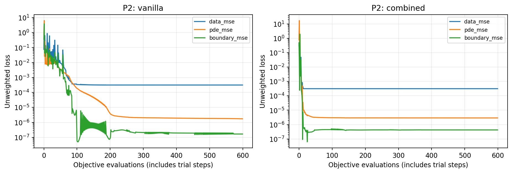

*Figure 3. P2: the same losses at $\delta/L=0.01$, with identical noise level, sample count and seed. No initial-condition loss is needed for the periodic ansatz.*

### 6.2 P3: errors against each knob

Relative field $L^2$ error integrates time-averaged squared error over an independent grid of 1,201 heights and 128 times, normalized by the reference norm. The near-wall region $y\leq\min(6\delta,1)$ is scored separately. Parameter error is $|\widehat\kappa/\kappa_{\mathrm{true}}-1|$. Gradient amplitude and phase come from the learned wall derivative, not training targets. Lines are three-seed medians and bands are full seed ranges, not confidence intervals.


*Figure 4. P3: viscosity, whole-field and wall-gradient amplitude errors against inverse thickness. Larger $L/\delta$ means a thinner layer.*


*Figure 5. P3: the same errors against observation-noise standard deviation at $\delta/L=0.1$ and $N_t=16$.*


*Figure 6. P3: the same errors against samples per probe per cycle at $\delta/L=0.1$ and $\sigma/U_0=0.02$.*

The compared methods are baseline, vanilla PINN and combined PINN. The combined method rescales coordinates and allocates half its collocation points to the initially estimated near-wall region. Additional near-wall and phase diagnostics are shown below; the scaling-only failure is examined separately in Section 7.1.

**Measurement knobs.** The viscosity error of all three methods grows almost linearly with noise, from essentially zero at sigma = 0 to about 10% at sigma = 0.10, and falls with more samples (baseline: 2.67% at Nt = 8, 2.12% at Nt = 16, 0.69% at Nt = 64). The three methods track each other closely along both knobs. This error is set mainly by the information in the noisy probes, and better physics enforcement in the network does not remove it.

**Thickness knob.** Errors do not increase steadily as the layer thins. The baseline's median viscosity and gradient-amplitude errors remain approximately 2.12% and 1.08%, since probe coordinates and standardized noise scale with thickness. Whole-field error falls partly because the layer occupies less of the domain. Near-wall PINN errors rise from approximately 0.36% at $\delta/L=1/6$ to 0.61% at $0.01$; the baseline remains near 0.32%. PINN phase errors also rise to approximately $0.3$–$0.8^\circ$, while the baseline stays below $0.003^\circ$.

**Method comparison.** The PINNs estimate viscosity and gradient amplitude with errors of similar order to the baseline, but the baseline has lower whole-field and near-wall velocity error at every thickness. Gradient accuracy alone does not determine physical-stress accuracy (Section 6.3). The combined method has no consistent advantage over vanilla across this sweep. At $\delta/L\geq0.1$, its near-wall allocation is often inactive: when $6\delta_0\geq1$, that region spans the whole domain. The controlled thin-layer comparisons in Section 7 provide the stronger evidence for its mechanism.


*Figure 7. P3: near-wall relative $L^2$ and wall-gradient/stress phase error across thickness, using three-seed medians and full seed ranges. These reveal local behavior hidden by the whole-domain norm.*

| delta/L | kappa true | Baseline kappa error (%) | Vanilla kappa error (%) | Combined kappa error (%) | Baseline near-wall L2 (%) | Vanilla near-wall L2 (%) | Combined near-wall L2 (%) |
|---|---:|---:|---:|---:|---:|---:|---:|
| 0.167 | 0.0139 | 2.13 | 2.20 | 2.20 | 0.330 | 0.355 | 0.355 |
| 0.1 | 0.005 | 2.12 | 2.16 | 2.19 | 0.323 | 0.422 | 0.421 |
| 0.05 | 0.00125 | 2.12 | 2.06 | 2.16 | 0.323 | 0.502 | 0.476 |
| 0.02 | 0.0002 | 2.12 | 1.56 | 2.10 | 0.324 | 0.578 | 0.505 |
| 0.01 | 5e-05 | 2.12 | 1.88 | 2.01 | 0.325 | 0.611 | 0.605 |

Values are three-seed medians at sigma = 0.02 and Nt = 16.

### 6.3 Thin-case numerical comparison

At $\delta/L=0.01$, $\sigma/U_0=0.02$ and $N_t=16$, the following values are medians over seeds 17, 29 and 41. The supervised and known-viscosity controls receive oracle information and **do not estimate viscosity**.

| Method | Viscosity error (%) | Whole-field L2 (%) | Near-wall L2 (%) | Gradient-amplitude error (%) | Stress-amplitude error (%) | Phase error (deg) | Fit/train (s) |
|---|---:|---:|---:|---:|---:|---:|---:|
| baseline | 2.12 | 0.0759 | 0.325 | 1.08 | 1.07 | 0.00237 | 0.0131 |
| vanilla | 1.88 | 0.144 | 0.611 | 0.571 | 1.85 | 0.833 | 1.09 |
| sampling | 2.10 | 0.121 | 0.517 | 1.18 | 0.939 | 0.332 | 1.14 |
| scaling | 10.2 | 0.192 | 0.820 | 4.32 | 5.96 | 1.68 | 1.07 |
| combined | 2.01 | 0.142 | 0.605 | 1.15 | 0.882 | 0.322 | 1.17 |
| supervised (oracle) | -- | 0.0163 | 0.0288 | 0.282 | 0.282* | 0.894 | 1.31 |
| known_kappa (oracle) | -- | 0.145 | 0.619 | 0.0252 | 0.0252* | 0.343 | 1.02 |

*Oracle stress errors use the supplied true viscosity; other stress errors use fitted viscosity. Phase error is identical for gradient and stress because viscosity is positive. Stress error is computed per seed before taking the median. The viscosity and gradient medians must not be combined to approximate a median stress error.*

### 6.4 P4: where the errors occur and their spectra

P4 compares baseline, vanilla and combined for $\delta/L=0.1$ and $0.01$, at $\sigma/U_0=0.02$, $N_t=16$ and seed 17, which was selected before inspecting results. The left column is signed velocity error $e=u_{\mathrm{pred}}-u_{\mathrm{ref}}$; the right is the PDE residual at the fitted viscosity. The maps show $y\leq\min(6\delta,1)$. Within each figure, velocity-error panels share one color scale and available residual panels share another. The baseline's continuous residual is unavailable because differentiating its interpolated field introduces a separate approximation; its discrete FD equations are solved to numerical precision.

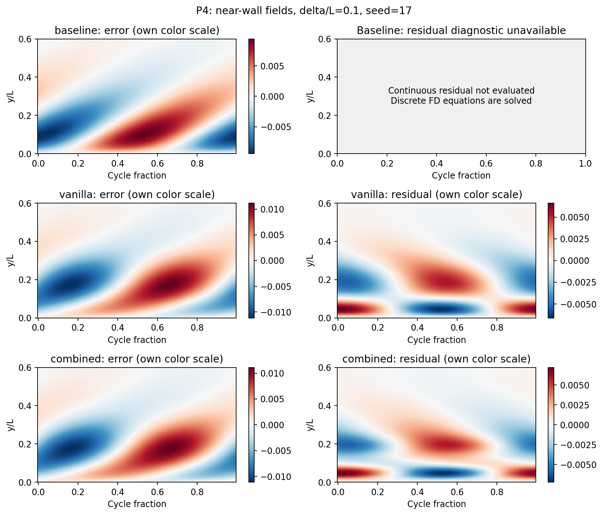

*Figure 8. P4: moderate-layer error and held-out PDE-residual maps. Scales are shared within each column.*

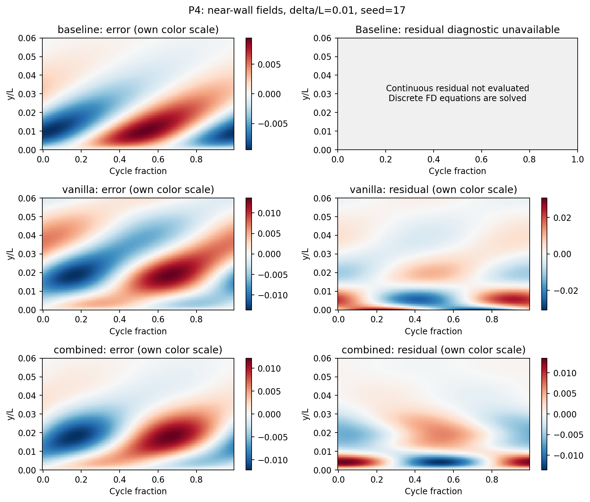

*Figure 9. P4: thin-layer error and residual maps, using the same within-column scaling rule.*

The error bands lie mainly within a few layer thicknesses and vary with forcing phase. At $\delta/L=0.1$, vanilla and combined are similar because the initial near-wall allocation spans the full domain for this seed. At $0.01$, combined reduces the largest near-wall residuals, although velocity-error patterns remain similar. Better physics enforcement does not automatically yield a comparable reduction in velocity error.


*Figure 10. P4: dimensionless wall-gradient history $g$ and the spatial velocity-error spectrum. This figure plots the gradient; physical stress and its hysteresis loop are shown separately below.*


*Figure 11. P4: inferred physical stress, normalized by $\rho\omega L U_0$, and its hysteresis loop at the thin setting. Each fitted curve uses that method's inferred viscosity.*

The spatial spectrum is the time-averaged squared type-II discrete cosine transform of velocity error over the full wall-normal domain. It is a Fourier cosine representation suited to this nonperiodic interval. High-mode error appears in both conventional and neural predictions; it can include viscosity-estimation and field-approximation error, so the spectrum alone does not prove spectral bias.

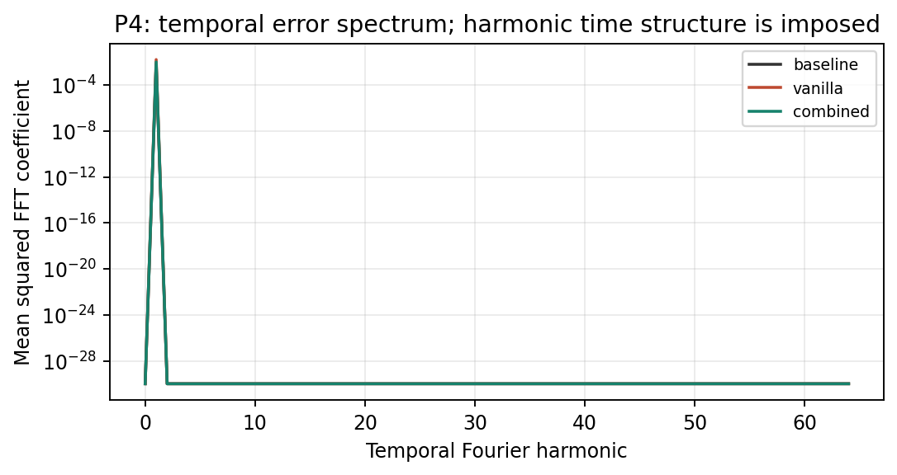

*Figure 12. P4: temporal error spectrum at the thin setting. The first harmonic dominates because single-frequency time dependence is imposed.*

This experiment cannot diagnose broadband temporal spectral bias or temporal causality violations. Supplemental moderate-case [gradient/spatial spectrum](final_results/figures/P4_shear_spectrum_d0.1.png) and [temporal spectrum](final_results/figures/P4_temporal_spectrum_d0.1.png) figures are also available; the former uses the original gradient-based shear label.

### 6.5 P5: total inverse cost, query cost and hardware

Across the full primary sweeps, median inverse fit/train times are 0.013 s for the conventional baseline, 1.15 s for the vanilla PINN, and 1.15 s for the combined PINN. Each plotted point represents the median timing across the three seeds at that boundary-layer thickness, so the curves emphasize the typical computational cost at each difficulty setting rather than the timing of an individual run. The vanilla PINN therefore requires 88.2 times longer than the baseline to obtain an inverse solution. In the left panel below, the x-axis is the inverse boundary-layer thickness, $L/\delta$, so moving to the right represents an increasingly thin boundary layer. Fit/train time remains nearly constant as the layer becomes thinner for all three methods. The dominant cost difference is therefore the choice of solution method rather than boundary-layer thickness: both PINN approaches consistently require roughly two orders of magnitude more computation than the conventional inverse fit. The logarithmic y-axis in the left panel makes the nearly two-order-of-magnitude difference between the baseline and PINN fitting times easier to compare; the vertical separation therefore represents a substantial computational-cost difference rather than a small absolute offset.

The right panel measures inference time after each method has already been fitted or trained. Each timing is the median of nine warmed evaluations of the same 1,201 by 128 velocity grid, corresponding to 153,728 predicted velocity values. Evaluation is fast for all three methods, but the conventional baseline remains faster at approximately 0.7–1.0 ms, compared with roughly 2–3 ms for the PINNs. As with fitting cost, there is no clear increase in inference time as the boundary layer becomes thinner. Because these measurements are only a few milliseconds, the small point-to-point fluctuations should not be interpreted as a meaningful trend. Derivatives are not requested during this query, although the current neural implementation still computes spatial derivative intermediates, so the PINN timings should not be interpreted as an optimized deployment benchmark.

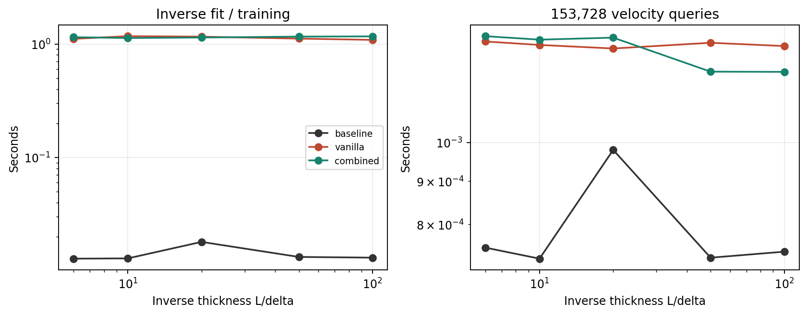

Lower values indicate lower computational cost in both panels. The left panel compares the cost of obtaining each inverse solution, while the right panel compares the cost of evaluating the resulting fitted models.

Hardware/software: **AMD64 Family 25 Model 33 Stepping 0, AuthenticAMD / Windows-11-10.0.26200-SP0**; one BLAS thread; Python **3.12.1**; NumPy **1.26.4**; SciPy **1.14.1**; Matplotlib **3.9.3**. No GPU is used. See environment.json for full provenance and linked BLAS information. Timing values should be rerun on the intended deployment hardware.

The surrogate break-even query number $N^*$ is not applicable to this experiment because these models perform inverse estimation rather than learning an operator that can be reused across a family of PDE inputs. A new measurement dataset requires a new conventional inverse fit or PINN training run. Although the fitted fields from either method can subsequently be evaluated cheaply, the right panel shows no inference-time advantage that could offset the PINNs' much larger fitting cost. For this minimal case, the appropriate comparison is therefore the total cost of obtaining the inverse solution together with its resulting accuracy, rather than a train-once, query-many break-even calculation.

## 7. Path B: controlled diagnosis

### 7.1 Observed limitation, without overstating it

Vanilla does not catastrophically collapse over the thickness sweep. The diagnosed failure concerns **the reliability of sampled physics loss as a check on near-wall derivatives**, particularly after coordinate scaling. In scaling-only, reducing $\delta/L$ from 0.1 to 0.01 makes the sampled PDE loss approximately 1,260 times smaller while increasing held-out near-wall PDE RMS by **45.6 times**. Gradient, stress and phase errors also worsen.

| $\delta/L$ | Sampled PDE MSE | Held-out layer PDE RMS | Gradient-amplitude error (%) | Stress-amplitude error (%) | Phase error (deg) |
|---|---:|---:|---:|---:|---:|
| 0.1 | 2.92e-6 | 0.00221 | 1.22 | 0.965 | 0.153 |
| 0.01 | 2.31e-9 | 0.1009 | 4.32 | 5.96 | 1.68 |


*Figure 14. Path B/P3: scaling-only sampled physics loss and held-out errors across its two tested thicknesses. Values are three-seed medians at $\sigma/U_0=0.02$ and $N_t=16$. Two settings show deterioration but do not identify a precise threshold or establish a monotonic trend between them.*

### 7.2 Candidate explanations and interventions

| Candidate explanation | Controlled test | What it establishes and what it does not |
|---|---|---|
| Neural architecture cannot represent the spatial solution | Fit the same raw-coordinate architecture directly to dense exact A,B targets | Low errors demonstrate practical representability under this budget; the oracle fit receives extra information and is not an inverse competitor |
| Unknown viscosity alone creates the field problem | Keep kappa fixed to truth, retaining sparse noisy data and raw-coordinate physics training | Separates parameter-estimation difficulty from field-learning difficulty; oracle control is not a valid viscosity estimator |
| Scaling alone resolves thin spatial features | Compare vanilla and scaling with matched uniform collocation | Scaling alone can worsen derivative/generalization behavior; rescaling is not automatically a remedy |
| Near-wall physics is insufficiently constrained by the chosen sampling | Compare scaling vs combined with identical weights, scale, data, optimizer, parameter count and evaluation budget | Adding near-wall samples reduces held-out residual/shear errors; this supports a sampling/physics-enforcement mechanism rather than insufficient probe information alone |
| Merely increasing model capacity or training longer explains improvement | Keep width=16, count=160 and max_nfev=600 fixed in the sampling comparison | Those quantities cannot explain this paired improvement; optimizer trajectories still change |

The sampling intervention changes both where residual constraints are evaluated and the effective spatial weighting of the empirical physics loss. It does **not** separately identify coverage and loss reweighting as exclusive causes. Consequently the supported diagnosis is inadequate **near-wall physics enforcement**, not a proof of pure spectral bias or of one unique root cause.

| Seed | Vanilla kappa error (%) | Combined kappa error (%) | Scaling-only gradient error (%) | Combined gradient error (%) | Scaling-only layer PDE RMS | Combined layer PDE RMS |
|---|---:|---:|---:|---:|---:|---:|
| 17 | 6.07 | 3.89 | 3.88 | 1.64 | 0.0378 | 0.0035 |
| 29 | 1.82 | 2.01 | 12.8 | 1.15 | 0.165 | 0.00834 |
| 41 | 1.88 | 1.05 | 4.32 | 0.206 | 0.101 | 0.00526 |

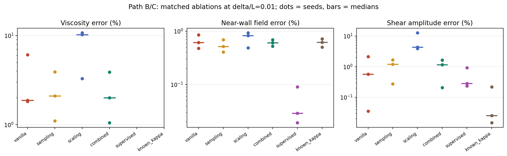

*Figure 15. Matched thin-layer ablations: dots are individual seeds, bars are medians; amplitude error refers to the wall gradient. Oracle controls are not viscosity estimators.*

Near-wall sampling improves the scaled network's held-out layer residual and gradient-amplitude error in every tested seed. Combined does not improve every vanilla metric for every seed. Noise, initialization and limited optimization remain possible contributors; three seeds do not support a broad superiority claim.

## 8. Path C: initial remedy, falsification check and residual-adaptive refinement

### 8.1 Initial matched-budget remedy

Define $\delta_0=\sqrt{2\kappa_0}$ from the initial estimate. Combined uses $y/\delta_0$ as its network coordinate and places half of 160 collocation points in $[0,\min(6\delta_0,1)]$, leaving the other half across the whole domain. The scale remains fixed during each fit. Neither true thickness nor an exact-error map determines this allocation.

The mechanism is direct: coordinate scaling supplies useful spatial scales, while near-wall residual points constrain the derivatives at those scales. The far field remains represented by the uniform half. No analytic exponential spatial basis or fitted reference solution is inserted. The remedy is inexpensive to implement and the all-seed before/after evidence appears in the paired table and diagnosis plot.

Relative to scaling-only, median held-out layer PDE RMS improves by 19.2 times and **wall-gradient amplitude error** by 3.75 times at the original budget. This local improvement requires the longer-training falsification check below.

### 8.2 Longer training: a useful counterexample

We retrain vanilla, scaling and combined variants from their same initial states with up to 6,000 evaluations, keeping the same 160 fixed points. Training longer does not remove the held-out residual problem; some runs terminate on a tight objective tolerance yet have worse residuals between collocation points. This separates the hypothesis of merely stopping too early from finite-point enforcement: a better sampled objective is not necessarily a better solution. The longer runs are all retained in budget_metrics.csv; no checkpoint is selected using exact errors.

### 8.3 Final refinement: use PDE residuals to add constraints

Starting from each original combined model, evaluate the current PDE residual on a fixed monitor consisting of 4,097 uniform wall-normal locations and 4,097 locations spanning [0,min(6 delta0,1)], with duplicates removed. True solution values and true kappa are not used in monitoring or point selection. At each of five fixed rounds, add 64 separated high-residual points while retaining all existing constraints, then train for at most 600 more evaluations. The final allocation is 480 points and at most 3,600 total evaluations including initial training. Every round is saved; intermediate reversals are shown, and the final fifth round is reported rather than the best truth-scored checkpoint.

| Method | Viscosity error (%) | Whole-field L2 (%) | Near-wall L2 (%) | Gradient-amplitude error (%) | Stress-amplitude error (%) | Phase error (deg) |
|---|---:|---:|---:|---:|---:|---:|
| vanilla | 1.88 | 0.144 | 0.611 | 0.571 | 1.85 | 0.833 |
| combined | 2.01 | 0.142 | 0.605 | 1.15 | 0.882 | 0.322 |
| vanilla, longer | 3.79 | 0.148 | 0.633 | 4.34 | 4.36 | 0.342 |
| scaling, longer | 10.8 | 0.192 | 0.822 | 4.67 | 6.67 | 1.75 |
| combined, longer | 9.01 | 0.194 | 0.828 | 1.15 | 1.57 | 0.234 |
| residual-adaptive, final round | 2.20 | 0.141 | 0.597 | 1.21 | 1.01 | 0.106 |

| Method | Max evaluations | Collocation points | Held-out layer PDE RMS | Fit/refinement time (s) | Inference time (ms) |
|---|---:|---:|---:|---:|---:|---:|
| vanilla | 600 | 160 | 0.00857 | 1.09 | 1.30 |
| combined | 600 | 160 | 0.00526 | 1.17 | 1.21 |
| vanilla, longer | 6000 | 160 | 0.0384 | 10.7 | 1.30 |
| scaling, longer | 6000 | 160 | 0.1088 | 3.07 | 1.18 |
| combined, longer | 6000 | 160 | 0.0918 | 7.62 | 1.24 |
| residual-adaptive, final round | 3600 | 480 | 0.00320 | 10.2 | 1.16 |

All entries are three-seed medians at $\delta/L=0.01$, $\sigma/U_0=0.02$ and $N_t=16$. Inference uses the same warmed 153,728-value velocity query as P5. Adaptive is the fifth predetermined round, not the checkpoint with lowest exact error. Stress errors are computed per seed using fitted viscosity.

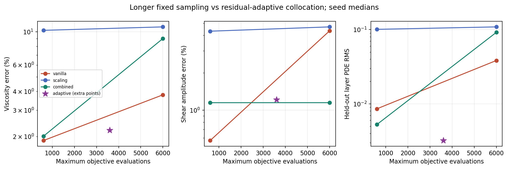

*Figure 16. Longer fixed-point training versus adaptive constraint enrichment. Gradient-amplitude error and held-out residual are distinct diagnostics. Adaptive uses additional points and monitoring work.*

Compared with the longer-trained vanilla control, the final adaptive model reduces median held-out layer PDE RMS by 12 times. All three seeds improve that residual relative to their longer-trained vanilla counterparts. The final refinement is not uniformly better than the original 600-evaluation combined model on every seed/metric, and residuals remain nonzero. The increased point count and monitoring also cost work; this is a targeted remedy, not an equal-compute superiority claim.

An independent residual-resolution audit uses 24,001 heights inside y in [0,0.06], without changing training. It confirms an adaptive improvement factor of **11.4 times** over the longer-trained vanilla model. This finer check guards against the coarser plotted grid missing narrow neural residual spikes; per-seed values are in dense_residual_audit.csv.

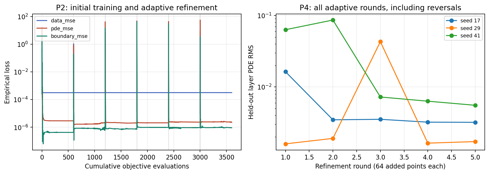

*Figure 17. P2: seed-17 loss histories across all refinement rounds. The second panel retains the held-out residual at every round for all seeds, including reversals.*

Losses across refinement boundaries use a changing point set and should not be read as a single unchanged quadrature objective. Adaptive timing includes the initial fit, residual monitoring, point selection and refinement optimization, but excludes subsequent scoring and plotting. In the following first-seed spatial profiles, residuals are evaluated at independent plotted locations, not just at training points.

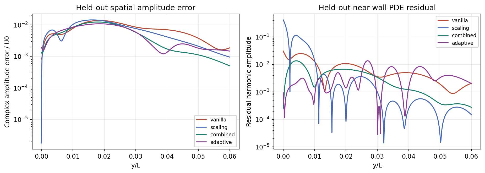

*Figure 18. P4: independent spatial amplitude-error and PDE-residual profiles at the thin setting, seed 17.*


*Figure 19. P4: spatial velocity-error cosine spectra for baseline, vanilla, combined and final adaptive fields, seed 17. Spectra describe error scales; they do not alone prove spectral bias.*

Before/after coverage is as follows: **P2** uses the initial and adaptive loss histories; **P3** uses the thickness-dependent failure in Section 7.1 and the near-wall/phase sweep in Section 6.2; **P4** uses the spatial profiles, spectra and dense residual audit; **P5** uses the fit/refinement and inference table above. Refinement itself was tested only at the thinnest setting. It addresses residual enforcement rather than establishing a generally superior inverse solver.

### 8.4 Practical conclusion

The supported mechanism is **finite-point near-wall physics underconstraint and residual overfitting**, with optimization and noise also contributing. A fixed allocation can improve the original training budget yet become insufficient under longer training. Residual-adaptive constraint enrichment addresses that mechanism. It does not establish that a PINN is preferable to the conventional inverse fit, nor a unique root cause across every architecture. Further tests should independently vary quadrature weighting, coverage, model width and fixed probe placement.

## 9. Recommendation memo (draft; send after team review)

## 9. Recommendation memo

**To:** Dr. Kiran Ramesh  
**From:** Luc Andreassi, Micah Kawamura, Nicholas Cheng, Sivan Garteiz and Andrew Coverston, MAE 598  
**Subject:** Retain the conventional inverse fit; monitor near-wall physics in neural trials

We tested the periodic oscillating boundary layer as a minimal demonstration of viscosity inference and reconstruction of near-wall velocity derivatives. A verified finite-difference inverse fit and a 67-parameter harmonic PINN used identical synthetic observations from three noisy probes.

For this one-parameter problem, we recommend the conventional inverse fit. The PINN generally recovered viscosity, but its median fitting cost was 88.2 times the baseline's, without a consistent accuracy advantage. Our gradient diagnostics measure $g=u_y(0,t)$; physical wall stress additionally requires multiplication by the inferred viscosity. This distinction matters when comparing stress-amplitude accuracy.

The neural controls exposed a useful limitation: small sampled physics losses can conceal inaccurate derivatives between collocation points. Near-wall sampling initially improved the scaled network, while longer training on fixed points exposed residual overfitting. Five rounds of residual-adaptive refinement reduced median held-out near-wall PDE RMS by approximately 12 times relative to longer-trained vanilla at $\delta/L=0.01$. We recommend held-out near-wall residual checks and targeted constraint enrichment before increasing training duration.

Confidence is strongest in our numerical verification and paired controls. Generalization remains limited by three seeds, one forcing harmonic, laminar periodic flow, and probes deliberately positioned inside each layer. This study does not establish performance on nonlinear airfoil flow or unknown unsteady closures.

The next experiment should hold physical probe positions fixed while varying frequency, then introduce two-harmonic forcing. Before extending the model, please identify which wall-stress amplitude and phase errors would affect a modeling decision, and which unknown closure quantity should be learned. Those requirements would connect the demonstrator to your unsteady boundary-layer workflow.

**Delivery status:** Prepared; not yet sent.

## 10. Assumptions, limitations and interpretation

1. Synthetic observations satisfy the half-space model apart from independent additive Gaussian noise. Real sensor biases, correlated noise and model discrepancy are not represented.
2. The finite top boundary is approximate; its mismatch is quantified above and matters most at delta=1/6.
3. Harmonic time structure is supplied to both methods. No claim is made about generic space-time PINNs, nonlinear flow, multiple frequencies, turbulence, transition, separation or airfoil geometry.
4. True thickness determines synthetic probe locations and the controlled initial-estimate factors. The inverse algorithms receive only fixed probe coordinates, observations and starting estimates, not the true kappa in their objectives. Oracle controls are explicitly labeled.
5. A one-at-a-time sweep does not characterize interactions such as very thin layers plus 10% noise plus only eight samples.
6. Noise and initialization vary together across three seeds. Full ranges are descriptive, not statistical confidence bounds.
7. Equal network size and evaluation budgets allow controlled comparisons; many finite-budget fits are not optimizer-converged.
8. Spatial spectra cannot by themselves identify spectral bias. Sampling interventions change coverage and effective residual weighting together. The adaptive remedy is demonstrated only at the thinnest case; it has not been swept over all knobs.
9. The optional unknown-outer-flow/two-harmonic extension is not implemented. The one-page recommendation prioritizes the next informative experiment over adding an unvalidated extension.
10. Interviews and sharing consent are documented in Section 1. Researcher validation of the brief and a production accuracy threshold remain outstanding. The recommendation therefore applies to this synthetic demonstration rather than establishing a deployment decision for the laboratory.

## 11. Verification and a hand-checkable example

All six tests in test_numerics.py pass: exact boundary/PDE consistency; full network parameter Jacobian by complex step; second spatial derivatives by complex step; second-order FD convergence; noiseless inverse recovery; and reproducible noise/probe coordinates. BDF/periodic-state checks and grid-refinement results are provided separately. Verify again after modifying the code.

At delta=0.1, kappa=0.005, y=delta/2=0.05 and t=0,

$$u=1-e^{-0.5}\cos(0.5)=0.4677192697843292.$$

The dimensionless wall-gradient amplitude is $\sqrt{2}/0.1=14.142135623730951$, with a $45^\circ$ phase lead. At $\delta/L=0.01$ the gradient amplitude is $141.4213562373095$. These independently check the reference scaling.

The independent audit recomputed the seed-17 thin-case vanilla whole-field relative $L^2$ error as **$0.0020437172646728405$**, exactly matching the stored metric. It reads saved field arrays without calling the neural evaluator or report generator. See [verification_audit.json](final_results/verification_audit.json).

## References

1. Supplied task card, *Oscillating boundary layer inverse problem with a PINN*, class-pinn-oscillating-bl.pdf, three pages. Source of the physical example, parameter/noise/sample grids and requested comparisons. Not redistributed in the archive.
2. [SciPy 1.14.1 least_squares documentation](https://docs.scipy.org/doc/scipy-1.14.1/reference/generated/scipy.optimize.least_squares.html). Trust-region reflective nonlinear least squares and analytic Jacobian interface.
3. [SciPy solve_ivp documentation](https://docs.scipy.org/doc/scipy/reference/generated/scipy.integrate.solve_ivp.html). BDF integration and sparse Jacobian support; executed version is pinned in the environment.
4. [SciPy 1.14.1 solve_banded documentation](https://docs.scipy.org/doc/scipy-1.14.1/reference/generated/scipy.linalg.solve_banded.html). Numerical tridiagonal harmonic solver.
5. [Krishnapriyan et al. (2021), *Characterizing possible failure modes in physics-informed neural networks*](https://arxiv.org/abs/2109.01050). Motivation for separating representability and physics-training issues; this study's numerical conclusions come from its own saved experiments.
