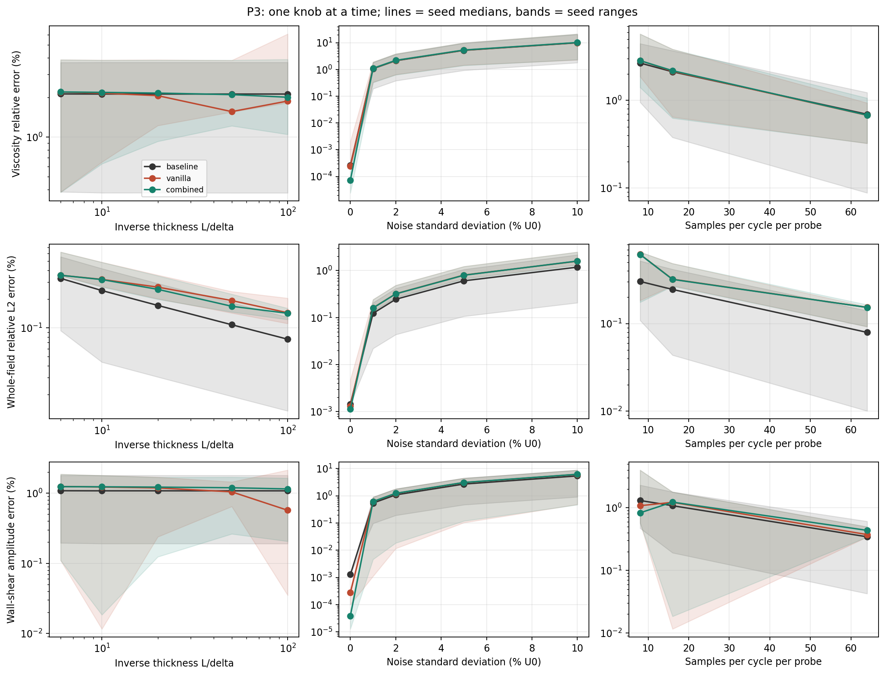
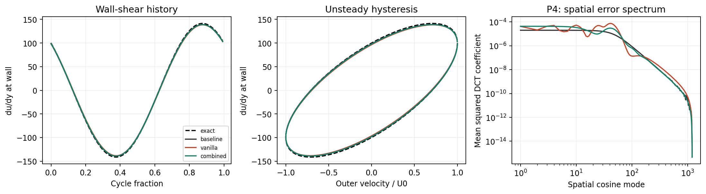

# Inverse oscillating boundary layer: a verified baseline and a diagnosed PINN limitation

**MAE 598 Project 3 | Technical experiment completed; researcher engagement and submission actions pending.**

Team members: Luc Andreassi, Micah Kawamura, Nicholas Cheng, Sivan Garteiz, Andrew Coverston. 
Researcher: Dr. Kiran Ramesh, PhD.

## Executive finding

For this one-parameter, single-frequency problem we recommend the conventional finite-difference inverse fit. The specialized PINN recovers viscosity and wall shear to accuracy comparable to the baseline, but its median training time is **88.2 times** the baseline's median inverse-fit time on the same machine (0.013 s versus 1.15 s). We do not claim that every PINN fails. We do show that a small neural training loss does not guarantee an accurate wall shear.

The thin-layer controls expose a concrete failure mode: **rescaling the network coordinate without sampling the near-wall physics adequately can give a very small training objective and an inaccurate wall derivative.** At delta/L = 0.01 and the original matched budget, adding near-wall collocation to the scaled network reduces the median held-out near-wall PDE residual (RMS) by **19.2 times** and the median wall-shear amplitude error by **3.75 times**. Training ten times longer then exposes residual overfitting between the fixed collocation points, including in the improved model. A residual-adaptive refinement, which adds collocation points where the current PDE residual is largest, reduces the median held-out near-wall PDE residual by **12 times** relative to the longer-trained vanilla PINN. Sections 7–8 present the controlled Path B diagnosis, the initial remedy, the counterexample and the final Path C refinement, with unfavorable results kept.

This is an exploratory three-seed study. No researcher has supplied an accuracy or cost target. All numerical findings below are measured; the interview, researcher review and communication status are reported as they are and are not inferred.

## 1. Outreach log and research problem brief


### 1.1 Outreach log

Researchers contacted, in chronological order (all dates 2026). 
Researchers found through previous student work, the Ira A Fulton Researcher website, and personal connections to the professors.

| Date | Researcher | Action | Outcome | Reason for Contact |
|---|---|---|---|---|
| 8 Oct | Prof. Yulia Peet | Email requesting a research interview | No response | On project recommendation list reaserch in CFD aligned with group interests|
| 12 Oct | Prof. Jay Oswald | Email requesting a research interview | Replied 22 Oct, after the team had committed to a project; not pursued |  On project recommendation list reaserch aligned with structural interest |
| 17 Oct | Dr. Kiran Ramesh, Associate Professor of Aerospace Engineering, SEMTE, Arizona State University | Email requesting a research interview | Accepted; interview scheduled for 18 Oct | Several team members knew of his research and it aligned with the project|
| 18 Oct | Dr. Ramesh | First interview (Zoom, 6 PM), prepared with the team's interview guide (`Interview_Question.md`) and a review of his publications (`ramesh-research-review.md`). Micah Kawamura could not attend | Research context and candidate problems discussed |
| 19 Oct | Dr. Ramesh| Second interview (Zoom) to choose the problem | Project secured: oscillating boundary-layer inverse problem with a PINN |

**Consent.** Dr. Ramesh consented during the Zoom meetings to being recorded and to being named and reported on in this project.

**Interview findings.** The points below come mainly from the 19 Oct interview; notes from the 18 Oct interview: [team to add].

- *Research objective.* Dr. Ramesh is developing an unsteady version of XFOIL. Like XFOIL, it uses viscous–inviscid interaction: the problem is split into a potential-flow solution and an integral boundary-layer solution.
- *Where the difficulty lies.* Integral boundary-layer methods collapse the wall-normal dimension, which leaves more unknowns than equations, so closure models must supply the missing information. Extending these methods to unsteady flow requires new unsteady integral boundary-layer formulations and new unsteady closure models. This is his current research focus.
- *Data and solvers.* He is using OpenFOAM to generate CFD data for building unsteady closure models. That work is at an early stage and outside this project's scope.
- *Role of this problem.* He described the oscillating boundary-layer inverse problem (estimating viscosity and wall shear stress from noisy sensor data with a PINN) as a demonstration: it has an exact solution, so it validates the method rather than serving as a production application.

**Research Before Interview in** (`ramesh-reaserch-review.md`) 


### 1.2 Problem brief

*Review status: researcher-supplied and reviewed. The problem, equations, difficulty knobs and objective below come from the task card Dr. Ramesh gave the team (*Task Card: Oscillating boundary layer inverse problem with a PINN*, Reference 1), supplemented by our 18–19 Oct interviews.*

**The scientific problem.** When the flow outside a boundary layer oscillates, the skin friction at the wall does not follow the outer flow in step: it peaks earlier. This happens on a pitching airfoil, in a gust, and on a rotor blade in forward flight. Dr. Ramesh's group is developing unsteady boundary-layer models for exactly these flows, as part of an unsteady version of XFOIL. Like XFOIL, it couples a potential-flow solution for the outer flow to an integral boundary-layer model of the thin viscous layer. That keeps it fast enough for design, where full CFD is not. The integral equations in (s, t) need closure models, most importantly for the wall shear. Steady closures exist; unsteady ones are the open research problem. As the task card states, predicting the unsteady wall shear, including its phase, is the basic requirement for these models.

**The physics that makes it hard.** The simplest case is Stokes' oscillating boundary layer: a flat wall under an outer stream U_e(t) = U_0 cos ωt, with no mean flow. The flow is laminar, depends only on the wall distance y and time t, and obeys

$$
\frac{\partial u}{\partial t}=\frac{dU_e}{dt}+\nu\frac{\partial^2 u}{\partial y^2},\qquad u(0,t)=0,\qquad u\to U_e(t)\ \text{far from the wall}.
$$

Its exact periodic solution has a layer thickness δ = √(2ν/ω), and its wall shear, τ_w = (√2 μU_0/δ) cos(ωt + π/4), **leads the outer velocity by 45°**, one-eighth of a cycle. The oscillating pressure gradient pushes equally at all heights, so it reverses the slow fluid near the wall before the faster fluid farther out. Plotted against the outer velocity over a cycle, the wall shear traces an ellipse rather than a line. A quasi-steady model, which takes wall shear proportional to the instantaneous outer velocity, misses this loop; an unsteady boundary-layer model must capture it. Integrating the equation across the layer gives d(U_e δ\*)/dt = τ_w/ρ, the x-independent form of the unsteady momentum integral equation used in integral boundary-layer methods. The wall shear recovered here is therefore exactly the quantity an unsteady closure must supply.

**The inverse problem.** Treat the viscosity ν as unknown. From three noisy velocity probes inside the layer (at 0.5δ, δ and 2δ, sampled N_t times per cycle), infer ν and, from it, the wall-shear history and its phase lead. Compare a physics-informed neural network (PINN) against a conventional solver-based fit. The problem is a good PINN test because it is a true inverse problem (an unknown coefficient from sparse, noisy data) and because it has a natural difficulty knob: raising the frequency thins the layer (δ/L from 1/6 down to 1/100), and thin layers are a known weak spot of PINNs. Noise (0–10% of U_0) and samples per cycle (64, 16 or 8) are the secondary knobs. Because the exact solution is known, every error can be measured against the truth.

**Current approach and cost.** The conventional alternative is a finite-difference solver inside a scalar optimizer, which the task card prescribes as the baseline. For Dr. Ramesh's research version, the closure data will come from OpenFOAM CFD, an effort at an early stage. High-fidelity runs are far more expensive than integral boundary-layer solves, and closures must be calibrated across many conditions, so the training data will be expensive and sparse. The per-run cost and hardware were not established in our interviews [team to add if known].

**How this supports Dr. Ramesh's research.** The study answers three questions his unsteady closure work will face:

1. *Can a PINN reliably extract wall shear and its phase from sparse, noisy data?* This is the core quantity of an unsteady closure, and we measure the achievable amplitude and phase accuracy against an exact answer.
2. *Can the training loss be trusted in thin layers?* We test whether a small physics loss guarantees an accurate wall derivative. If it does not, we identify a check (held-out near-wall residuals) and remedies (near-wall collocation, coordinate scaling by the current δ estimate, residual-adaptive points) that carry over to closure training.
3. *Where is a neural method worth its cost?* We compare the PINN's training cost and accuracy with a verified conventional fit, to show whether neural methods should replace conventional solvers for known physics or be reserved for unknown closure terms.

## 2. Complete mathematical formulation

### 2.1 Dimensional problem

Let y be the distance from a stationary wall, and let the imposed outer velocity be Ue(t) = U0 cos(omega t). For incompressible, unidirectional laminar flow, u = u(y,t) and the streamwise convective terms vanish identically, leaving

$$
u_t=\frac{dU_e}{dt}+\nu u_{yy},\qquad u(0,t)=0,\qquad u(y,t)\to U_e(t)\text{ as }y\to\infty.
$$

The streamwise pressure gradient is represented by its outer-flow value, -(1/rho) dp/dx = dUe/dt. The kinematic viscosity nu is constant but unknown to both inverse methods.


### 2.2 Nondimensional variables, domain and unknown

Define yhat = y/L, that = omega t, uhat = u/U0 and kappa = nu/(omega L^2), and drop the hats below. The computational domain is y in [0,1] and t in [0, 2 pi), one complete periodic cycle:

$$
u_t=-\sin t+\kappa u_{yy},\qquad u(0,t)=0,\quad u(1,t)=\cos t,\quad u(y,t+2\pi)=u(y,t).
$$

The inverse unknown is the scalar kappa > 0. Dimensional viscosity follows as nu = kappa omega L^2 when the dimensional frequency and length are known. We study the periodic state after startup transients have decayed, so the PINN has no separate initial condition. Both inverse methods restrict kappa to the same broad interval [1e-8, 0.2], which contains every tested truth.

### 2.3 Exact reference, wall shear and finite-domain consistency

The half-space (Stokes second problem) reference supplied in the task card is

$$
u_\infty(y,t)=\cos t-e^{-y/\delta}\cos(t-y/\delta),\qquad \delta=\sqrt{2\kappa},
$$

where delta denotes delta/L. Its dimensionless wall shear, a velocity gradient rather than a dimensional stress, is

$$
g(t)=u_y(0,t)=\frac{\sqrt{2}}{\delta}\cos(t+\pi/4).
$$

The target shear amplitude is therefore sqrt(2)/delta, with a 45-degree phase lead over the outer velocity. The dimensional wall stress is mu U0/L times this gradient; if viscosity is inferred, the inferred nu must be converted consistently through mu = rho nu.

The half-space field does not equal cos t exactly at y = 1. The discrepancy is bounded by exp(-1/delta): 2.48e-3 U0 at delta = 1/6, 4.54e-5 U0 at delta = 0.1, 2.1e-9 U0 at delta = 0.05 and negligible for the thinner cases. We keep the task-card half-space reference for generating data and for scoring, and both inverse methods enforce the approximate far-field condition u(1,t) = cos t. Separately, we verify the discretization against the **boundary-consistent finite-domain analytic amplitude**

$$
a_F(y)=1-\frac{\sinh[q(1-y)]}{\sinh q},\qquad q=(1+i)/\delta,\qquad u_F=\Re[a_F e^{it}].
$$

The code evaluates this in an equivalent exponential form to avoid overflow for small delta. The finite-domain expression is used only to verify the solver, never to fit measurements. The truncation is an explicitly bounded model discrepancy, not a coding error or a PINN pathology.
### 2.4 Difficulty knobs and experimental design

Primary knob: delta in {1/6, 1/10, 1/20, 1/50, 1/100}, so smaller delta means a thinner layer. Equivalently, L/delta in {6, 10, 20, 50, 100} increases with difficulty. At fixed dimensional nu and L, a higher forcing frequency omega produces the thinner layers. The corresponding true values are kappa = delta^2/2.

Secondary knobs: noise sigma in {0, 0.01, 0.02, 0.05, 0.10} U0, and Nt in {64, 16, 8} samples per probe per cycle. Each knob is varied one at a time about the reference setting delta = 0.1, sigma = 0.02, Nt = 16. After removing duplicate reference settings this gives 11 settings, and seeds 17, 29 and 41 give 33 measurement datasets.

The 117 primary method/case runs are: baseline, vanilla PINN and combined PINN on all 33 datasets (99 runs); sampling-only and scaling-only controls at delta = 0.1 and 0.01 (12 runs); and the two oracle controls, supervised and known_kappa, at delta = 0.01 (6 runs). Two supplementary studies reuse the delta = 0.01 data: nine longer-budget controls (vanilla, scaling and combined × three seeds) and 15 adaptive refinement fits (five rounds × three seeds). This is not a full factorial sweep and does not characterize interactions between knobs.

The three probes sit at y = {0.5 delta, delta, 2 delta}. Following the task card, their positions move with the true layer from one synthetic experiment to the next. Within an inverse fit the probe positions are fixed and do not move with the candidate kappa. This keeps measurements inside the layer by design; it does not test the harder case of fixed instruments that end up outside a thinning layer.

## 3. Reproducibility and implementation map

### 3.1 Run instructions

Requires Python 3.12 and the pinned packages in requirements.txt (NumPy 1.26.4, SciPy 1.14.1, Matplotlib 3.9.3, threadpoolctl 3.5.0). No PyTorch, GPU, XFOIL or experimental data are needed.

```bash
python -m venv .venv
# Activate .venv for your operating system, then:
python -m pip install -r requirements.txt
python -m unittest -v test_numerics.py
python oscillating_bl.py --suite full --seeds 17 29 41 --width 16 --collocation 160 --max-nfev 600 --threads 1 --output final_results
python budget_controls.py --results final_results
python adaptive_fix.py --results final_results --rounds 5
python audit_submission.py --results final_results
```

`make_report.py --results final_results` generated the first draft of this report from the saved results. **Do not rerun it on the final report:** it overwrites REPORT.md, including the hand-written discussion and the team-supplied engagement sections.

For a two-setting smoke test, use `--suite pilot --seeds 17 --output pilot_results`. To resume an interrupted full run, repeat the identical command with `--resume`; resuming is refused if the code hash or experiment settings have changed. A resumed run keeps the original per-model training times, and environment.json records the resumed invocation's wall time.

All figures and tables come from the completed full run, not the smoke test (the main study took 128 s of wall time on the recorded machine). With the pinned versions, floating-point results should be nearly identical on other machines. Wall times and exact optimizer trajectories can differ across hardware and BLAS builds.


### 3.2 Main functions and data flow

| Stage | Function(s) | Inputs -> outputs |
|---|---|---|
| Reference and noise | exact_amplitude, exact_velocity, make_measurements | Truth, probe positions, seed -> clean and noisy samples |
| Numerical forward solver | grid_operator, fd_periodic | Candidate kappa -> numerical periodic velocity amplitude |
| Time-integration check | mol_check | Numerical periodic state -> BDF-integrated cycle |
| Conventional inverse fit | fit_baseline | Fixed noisy probes -> fitted kappa |
| Neural representation | Jet2, neural_fields | Weights and y -> A, B and their spatial derivatives |
| Physics training | residual_jacobian, train_pinn | Data and collocation points -> network weights and kappa |
| Scoring | evaluate, field_metrics | Trained model plus withheld exact reference -> errors and timings |
| Diagnostics | p1_verification, plot_summary, plot_case, plot_diagnosis | Saved results -> P1–P5 and Path B figures |
| Longer-budget control | budget_controls.py | Thin-case data -> 6,000-evaluation vanilla/scaling/combined fits |
| Residual-adaptive refinement | adaptive_fix.py (refine) | Combined models and PDE residual monitor -> five refinement rounds |
| Independent audit | audit_submission.py | Saved fields and models -> recomputed error, dense residual audit, supplementary figures |
| Report draft | make_report.py | Saved CSV/JSON results -> first draft of this report |

### 3.3 Files and audit trail

- oscillating_bl.py: complete numerical study and figure generation.
- test_numerics.py: six scientific verification tests.
- requirements.txt: exact package versions.
- budget_controls.py: nine tenfold-budget controls, kept separate from the primary runs.
- adaptive_fix.py: five fixed residual-adaptive refinement rounds for each thin-case seed.
- audit_submission.py: independent field-error audit, dense residual audit and supplementary figures.
- make_report.py: generated the first draft of this report from measured results.
- final_results/data/: all 33 clean/noisy measurement datasets, with their standard Gaussian draws and probe coordinates.
- final_results/models/: every fitted model with its per-run metrics and optimizer status.
- final_results/histories/: per-evaluation objective components, elapsed time and kappa for every neural run.
- final_results/metrics.csv: all 117 primary method/case records, including every seed and negative outcomes.
- final_results/budget_metrics.csv and adaptive_metrics.csv: the longer-budget controls and every refinement round.
- final_results/baseline_grid_convergence.csv and mol_verification.json: independent baseline verification.
- final_results/dense_residual_audit.csv and verification_audit.json: audit outputs (Sections 8.3 and 11).
- final_results/fields/: seven representative full fields used in the plots.
- final_results/figures/: the diagnostic PNGs linked below.
- final_results/environment.json (plus budget_ and adaptive_environment.json): command, versions, hardware, thread settings and source hashes.

To keep the archive compact, full field arrays are included only for the six plotted baseline/vanilla/combined runs (seed 17, delta = 0.1 and 0.01) and the seed-17 final adaptive field. Every model, measurement dataset, loss history and summary metric is included, and the commands above regenerate all other field arrays. The assignment and task-card PDFs are not redistributed.

Source SHA-256 at experiment execution: `567777beb993db101a9ade366ad1180b6f76d36a02b9561fd4324d60a24d7f20`.

## 4. P1: conventional forward and inverse baseline

### 4.1 Spatial discretization

The baseline uses a fixed stretched grid y_j = sinh(6 j/N)/sinh(6), with N = 400 intervals for inverse fitting. The grid is chosen without knowledge of the true kappa. With h_m = y_j - y_{j-1} and h_p = y_{j+1} - y_j, the second derivative is approximated by

$$
(D_2u)_j=\frac{2u_{j-1}}{h_m(h_m+h_p)}-\frac{2u_j}{h_m h_p}+\frac{2u_{j+1}}{h_p(h_m+h_p)}.
$$

Boundary values enter through the right-hand side. The smooth stretching clusters points at the wall while still covering the whole domain: the first spacing is 7.4e-5, and 96 of the 400 intervals lie inside y <= 0.01, the thinnest tested layer thickness.

### 4.2 Periodic solver and time-integration check

Because the PDE and boundary conditions are linear with a single known forcing frequency, substituting u = Re[a(y) e^{it}] into the discretized PDE gives

$$
(\kappa D_2-iI)a=-i\mathbf1,
$$

with a(0) = 0 and a(1) = 1. One complex tridiagonal (banded) solve produces the numerical periodic state; the exact spatial formula is never inserted. This is an efficient conventional solver for exactly the PDE under comparison, not a weakened baseline.

**Departure from the task card's time-marching recipe:** instead of marching from u = 1 for every trial viscosity, the inverse baseline solves the periodic finite-difference system directly. As a separate check, a BDF `solve_ivp` integration of the same method-of-lines system runs over one full cycle, starting from the numerical periodic state (N = 200, all five kappa truths). Its largest relative L2 difference from the periodic solution over the cycle is **1.37e-7**. This shows the time-domain and harmonic solvers agree; it is not a startup-from-uniform-flow validation. The 10–20 startup cycles suggested in the task card do not guarantee convergence, because the slowest error mode decays roughly as exp(-kappa pi^2 t). A 1e-6 decay takes about 17 cycles at delta = 1/6 but about 4,456 cycles at delta = 0.01. Solving for the periodic state directly avoids charging the baseline for an unnecessarily expensive transient.

Grid refinement with N = {100, 200, 400, 800} is checked against the finite-domain exact amplitude. At N = 400 the largest relative L2 amplitude error over the five thicknesses is **1.3e-5** (at delta = 1/6), and each grid doubling reduces the error by a factor of about 4, consistent with second-order convergence. A unit test checks this convergence independently.

**Departure from the task-card time-marching recipe:** the main inverse baseline solves the periodic finite-difference system directly instead of marching from u=1 for each trial viscosity. A separate BDF solve_ivp check integrates that same method-of-lines system for a complete cycle, initialized from the numerical periodic state. The maximum measured relative difference from that state is **1.37e-07**. This confirms the time and harmonic solvers agree; it is not a startup-from-uniform-flow validation. The task card's suggested 10--20 startup cycles are not a convergence guarantee: the slowest error mode decays approximately as exp(-kappa pi^2 t). At delta=0.01, a factor 1e-6 decay can require about 4,456 cycles. Solving the periodic state avoids charging an unnecessarily expensive transient to the baseline.

Grid refinement N={100,200,400,800} is checked against the finite-domain exact amplitude. At N=400 the maximum tested relative L2 amplitude error is **1.3e-05**. The independent unit test confirms approximately second-order convergence.


### 4.3 Conventional inverse fit

For each candidate kappa, the baseline solves the finite-difference system, interpolates the complex amplitude to the fixed probe heights, and computes the mean squared velocity mismatch against the same noisy measurements the PINN uses. It optimizes log(kappa) over the shared bounds. A 61-point coarse scan in log(kappa) comes first; then bounded scalar minimization refines each of the three best scan points within its neighboring scan interval, and the best of the three is kept. The global scan matters because trial layers much thinner than all three probes produce an almost flat misfit, and a single bounded search over the full range can stall there.

The reported inverse time includes the scan, every numerical forward solve, the interpolation and the scalar optimization. Exact reference values never enter the objective. A unit test with noiseless data recovers kappa to within 0.1% on an N = 800 grid; rerunning that noiseless case on the default N = 400 grid gives a relative error of about 3e-6.

## 5. Synthetic measurements and the PINN

### 5.1 Measurement generation

At each of the three probe heights, one cycle is sampled at t = 2 pi j/Nt, j = 0, ..., Nt-1; the duplicate endpoint at 2 pi is omitted. The observations are

$$
u^{obs}_{ij}=u_\infty(y_i,t_j;\kappa_{true})+\sigma\epsilon_{ij},\qquad\epsilon_{ij}\sim\mathcal N(0,1).
$$

Sigma is a fraction of U0, not of the instantaneous velocity, so zero crossings do not create a relative-noise singularity. Noise is added only to the observations; the reference, PDE and boundary conditions stay clean. The clean samples and the standard Gaussian draws are saved, and every method in a pairing uses the identical dataset.

The standard Gaussian draws depend only on the seed, so a given seed reuses the same draws at every thickness and noise level. Because the probes also scale with delta, the baseline faces an almost self-similar problem across the thickness sweep, which is why its kappa error barely changes (Section 6.2). The seed also sets the neural initialization and the collocation points. The three replications therefore combine measurement and initialization variability rather than estimating either one independently.

### 5.2 Trainable neural representation and its scope

The network is a fully trainable multilayer perceptron with one hidden layer of 16 tanh units and two outputs:

$$
z_j(y)=\tanh(w_j y/s+b_j),\quad A(y)=\sum_jv^A_jz_j+c_A,\quad B(y)=\sum_jv^B_jz_j+c_B,
$$

$$u_\theta(y,t)=A(y)\cos t+B(y)\sin t.$$

Here s is the coordinate scale: s = 1 for the raw-coordinate variants, and s = delta0 (Section 8.1) for the scaled variants. All hidden weights and biases and all output weights and biases are optimized together with log(kappa), 67 trainable parameters in total (4 × 16 + 2 + 1). Time periodicity is exact by construction. Neither A(y) nor B(y) is given the Stokes exponential form; their spatial shapes must be learned from the sparse probes and the physics.

**Departure from a generic MLP with inputs (y, cos t, sin t):** the harmonic output form builds in the known single-frequency linear response, restricting the time dependence. This makes it a specialized PINN that has more physical information than a generic space-time network. Both neural variants and the numerical baseline use the same known forcing frequency. Our conclusions therefore say nothing about how a generic space-time PINN (for example in PyTorch) would train, or how nonlinear or multi-frequency airfoil flows would behave.

First and second spatial derivatives are propagated with a minimal forward-mode automatic differentiator (Jet2) built from affine and tanh rules. The Jacobians with respect to the optimizer parameters are analytic. Unit tests verify, by complex-step differentiation, every column of the residual Jacobian and the second spatial derivatives, in both raw and scaled coordinates. The PINN never takes finite differences of noisy observations.

### 5.3 Loss, optimizer and initialization

For the harmonic trial function, the PDE residual is

$$
r(y,t)=[B-\kappa A'']\cos t+[1-A-\kappa B'']\sin t.
$$

The PDE loss integrates its square **exactly in time**, which gives

$$
L_{PDE}=\frac1{2N_c}\sum_{j=1}^{N_c}\left[(B_j-\kappa A_j'')^2+(1-A_j-\kappa B_j'')^2\right].
$$

The data loss is the ordinary mean squared velocity error at the probes. The boundary loss is the mean of A(0)^2, B(0)^2, [A(1)-1]^2 and B(1)^2. The training objective is L = L_data + L_PDE + L_BC with equal weights and no initial-condition term. The boundary conditions are therefore soft penalties, not built exactly into the network.

Training uses SciPy's trust-region reflective nonlinear least-squares method with the full analytic Jacobian, float64 arithmetic, ftol = xtol = gtol = 1e-9 and at most 600 function evaluations. This choice suits a small residual-based inverse problem; it is not an Adam experiment. Wall time is reported as well, because equal evaluation counts do not imply equal compute cost.

Initialization deliberately starts away from the truth: seeds 17 and 41 start with kappa at 5 times the true value and seed 29 at 0.2 times, following the task card's synthetic initialization check. This is a controlled benchmark, not a procedure for choosing a starting viscosity from unknown real data; a deployment claim would need an extra experiment with a data-selected starting value. Within each seed, every PINN variant starts from the same initial weights and kappa estimate. The two oracle controls are the exception: they are given the true kappa.

**Stopping status:** all 84 primary neural runs (vanilla and combined on 33 datasets, plus 6 sampling, 6 scaling and 6 oracle runs) stopped at the 600-evaluation limit rather than at a convergence tolerance. Their errors are valid finite-budget results, and we make no claim of fully converged or globally optimal fits. Each run's status, final objective and optimality measure are saved.

## 6. P2--P5 diagnostics and measured results

### 6.1 P2: separate loss histories

Every neural run records its data, PDE and boundary losses separately at every objective evaluation. These histories include trust-region trial steps that were rejected, so the curves need not decrease monotonically. For the supervised oracle control, the optimized history is its supervised field loss, not a physics-training history; its final physics residual is scored separately.


### 6.2 P3: errors against each knob

Relative field L2 error is the square root of the time-averaged squared error integrated over y, divided by the same integral of the reference, evaluated on an independent uniform grid of 1,201 heights × 128 times. The near-wall region y <= min(6 delta, 1) is also scored separately, because a whole-domain norm can hide errors in a very thin layer (at delta = 1/6 this region is the entire domain, so the two norms coincide). Parameter error is |kappa_hat/kappa_true - 1|. Shear amplitude and phase come from the learned wall derivative; they are never training targets. The figure shows three-seed medians and the full range over seeds; the ranges are not confidence intervals.



The columns of P3 correspond to the three knobs. The first column is the main physical difficulty knob, L/delta: a larger ratio means a thinner boundary layer with sharper near-wall gradients. The other two columns are measurement knobs, the noise standard deviation and the number of samples per cycle per probe, each varied one at a time about the reference setting. The rows show viscosity error, whole-field L2 error and wall-shear amplitude error for the conventional baseline (black), the vanilla PINN (red) and the combined PINN (green), which rescales the network coordinate and concentrates half its collocation points near the wall.

**Measurement knobs.** The viscosity error of all three methods grows almost linearly with noise, from essentially zero at sigma = 0 to about 10% at sigma = 0.10, and falls with more samples (baseline: 2.67% at Nt = 8, 2.12% at Nt = 16, 0.69% at Nt = 64). The three methods track each other closely along both knobs. This error is set mainly by the information in the noisy probes, and better physics enforcement in the network does not remove it.

**Thickness knob.** Errors do not grow steadily as the layer thins. The baseline's viscosity and shear-amplitude errors stay at 2.12% and 1.08% at every thickness, because the probes and the standardized noise draws scale with delta (Section 5.1). The whole-field L2 error of every method falls as the layer thins, partly because the near-wall region becomes a smaller fraction of the domain; the near-wall norm in the table below is the fairer comparison. Two thin-layer trends do appear. The PINNs' near-wall L2 error rises from 0.36% at delta = 1/6 to about 0.61% at delta = 0.01, while the baseline's stays near 0.32%. The PINNs' wall-shear phase error also rises, from about 0.1 degrees to 0.3–0.8 degrees, while the baseline's stays below 0.003 degrees.

**Method comparison.** The PINNs estimate viscosity and shear amplitude about as well as the baseline, sometimes slightly better for a given seed, but the baseline has lower whole-field and near-wall velocity errors at every thickness. The combined PINN has no consistent advantage over the vanilla PINN along this sweep. At delta >= 0.1 its near-wall sampling is mostly inactive: when the initial layer estimate gives 6 delta0 >= 1 (seeds 17 and 41 at delta = 0.1), the "near-wall" region is the whole domain. Its benefit appears in the controlled thin-layer comparison of Section 7, not in this sweep.

| delta/L | kappa true | Baseline kappa error (%) | Vanilla kappa error (%) | Combined kappa error (%) | Baseline near-wall L2 (%) | Vanilla near-wall L2 (%) | Combined near-wall L2 (%) |
|---|---:|---:|---:|---:|---:|---:|---:|
| 0.167 | 0.0139 | 2.13 | 2.20 | 2.20 | 0.330 | 0.355 | 0.355 |
| 0.1 | 0.005 | 2.12 | 2.16 | 2.19 | 0.323 | 0.422 | 0.421 |
| 0.05 | 0.00125 | 2.12 | 2.06 | 2.16 | 0.323 | 0.502 | 0.476 |
| 0.02 | 0.0002 | 2.12 | 1.56 | 2.10 | 0.324 | 0.578 | 0.505 |
| 0.01 | 5e-05 | 2.12 | 1.88 | 2.01 | 0.325 | 0.611 | 0.605 |

Values are three-seed medians at sigma = 0.02 and Nt = 16.

### 6.3 Thin-case numerical comparison

At delta=0.01, sigma=0.02 and Nt=16, the following values are medians over seeds 17,29,41. Controls marked supervised and known_kappa receive additional oracle information and **do not estimate viscosity**.

| Method | Viscosity error (%) | Whole-field L2 (%) | Near-wall L2 (%) | Shear amplitude error (%) | Shear phase error (deg) | Fit/train (s) |
|---|---:|---:|---:|---:|---:|---:|
| baseline | 2.12 | 0.0759 | 0.325 | 1.08 | 0.00237 | 0.0131 |
| vanilla | 1.88 | 0.144 | 0.611 | 0.571 | 0.833 | 1.09 |
| sampling | 2.1 | 0.121 | 0.517 | 1.18 | 0.332 | 1.14 |
| scaling | 10.2 | 0.192 | 0.82 | 4.32 | 1.68 | 1.07 |
| combined | 2.01 | 0.142 | 0.605 | 1.15 | 0.322 | 1.17 |
| supervised | -- | 0.0163 | 0.0288 | 0.282 | 0.894 | 1.31 |
| known_kappa | -- | 0.145 | 0.619 | 0.0252 | 0.343 | 1.02 |

### 6.4 P4: where the errors occur and their spectra

P4 examines where the prediction errors occur and which spatial and temporal scales they contain. The following figures compare the conventional baseline, vanilla PINN, and combined PINN for moderate and thin boundary layers, with $(\delta/L=0.1)$ and $(0.01)$. Both cases use 2% observation noise and 16 samples per probe per cycle. Seed 17 was selected before inspecting the results.
The left columns show the signed velocity error, $(e(y,t)=u_{\mathrm{pred}}(y,t)-u_{\mathrm{ref}}(y,t))$. The right columns show the PINN’s PDE residual, evaluated at held-out locations. Velocity error measures agreement with the reference; the residual measures satisfaction of the governing equation at the fitted viscosity. These quantities answer different questions.
The maps display the near-wall region $(y/L\leq\min(6\delta/L,1))$. Each panel has its own color scale, so comparisons of magnitude must use the colorbar values. The baseline’s continuous residual is left unavailable because differentiating its interpolated finite-difference field would introduce a separate approximation. Baseline continuous residuals are not inferred by differentiating interpolated FD values; that panel states it is unavailable. The FD system itself is solved to numerical precision.


The largest visible velocity-error bands occur within a few boundary-layer thicknesses of the wall. Their alternating signs over the cycle show that the prediction mismatch depends on both wall distance and forcing phase. The near-wall view is particularly important for the thin case: a whole-domain error norm can conceal local inaccuracies when the boundary layer occupies only a small fraction of the domain.
At $(\delta/L=0.1)$, the vanilla and combined PINNs have nearly identical error and residual patterns. For the displayed seed, the initial thickness estimate makes the combined method’s sampling region span the entire domain, so this case does not demonstrate the benefit of concentrating constraints in a narrow near-wall region.
At $(\delta/L=0.01)$, the combined PINN reduces the magnitude of the largest visible near-wall PDE residuals relative to vanilla, while their velocity-error patterns remain similar. Improved physics enforcement therefore does not translate directly into an equally large reduction in velocity error. 



The wall-shear and hysteresis plots connect the field reconstruction to the quantity needed for an unsteady boundary-layer closure. All three methods reproduce the overall oscillation and hysteresis loop, but their nearly overlapping curves can conceal amplitude and phase differences. The errors reported in Section 6.3 provide the quantitative comparison. Because wall shear depends on the wall-normal derivative, accurate velocity values alone do not guarantee an equally accurate shear prediction.
The spatial spectrum shows the time-averaged squared coefficients of a type-II discrete cosine transform of the velocity error over the full wall-normal domain. This Fourier cosine representation accommodates the nonperiodic spatial interval without the artificial endpoint jump introduced by a periodic extension.
The PINN spectra contain structure across low and intermediate spatial modes, followed by a decaying high-mode tail. The baseline also contains high-mode error. Consequently, the presence of high spatial frequencies alone does not establish neural spectral bias: the plotted error includes the effects of an imperfect viscosity estimate as well as field-approximation errors. The controlled experiments in Section 7 are needed to distinguish candidate explanations.

The spatial error spectrum is a type-II discrete cosine transform, averaged over time. It is a Fourier cosine spectrum appropriate to a nonperiodic wall-normal interval; a periodic spatial FFT would introduce artificial endpoint jumps. The temporal FFT is also saved and plotted:


The first temporal harmonic dominates by construction. This experiment cannot diagnose temporal causality violations or broadband temporal spectral bias. Spatial high-mode error is descriptive evidence, not proof that spectral bias alone caused a failure. A changing wall derivative can matter even when the integrated velocity error is small.

### 6.5 P5: total inverse cost, query cost and hardware

Across the full primary sweeps, median inverse fit/train times are 0.013 s for the conventional baseline, 1.15 s for the vanilla PINN, and 1.15 s for the combined PINN. Each plotted point represents the median timing across the three seeds at that boundary-layer thickness, so the curves emphasize the typical computational cost at each difficulty setting rather than the timing of an individual run. The vanilla PINN therefore requires 88.2 times longer than the baseline to obtain an inverse solution. In the left panel below, the x-axis is the inverse boundary-layer thickness, $L/\delta$, so moving to the right represents an increasingly thin boundary layer. Fit/train time remains nearly constant as the layer becomes thinner for all three methods. The dominant cost difference is therefore the choice of solution method rather than boundary-layer thickness: both PINN approaches consistently require roughly two orders of magnitude more computation than the conventional inverse fit. The logarithmic y-axis in the left panel makes the nearly two-order-of-magnitude difference between the baseline and PINN fitting times easier to compare; the vertical separation therefore represents a substantial computational-cost difference rather than a small absolute offset.

The right panel measures inference time after each method has already been fitted or trained. Each timing is the median of nine warmed evaluations of the same 1,201 by 128 velocity grid, corresponding to 153,728 predicted velocity values. Evaluation is fast for all three methods, but the conventional baseline remains faster at approximately 0.7–1.0 ms, compared with roughly 2–3 ms for the PINNs. As with fitting cost, there is no clear increase in inference time as the boundary layer becomes thinner. Because these measurements are only a few milliseconds, the small point-to-point fluctuations should not be interpreted as a meaningful trend. Derivatives are not requested during this query, although the current neural implementation still computes spatial derivative intermediates, so the PINN timings should not be interpreted as an optimized deployment benchmark.


Lower values indicate lower computational cost in both panels. The left panel compares the cost of obtaining each inverse solution, while the right panel compares the cost of evaluating the resulting fitted models.

Hardware/software: **AMD64 Family 25 Model 33 Stepping 0, AuthenticAMD / Windows-11-10.0.26200-SP0**; one BLAS thread; Python **3.12.1**; NumPy **1.26.4**; SciPy **1.14.1**; Matplotlib **3.9.3**. No GPU is used. See environment.json for full provenance and linked BLAS information. Timing values should be rerun on the intended deployment hardware.

The surrogate break-even query number $N^*$ is not applicable to this experiment because these models perform inverse estimation rather than learning an operator that can be reused across a family of PDE inputs. A new measurement dataset requires a new conventional inverse fit or PINN training run. Although the fitted fields from either method can subsequently be evaluated cheaply, the right panel shows no inference-time advantage that could offset the PINNs' much larger fitting cost. For this minimal case, the appropriate comparison is therefore the total cost of obtaining the inverse solution together with its resulting accuracy, rather than a train-once, query-many break-even calculation.

## 7. Path B: controlled diagnosis

### 7.1 Observed limitation, without overstating it

The vanilla harmonic PINN does not catastrophically collapse over the prescribed thickness sweep. It often obtains useful viscosity estimates. It remains more expensive than the verified conventional fit, and its thin-layer field/derivative errors are not controlled by training loss alone. A plausible coordinate-scaling-only treatment is particularly revealing: it can have small sampled PDE and boundary losses while its held-out near-wall PDE residual and wall-shear error are substantially larger. This negative outcome is retained rather than hidden.

### 7.2 Candidate explanations and interventions

| Candidate explanation | Controlled test | What it establishes and what it does not |
|---|---|---|
| Neural architecture cannot represent the spatial solution | Fit the same raw-coordinate architecture directly to dense exact A,B targets | Low errors demonstrate practical representability under this budget; the oracle fit receives extra information and is not an inverse competitor |
| Unknown viscosity alone creates the field problem | Keep kappa fixed to truth, retaining sparse noisy data and raw-coordinate physics training | Separates parameter-estimation difficulty from field-learning difficulty; oracle control is not a valid viscosity estimator |
| Scaling alone resolves thin spatial features | Compare vanilla and scaling with matched uniform collocation | Scaling alone can worsen derivative/generalization behavior; rescaling is not automatically a remedy |
| Near-wall physics is insufficiently constrained by the chosen sampling | Compare scaling vs combined with identical weights, scale, data, optimizer, parameter count and evaluation budget | Adding near-wall samples reduces held-out residual/shear errors; this supports a sampling/physics-enforcement mechanism rather than insufficient probe information alone |
| Merely increasing model capacity or training longer explains improvement | Keep width=16, count=160 and max_nfev=600 fixed in the sampling comparison | Those quantities cannot explain this paired improvement; optimizer trajectories still change |

The sampling intervention changes both where residual constraints are evaluated and the effective spatial weighting of the empirical physics loss. It does **not** separately identify coverage and loss reweighting as exclusive causes. Consequently the supported diagnosis is inadequate **near-wall physics enforcement**, not a proof of pure spectral bias or of one unique root cause.

| Seed | Vanilla kappa error (%) | Combined kappa error (%) | Scaling-only shear error (%) | Combined shear error (%) | Scaling-only layer PDE RMS | Combined layer PDE RMS |
|---|---:|---:|---:|---:|---:|---:|
| 17 | 6.07 | 3.89 | 3.88 | 1.64 | 0.0378 | 0.0035 |
| 29 | 1.82 | 2.01 | 12.8 | 1.15 | 0.165 | 0.00834 |
| 41 | 1.88 | 1.05 | 4.32 | 0.206 | 0.101 | 0.00526 |


The three paired seeds show that near-wall sampling improves the scaled network's held-out layer residual and wall-shear amplitude error in every tested replication. The combined method does not improve every metric of the raw vanilla network for every seed. Observation noise, initialization and limited optimization remain possible contributors. Three seeds are insufficient for a broad statistical superiority claim.

## 8. Path C: initial remedy, falsification check and residual-adaptive refinement

### 8.1 Initial matched-budget remedy

Define an initial layer estimate delta0=sqrt(2 kappa0). The combined remedy uses y/delta0 as the network coordinate and moves half the stratified collocation points into [0,min(6 delta0,1)], leaving the other half distributed across the whole domain. The number of points remains 160. Delta0 is computed from the **initial estimate**, not from true thickness or post-hoc error maps. The network coordinate scale is fixed during that run, avoiding an extra moving-coordinate optimization effect.

The mechanism is direct: coordinate scaling supplies useful spatial scales, while near-wall residual points constrain the derivatives at those scales. The far field remains represented by the uniform half. No analytic exponential spatial basis or fitted reference solution is inserted. The remedy is inexpensive to implement and the all-seed before/after evidence appears in the paired table and diagnosis plot.

Relative to scaling alone, median layer PDE RMS improves by 19.2 times and shear amplitude error by 3.75 times at the original budget. This is a measured improvement, but a further check is needed before calling it robust.

### 8.2 Longer training: a useful counterexample

We retrain vanilla, scaling and combined variants from their same initial states with up to 6,000 evaluations, keeping the same 160 fixed points. Training longer does not remove the held-out residual problem; some runs terminate on a tight objective tolerance yet have worse residuals between collocation points. This separates the hypothesis of merely stopping too early from finite-point enforcement: a better sampled objective is not necessarily a better solution. The longer runs are all retained in budget_metrics.csv; no checkpoint is selected using exact errors.

### 8.3 Final refinement: use PDE residuals to add constraints

Starting from each original combined model, evaluate the current PDE residual on a fixed monitor consisting of 4,097 uniform wall-normal locations and 4,097 locations spanning [0,min(6 delta0,1)], with duplicates removed. True solution values and true kappa are not used in monitoring or point selection. At each of five fixed rounds, add 64 separated high-residual points while retaining all existing constraints, then train for at most 600 more evaluations. The final allocation is 480 points and at most 3,600 total evaluations including initial training. Every round is saved; intermediate reversals are shown, and the final fifth round is reported rather than the best truth-scored checkpoint.

| Method / allocation | Max evaluations | Collocation points | Kappa error (%) | Shear amplitude error (%) | Held-out layer PDE RMS | Fit/refinement time (s) |
|---|---:|---:|---:|---:|---:|---:|
| vanilla | 600 | 160 | 1.88 | 0.571 | 0.00857 | 1.09 |
| combined | 600 | 160 | 2.01 | 1.15 | 0.00526 | 1.17 |
| vanilla, longer | 6000 | 160 | 3.79 | 4.34 | 0.0384 | 10.7 |
| scaling, longer | 6000 | 160 | 10.8 | 4.67 | 0.109 | 3.07 |
| combined, longer | 6000 | 160 | 9.01 | 1.15 | 0.0918 | 7.62 |
| residual-adaptive, final round | 3600 | 480 | 2.2 | 1.21 | 0.0032 | 10.2 |


Compared with the longer-trained vanilla control, the final adaptive model reduces median held-out layer PDE RMS by 12 times. All three seeds improve that residual relative to their longer-trained vanilla counterparts. The final refinement is not uniformly better than the original 600-evaluation combined model on every seed/metric, and residuals remain nonzero. The increased point count and monitoring also cost work; this is a targeted remedy, not an equal-compute superiority claim.

An independent residual-resolution audit uses 24,001 heights inside y in [0,0.06], without changing training. It confirms an adaptive improvement factor of **11.4 times** over the longer-trained vanilla model. This finer check guards against the coarser plotted grid missing narrow neural residual spikes; per-seed values are in dense_residual_audit.csv.


Losses across refinement boundaries use a changing point set and should not be read as a single unchanged quadrature objective. Adaptive timing includes the initial fit, residual monitoring, point selection and refinement optimization, but excludes subsequent scoring and plotting. In the following first-seed spatial profiles, residuals are evaluated at independent plotted locations, not just at training points.


### 8.4 Practical conclusion

The supported mechanism is **finite-point near-wall physics underconstraint and residual overfitting**, with optimization and noise also contributing. A fixed allocation can improve the original training budget yet become insufficient under longer training. Residual-adaptive constraint enrichment addresses that mechanism. It does not establish that a PINN is preferable to the conventional inverse fit, nor a unique root cause across every architecture. Further tests should independently vary quadrature weighting, coverage, model width and fixed probe placement.

## 9. Recommendation memo (draft; send after team review)

**To:** [Confirmed researcher; supplied task card refers to Kiran's lab]  
**From:** [Team names], MAE 598  
**Subject:** Sparse-probe inverse oscillating boundary layer: retain the conventional fit; enforce near-wall physics in neural trials

We tested the single-frequency oscillating boundary layer as a minimal example retaining unsteady wall-shear phase and a thin viscous layer. Synthetic probes at three heights were generated from the known reference, with controlled noise and sampling. A verified finite-difference inverse fit and a 67-parameter harmonic PINN used the same observations.

For this one-parameter problem, we recommend the conventional inverse fit. The PINN generally recovered viscosity, but its median training cost was 88.2 times the baseline's measured inverse cost, without a consistent accuracy advantage. This result does not rule out neural methods for unknown closures, nonlinear unsteady airfoils or other inverse problems.

The neural controls identified an actionable limitation. Small sampled physics losses can conceal poor derivatives between collocation points. Near-wall allocation initially improved the scaled network, but longer fixed-point training exposed residual overfitting. A further five-round residual-adaptive refinement, using only the current PDE residual to add points, reduced median held-out layer PDE RMS by 12 times relative to the longer-trained vanilla control at delta/L=0.01. We recommend monitoring held-out near-wall physics and enriching constraints rather than trusting training loss or simply training longer.

Confidence is strongest in the numerical verification and the paired intervention within this small study. Generalization remains uncertain: only three seeds, one forcing harmonic, laminar periodic flow and probes deliberately placed inside each layer were tested. Many neural optimizations exhausted their evaluation budget. No laboratory-specific accuracy requirement or production computational bottleneck was available to us.

The next useful experiment is a fixed-probe placement sweep across frequency, followed by a two-harmonic forcing case. Please confirm which wall-shear amplitude/phase errors and missing-physics scenarios would change your modeling decision. If the actual goal is learning an unsteady closure rather than estimating viscosity, we suggest defining that gap before scaling up the neural model.

**Delivery status:** draft prepared, not sent. Add actual delivery date and researcher response after sending it.

## 10. Assumptions, limitations and interpretation

1. Synthetic observations satisfy the half-space model apart from independent additive Gaussian noise. Real sensor biases, correlated noise and model discrepancy are not represented.
2. The finite top boundary is approximate; its mismatch is quantified above and matters most at delta=1/6.
3. Harmonic time structure is supplied to both methods. No claim is made about generic space-time PINNs, nonlinear flow, multiple frequencies, turbulence, transition, separation or airfoil geometry.
4. True thickness determines synthetic probe locations and the controlled initial-estimate factors. The inverse algorithms receive only fixed probe coordinates, observations and starting estimates, not the true kappa in their objectives. Oracle controls are explicitly labeled.
5. A one-at-a-time sweep does not characterize interactions such as very thin layers plus 10% noise plus only eight samples.
6. Noise and initialization vary together across three seeds. Full ranges are descriptive, not statistical confidence bounds.
7. Equal network size and evaluation budgets allow controlled comparisons; many finite-budget fits are not optimizer-converged.
8. Spatial spectra cannot by themselves identify spectral bias. Sampling interventions change coverage and effective residual weighting together. The adaptive remedy is demonstrated only at the thinnest case; it has not been swept over all knobs.
9. The optional unknown-outer-flow/two-harmonic extension is not implemented. The one-page recommendation prioritizes the next informative experiment over adding an unvalidated extension.
10. The interview, researcher review, public-sharing consent, repository publication, memo delivery and Canvas submission remain team actions. This report does not invent them.

## 11. Verification and a hand-checkable example

All six tests in test_numerics.py pass: exact boundary/PDE consistency; full network parameter Jacobian by complex step; second spatial derivatives by complex step; second-order FD convergence; noiseless inverse recovery; and reproducible noise/probe coordinates. BDF/periodic-state checks and grid-refinement results are provided separately. Verify again after modifying the code.

At delta=0.1, kappa=0.005, y=delta/2=0.05 and t=0,

$$u=1-e^{-0.5}\cos(0.5)=0.4677192697843292.$$

The dimensionless shear amplitude is sqrt(2)/0.1=14.142135623730951 with phase lead 45 degrees. At delta=0.01 the amplitude is 141.4213562373095. These are independent arithmetic checks of the reference and the expected scaling.

The field files provide the exact and predicted values used for error scoring. The packaged audit below independently recomputes one full relative L2 error from a saved field without calling the neural evaluator or report generator.

## 12. Rubric mapping and final team actions

| Rubric category | Points | Evidence/location | Status |
|---|---:|---|---|
| Outreach/interview | 10 | Section 1.1 and actual correspondence | Team evidence required |
| Problem brief | 15 | Section 1.2 | Provisional; researcher check required |
| Minimal formulation | 15 | Section 2 | Implemented; simplifications stated |
| Baseline/diagnostics | 20 | Sections 4--6 and saved data | Executed P1--P5 |
| Path findings | 25 | Sections 7--8 and paired controls | Measured diagnosis and targeted remedy; limits stated |
| Recommendation memo | 5 | Section 9 | Draft complete; actual sending pending |
| Reproducibility | 5 | Section 3, pinned dependencies, code/data/models | Executed and checked |
| Presentation/clarity | 5 | Single Markdown report, equations and figures | Check rendering in the final GitHub repository |
| Path C bonus | up to 10 | Section 8 | Targeted before/after evidence; award is grader's decision |

Before submitting: replace team/researcher placeholders, add the actual outreach/interview findings and consent, obtain a researcher correction of the brief, send the reviewed memo, and record any reply. Put this Markdown file and its relative figure paths in the team's public GitHub repository with runnable code, keeping restricted interview material out of it. Submit the repository URL on Canvas. No repository was created or message sent by this task.

## References

1. Supplied task card, *Oscillating boundary layer inverse problem with a PINN*, class-pinn-oscillating-bl.pdf, three pages. Source of the physical example, parameter/noise/sample grids and requested comparisons. Not redistributed in the archive.
2. [MAE 598 Project 3 assignment and rubric](https://designinformaticslab.github.io/DesignOptimization2025/project3.html), accessed 2026-10-19. Source of report structure, P1--P5 and Path B/C expectations.
3. [SciPy 1.14.1 least_squares documentation](https://docs.scipy.org/doc/scipy-1.14.1/reference/generated/scipy.optimize.least_squares.html). Trust-region reflective nonlinear least squares and analytic Jacobian interface.
4. [SciPy solve_ivp documentation](https://docs.scipy.org/doc/scipy/reference/generated/scipy.integrate.solve_ivp.html). BDF integration and sparse Jacobian support; executed version is pinned in the environment.
5. [SciPy 1.14.1 solve_banded documentation](https://docs.scipy.org/doc/scipy-1.14.1/reference/generated/scipy.linalg.solve_banded.html). Numerical tridiagonal harmonic solver.
6. [Krishnapriyan et al. (2021), *Characterizing possible failure modes in physics-informed neural networks*](https://arxiv.org/abs/2109.01050). Motivation for separating representability and physics-training issues; this study's numerical conclusions come from its own saved experiments.
