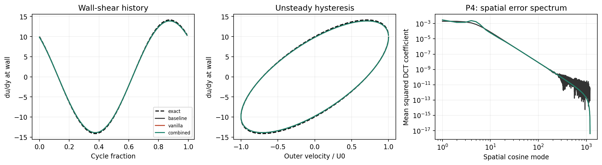

# Graph explanation

Every figure in `final_results/figures/`, in the order `REPORT.md` uses them. Each one has what it shows, how to read it, and the takeaway. Most axes are log scale, so each gridline step is a factor of 10.

**Colour key used in the figures:** black = baseline (finite difference), red = vanilla PINN, green/teal = combined PINN (scaled coordinates + near-wall collocation points), blue = scaling-only PINN, purple = adaptive fix or oracle checks.

**Sections:** [P1 Baseline](#p1-is-the-baseline-solver-correct) · [P2 Training](#p2-how-did-pinn-training-go) · [P3 Knobs](#p3-how-does-error-change-with-each-difficulty-knob) · [P4 Errors](#p4-where-do-the-errors-sit) · [P5 Cost](#p5-what-does-each-method-cost) · [Path B](#path-b-why-does-the-pinn-struggle-near-the-wall) · [Path C](#path-c-does-training-longer-help-and-does-the-fix-work)

---

## P1: Is the baseline solver correct?

`P1_grid_convergence.png`

- **Shows:** error of the finite-difference solver against the exact solution (y-axis) as the grid gets finer (x-axis: 100, 200, 400, 800 intervals). One line per layer thickness.
- **How to read:** every line drops about 4x each time the grid doubles. That straight slope is second-order convergence, which is exactly what this scheme should do. At the 400 intervals used in the study, error is about 1e-5 (0.001%).
- **Takeaway:** the baseline is trustworthy, so it is a fair and strong opponent for the PINN.

---

## P2: How did PINN training go?

Left panel vanilla, right panel combined. Blue = mismatch with probe data, orange = PDE violation at training points, green = boundary-condition violation.

`P2_losses_d0.1.png` (moderate layer, delta/L = 0.1)

- **How to read:** all three losses crash down in the first ~100 steps, then go flat. The data loss stops at about 3e-4, which is the noise level (2% noise squared is 4e-4). The network fits the data as well as noisy data allows. Spikes are rejected trial steps, not instability.

`P2_losses_d0.01.png` (thin layer, delta/L = 0.01)

- **How to read:** same picture, but the vanilla PINN takes about 200 steps to settle while the combined one settles in about 20.
- **Takeaway:** training looks successful in every case, with tiny PDE and boundary losses. Path B later shows this small loss can hide large errors between the training points.

---

## P3: How does error change with each difficulty knob?

`P3_knob_sweeps.png`

- **Shows:** columns are the three knobs, changed one at a time: layer thinness (L/delta from 6 to 100), noise (0 to 10%), and samples per cycle (8 to 64). Rows are viscosity error, whole-field error and wall-shear error. Lines are the median of 3 seeds; shaded bands are the min-to-max range.
- **How to read:**
  - **Thinness (left column):** lines are nearly flat. A 16x thinner layer barely changes accuracy, because the probes move with the layer.
  - **Noise (middle column):** every error climbs steeply, and all methods climb together. At 0% noise errors are about 1e-4%; at 10% noise viscosity error is about 10%.
  - **Samples (right column):** more samples lowers error for everyone, from about 3% at 8 samples to about 0.7% at 64.
  - The baseline (black) is as good or better almost everywhere. Bands overlap, so with 3 seeds the differences between methods are not significant.
- **Takeaway:** the PINN does not fail as the layer thins. Noise sets the accuracy for every method, so the PINN gives no accuracy advantage to justify its cost.

---

## P4: Where do the errors sit?

The colour maps plot height above the wall (y-axis) against time through one cycle (x-axis). Left column = velocity error, right column = PDE residual (how badly the physics equation is broken). Each panel has its own colour scale, so compare patterns, not colours.

`P4_fields_d0.1.png` (moderate layer)

- **How to read:** all three methods show the same tilted red and blue stripes in the error. That pattern comes from estimating viscosity about 2% wrong, which shifts the whole wave slightly. The baseline residual panel is blank because it solves its discrete equations exactly.

`P4_fields_d0.01.png` (thin layer)

- **How to read:** the PINN residual concentrates in a band right at the wall (bottom 0.01). Vanilla peaks near 0.03; combined near 0.013.
- **Takeaway:** the PINN's physics violations live next to the wall, exactly where wall shear is computed. That points to the near-wall region as the thing to fix.

`P4_shear_spectrum_d0.01.png` (thin layer)

- **Wall-shear history (left):** shear at the wall over one cycle. All methods sit on the dashed exact curve.
- **Hysteresis loop (middle):** shear against outer velocity. It is an ellipse, not a line, because shear leads velocity by 45 degrees. This unsteady effect matters for airfoils, and all methods capture it.
- **Spatial error spectrum (right):** error split into wall-normal wiggle frequencies. The vanilla PINN (red) has extra bumps around modes 10 to 50, meaning wiggly error the baseline does not have. Combined (green) is closer to the baseline.

`P4_shear_spectrum_d0.1.png` (moderate layer)

- **How to read:** same three panels. Here the PINN spectrum lies on top of the baseline with no extra bumps, so the wiggly error only appears once the layer gets thin.

`P4_temporal_spectrum_d0.01.png` (the `d0.1` version looks the same)

- **How to read:** error split into time frequencies. Everything sits at harmonic 1 and is zero elsewhere. That is by construction: both methods were told the flow oscillates at one frequency. It is a sanity check and cannot reveal time-direction PINN problems.

---

## P5: What does each method cost?

`P5_cost.png`

- **Shows:** seconds (log scale) against layer thinness. Left: time to fit (baseline) or train (PINNs). Right: time to evaluate the finished model at 153,728 points.
- **How to read:** on the left, the baseline takes about 0.013 s and both PINNs about 1.1 s, roughly 100x apart (the report's median ratio is 88x). On the right, everything answers in about a millisecond; the baseline is slightly faster, and these tiny timings are noisy.
- **Takeaway:** the PINN loses on cost by about two orders of magnitude for no accuracy gain. Every new dataset needs a fresh fit, so there is no train-once, query-many payoff.

---

## Path B: Why does the PINN struggle near the wall?

`BC_controlled_diagnosis.png` (thin layer; dots = seeds, bar = median)

- **Variants:**
  - **vanilla:** plain PINN.
  - **sampling:** more training points near the wall.
  - **scaling:** network input stretched to the layer thickness.
  - **combined:** scaling plus sampling.
  - **supervised:** oracle check, fitted directly to the exact answer. Not a real method.
  - **known_kappa:** oracle check, given the true viscosity. Not a real method.
- **How to read:**
  - **supervised** has about 20x lower near-wall error, so the small network can represent the solution. Size is not the problem.
  - **known_kappa** has the same field error as vanilla, so the unknown viscosity is not the cause either.
  - **scaling** is worst everywhere: about 10% viscosity error and 4% shear error.
  - **combined** pulls scaling back to vanilla's level. Adding near-wall points is what fixes it.
  - The oracle runs have no viscosity bars because they don't estimate viscosity.
- **Takeaway:** the root cause is physics not being enforced densely enough right at the wall.

---

## Path C: Does training longer help, and does the fix work?

`BC_budget_and_adaptive.png`

- **Shows:** each line joins a variant trained 600 steps (left dot) to the same variant trained 6,000 steps (right dot). The purple star is the adaptive fix (3,600 steps, 480 points). Panels: viscosity error, wall-shear error, and held-out near-wall PDE residual (physics error at points not used in training).
- **How to read:** almost every line goes up, so training 10x longer made things worse. Combined goes from 2% to 9% viscosity error, and its held-out residual from 0.005 to 0.09. The network overfits its fixed training points. The star has the lowest residual of all (0.003), with viscosity error back near 2%.
- **Takeaway:** training longer is the wrong fix. Moving training points to where the physics is broken is the right one.

`BC_adaptive_losses.png`

- **Shows:** left, training losses across five refinement rounds; each spike is where 64 new points are added. Right, held-out near-wall residual after each round, per seed.
- **How to read:** the improvement is not smooth. Seed 41 drops 10x by round 3, seed 17 drops early, and seed 29 jumps up at round 3 before recovering. The report keeps these reversals and reports round 5 instead of picking the best round.

`BC_near_wall_profiles.png` (seed 17, bottom 0.06 of the domain)

- **Shows:** left, velocity error against height. Right, PDE residual against height. Both at held-out points.
- **How to read:** in the right panel, scaling (blue) spikes to about 0.4 at the wall even though its training loss looked small. That is the hidden failure. Vanilla is about 0.03 at the wall and adaptive about 0.001, though adaptive still has smaller bumps higher up. In the left panel, velocity error is about 1% for all methods, set by the noisy viscosity estimate.

---

## Bottom line

The conventional solver is as accurate and about 88x cheaper, so it is the recommendation. The PINN's real weakness is that a small training loss can hide broken physics next to the wall. Checking physics at held-out points and adding training points where it fails is the fix.
