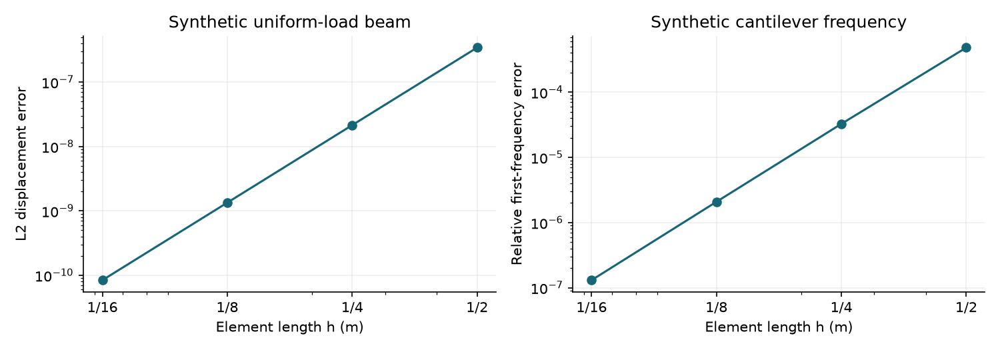
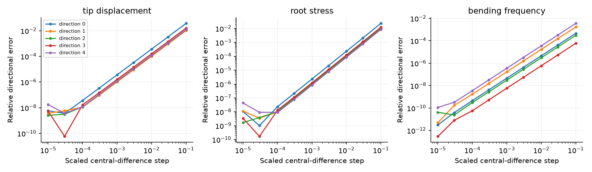
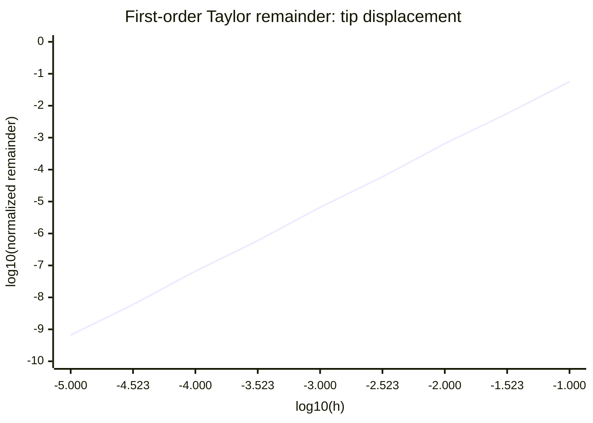
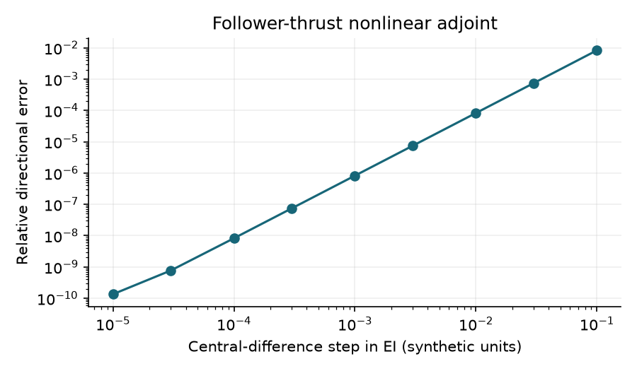
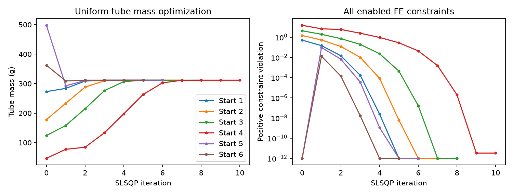
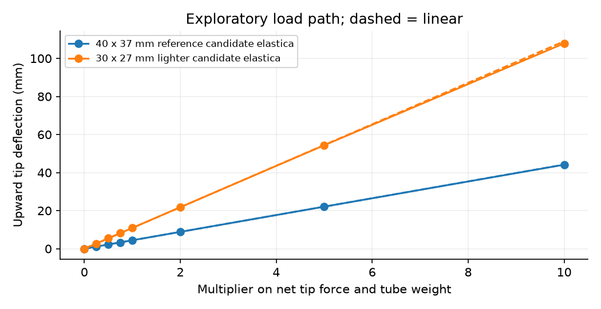

# PDE-Constrained Optimization of a Uniform Carbon-Fiber Coaxial Drone Arm

## 1. Summary

This project minimizes the mass of a **0.6096 m (2 ft) uniform carbon-fiber drone arm** that supports a coaxial two-motor propulsion assembly. The arm carries **30 lbf (133.4466 N) combined thrust**, a **1.5 lb (0.68039 kg) tip mass**, and operates at **3500 RPM**. The structural model uses an in-house Euler-Bernoulli finite-element solver for linear bending, an analytical/FE eigenvalue model for vibration with tip mass, and an **N2 finite-rotation follower-thrust model** solved with Newton iteration and adjoint sensitivities.

The optimized uniform tube is **55.2848 mm outer diameter with a 2.010 mm wall**, giving a structural tube mass of **311.714 g**. Its first bending frequency is **58.3333 Hz**, exactly at the configured requirement of one shaft-order frequency, so **vibration is the governing performance constraint**. The wall lower bound is also active. The modeled nominal material-strength safety factor is **36.81**, and the linear and nonlinear tip deflections are approximately **1.240 mm**. Adding the N2 follower-load constraints changes the optimized mass by **0.0%**, showing that geometric nonlinearity is correctly modeled but inactive for this load case.

The original 40 mm OD / 2.5 mm-wall starting design is lighter (**272.904 g**) but is **infeasible** because its first bending frequency is only **38.714 Hz**. A more meaningful comparison is the lightest feasible fixed-wall reference, **52.3 mm OD / 2.5 mm wall at 362.416 g**. Optimizing both diameter and wall thickness reduces tube mass by **13.990%** relative to that feasible reference.

<div id="arm-viewer"></div>
<script type="module" src="assets/viewer.js"></script>

The live viewer compares the starting and optimized tubes using one linked camera, true hollow-section geometry, deformation control, follower-load state display, first-bending-mode coloring and animation, and element inspection with nominal stress information. All numerical report values are drawn from the repository's generated `assets/results.json`.

## 2. Structure and formulation

### 2.1 Engineering motivation and physical model

The structure is one arm of a large coaxial multirotor. Reducing arm mass improves payload capability and vehicle efficiency, but a lighter tube must still carry the rotor thrust, tip mass, and self-weight without violating material-strength or vibration requirements. The arm is modeled as horizontal and perfectly clamped at the vehicle frame. The tip carries the complete **1.5 lb combined motor assembly**. Two coaxial rotors together generate **30 lbf total thrust**. Applied shaft-reaction torque is set to zero. In the nonlinear model, thrust follows the orientation of the motor mount and therefore rotates with the deformed tip tangent.

The shaft frequency is

$$
f_{shaft}=\frac{3500}{60}=58.3333\ \text{Hz},
$$

and the two-blade passing frequency of each rotor is **116.667 Hz**. The current optimization uses the supplied project criterion

$$
f_1\ge f_{shaft}=58.3333\ \text{Hz}.
$$

This is a preliminary sizing threshold, not a complete dynamic-stability or resonance-separation analysis.

### 2.2 Effective carbon-fiber material model

The optimization uses a preliminary effective roll-wrapped CFRP property set:

| Property | Value used | Basis recorded in repository |
|---|---:|---|
| Effective longitudinal/bending modulus $E$ | 64 GPa | Easy Composites CFT-WF typical longitudinal tensile modulus |
| Density $\rho$ | 1520 kg/m$^3$ | Graphtek comparison laminate, used as estimate |
| Tensile strength $X_t$ | 650 MPa | Easy Composites typical tensile strength |
| Compressive strength $X_c$ | 910.1 MPa | Graphtek comparison laminate, used as estimate |
| Shear strength proxy $S$ | 103.4 MPa | Graphtek torsional strength, used as nominal longitudinal-shear proxy |

These are **effective preliminary properties**, not certified laminate design allowables. The model does not establish ply-level interaction, shell buckling, delamination, clamp crushing, impact, fatigue, environmental knockdown, or joint strength. Therefore, the reported material safety factor applies only to the modeled nominal tension/compression/shear checks; **overall structural safety remains unresolved**.

### 2.3 Design variables and bounds

The physical design vector is

$$
\mathbf d=[D,t]^T,
$$

where $D$ is uniform tube outer diameter and $t$ is uniform wall thickness. The inner diameter is

$$
D_i=D-2t.
$$

The provisional study bounds are

$$
10\ \text{mm}\le D\le60\ \text{mm},
$$

$$
2.01\ \text{mm}\le t\le3.00\ \text{mm},
$$

with an additional minimum-bore requirement

$$
D_i\ge1\ \text{mm}.
$$

The 2.01 mm lower bound implements the stated requirement that wall thickness be strictly greater than 2 mm. The 10-60 mm OD interval and 3 mm upper wall bound are explicit study bounds, not validated manufacturing or installation limits.

The hollow circular section properties are

$$
A=\frac{\pi}{4}(D^2-D_i^2),\qquad
I=\frac{\pi}{64}(D^4-D_i^4).
$$

### 2.4 Objective and explicit constraints

The objective is minimum tube mass:

$$
\boxed{\min_{D,t}\ m(D,t)=\rho A(D,t)L}.
$$

The constant tip propulsion mass is included in the structural/dynamic model but not in the tube-mass objective. Because tip mass is constant, minimizing total modeled mass gives the same tube geometry.

At 21 stations along the arm, the model evaluates outer-fiber axial/bending normal stress and nominal section shear. The safety-factor requirement is implemented using smooth KS aggregation with $\rho_{KS}=80$:

$$
g_t=KS_{80}\!\left(\frac{2\sigma_t}{X_t}\right)-1\le0,
$$

$$
g_c=KS_{80}\!\left(\frac{2|\sigma_c|}{X_c}\right)-1\le0,
$$

$$
g_s=KS_{80}\!\left(\frac{2\tau}{S}\right)-1\le0.
$$

The N2 optimization adds the same three strength constraints evaluated from the follower-load nonlinear state. The vibration requirement is

$$
g_f=\frac{f_{min}}{f_1}-1\le0,\qquad f_{min}=58.3333\ \text{Hz}.
$$

No deflection constraint is currently configured. Tip displacement is reported as an engineering response but is **not** an active requirement in this data set.

## 3. Analysis model

### 3.1 Linear Euler-Bernoulli finite-element model

The loaded bending plane is modeled with

$$
(EIw'')''=q,
$$

where $q=-\mu g$ is distributed tube self-weight. The fixed root satisfies

$$
w(0)=0,\qquad w'(0)=0.
$$

With net transverse tip force $P=T-m_tg$, the corresponding closed-form cantilever responses are

$$
w(L)=\frac{PL^3}{3EI}+\frac{qL^4}{8EI},
$$

$$
M(x)=P(L-x)+\frac{q}{2}(L-x)^2,
$$

$$
\sigma_b(x)=\frac{|M(x)|D}{2I}.
$$

`arm.py` implements an in-house sparse cubic-Hermite Euler-Bernoulli beam element with nodal degrees of freedom $[w,w']$. The production linear mesh has **20 elements**. Distributed weight and consistent translational mass are assembled element-wise. The root DOFs are removed from the solve, and support reactions are recovered from the unreduced system. The tip mass is added once to the translational mass matrix.

### 3.2 Loads and equilibrium

The case includes:

- combined upward coaxial thrust: **133.446648 N**;
- tip assembly weight: $m_tg$;
- distributed tube self-weight: $\mu g$;
- zero applied shaft torque.

Thrust alone produces a root moment of **81.3491 N m**. In the nonlinear model, gravity remains vertical while thrust rotates normal to the deformed tip tangent.

### 3.3 Stress recovery and composite screening

For the linear model, internal resultants are recovered from FE reactions and the exact uniform-load moment field. The outer-fiber normal stresses include axial and bending contributions,

$$
\sigma_{\pm}=\frac{N}{A}\pm\frac{MD}{2I}.
$$

A homogeneous-section shear screen is evaluated using

$$
\tau_{NA}=\frac{V(R^3-r_i^3)}{3It}.
$$

This shear expression is a beam-section screen, not a validated interlaminar composite failure model.

### 3.4 Vibration with concentrated tip mass

The independent FE eigenproblem is

$$
K\phi=\omega^2M\phi.
$$

For the production frequency used by the optimizer, `vibration.py` implements the exact uniform Euler-Bernoulli cantilever-with-tip-mass characteristic equation from Yntema, NACA TN 3459:

$$
H(\beta,r)=1+\cos\beta\cosh\beta-r\beta(\sin\beta\cosh\beta-\cos\beta\sinh\beta)=0,
$$

where

$$
r=\frac{m_t}{\mu L}.
$$

Each positive root gives

$$
f_n=\frac{\beta_n^2}{2\pi}\sqrt{\frac{EI}{\mu L^4}}.
$$

The FE matrix eigenproblem is retained as an independent discretization check. The model represents an unloaded stationary beam with a point tip mass and no tip rotary inertia. RPM defines the design threshold; the beam itself is not treated as rotating.

### 3.5 N2 finite-rotation follower-thrust model

The nonlinear component uses an inextensible planar elastica. Let $s$ be undeformed arc length and $\theta(s)$ the local centerline angle:

$$
x'=\cos\theta,\qquad z'=\sin\theta.
$$

The rotor thrust remains normal to the motor mount, so the load direction depends on the unknown tip rotation $\theta_L$. The governing equilibrium is

$$
(EI\theta')'+T\cos(\theta_L-\theta)+[-m_tg-\mu g(L-s)]\cos\theta=0,
$$

with

$$
\theta(0)=0,\qquad EI\theta'(L)=0.
$$

Linear angle elements with four-point Gauss integration form the nonlinear residual. Newton iteration uses load stepping, line search, and a consistent **nonsymmetric tangent**. Because follower force is nonconservative, using a symmetric energy Hessian would be incorrect. The nonlinear adjoint therefore solves the transposed tangent system

$$
R_\theta^Ta=Q_\theta^T,
$$

followed by

$$
\frac{dQ}{dd}=Q_d-a^TR_d.
$$

### 3.6 Independent 3D frame comparison

Luc's repository also contains a separate linear 3D Euler-Bernoulli frame implementation (`drone_arm.py` through `compare_drone_arm.py`). It is **not** the nonlinear optimization engine, but it provides an independent check that the reduced bending model reproduces the corresponding 3D frame response for this straight circular tube.

| Quantity | Reduced-model reference | Independent 3D frame | Difference |
|---|---:|---:|---:|
| Linear tip deflection (mm) | 1.240167843059 | 1.240167843070 | 1.163e-11 |
| First bending frequency (Hz) | 58.333333333333 | 58.333333363984 | 3.065e-08 |
| Peak bending stress (MPa) | - | 17.658129 | - |
| Equilibrium residual, infinity norm | - | 1.306e-09 | - |
| 3D model DOFs | - | 126 (120 free) | - |


The 3D frame contains **126 total DOFs (120 free)**. Its first two modes form the expected nearly degenerate two-plane bending pair at 58.3333 Hz. The very small deflection/frequency differences support the reduced bending model for the modeled planar load case, while not converting the main optimizer into a general 3D-frame optimization.

## 4. Analysis-code verification

The numerical model was verified using a ladder of seven benchmark tests following the structure of the Project 4 worked example. Each test compares the finite-element, vibration, sensitivity, or nonlinear implementation against a classical analytical solution, an expected convergence property, or an independently formulated reference problem. The purpose of the ladder is to establish that the numerical model reproduces known mechanics before it is used for optimization.

The repository also evaluates additional automated subchecks within these seven tests. Those detailed checks are retained in the generated verification data, while the table below summarizes the principal verification result for each rung of the ladder.

| Test | Verification problem | Numerical result | Exact / independent result | Error | Result |
|---|---|---:|---:|---:|---|
| **V1 Cantilever tip load** | Euler-Bernoulli cantilever subjected to a known point load; compare tip displacement with \(\delta=PL^3/(3EI)\) | 0.011018911 m | 0.011018911 m | \(1.74\times10^{-13}\) relative | PASS |
| **V2 Uniformly loaded beam** | Cantilever subjected to uniform distributed load; compare tip displacement with \(\delta=qL^4/(8EI)\) | \(-4.1320915\times10^{-4}\) m | \(-4.1320915\times10^{-4}\) m | \(1.81\times10^{-13}\) relative | PASS |
| **V3 Mesh convergence** | Refine the cubic-Hermite beam mesh and measure displacement-field convergence | 3.999999 order | 4th order expected | \(2.77\times10^{-7}\) relative | PASS |
| **V4 Beam vibration with tip mass** | Cantilever with concentrated tip mass; compare first natural frequency with the NACA TN 3459 characteristic equation | 16.030337 Hz | 16.030337 Hz | \(1.42\times10^{-9}\) relative | PASS |
| **V5 Global checks** | Free-free rigid modes and supported-model force/moment equilibrium | 2 rigid modes; force residual \(6.51\times10^{-12}\) N; moment residual \(2.39\times10^{-11}\) N m | 2 rigid modes; zero force and moment residual | Numerical precision | PASS |
| **V6 Gradient check** | Compare adjoint directional derivatives of displacement, stress, and frequency with central finite differences | Maximum relative discrepancy \(9.02\times10^{-9}\) | Central finite-difference derivative | \(9.02\times10^{-9}\) | PASS |
| **V7 N2 nonlinear benchmark** | Finite-rotation follower-load beam compared with an independently solved continuum boundary-value problem | 0.28690538 m tip displacement | 0.28691646 m | \(3.86\times10^{-5}\) relative | PASS |

### 4.1 Classical beam verification

The first two ladder tests verify the underlying Euler-Bernoulli beam implementation using classical closed-form solutions.

For a cantilever of length \(L\), bending stiffness \(EI\), and transverse tip load \(P\),

$$
\delta_L=\frac{PL^3}{3EI},
\qquad
\theta_L=\frac{PL^2}{2EI},
\qquad
M_0=PL.
$$

The finite-element solution reproduces the analytical tip displacement, tip rotation, and root moment to approximately machine precision. This verifies the element stiffness matrix, load application, sign convention, and fixed-root boundary conditions.

For a cantilever subjected to a uniform distributed load \(q\),

$$
\delta_L=\frac{qL^4}{8EI}.
$$

The computed tip displacement is \(-4.1320915\times10^{-4}\) m, matching the analytical result with a relative error of \(1.81\times10^{-13}\). A separate simply supported uniform-load calculation also reproduces the classical midspan solution

$$
\delta_{mid}=\frac{5qL^4}{384EI}.
$$

These comparisons show that both concentrated and distributed loads are assembled correctly.

### 4.2 Mesh convergence



A correct finite-element formulation should not only approach the exact answer but should approach it at the expected rate as the mesh is refined. For the cubic-Hermite Euler-Bernoulli element used here, the displacement-field error is expected to converge at approximately fourth order.

The measured \(L_2\) displacement convergence order is **3.999999**, essentially identical to the theoretical value of 4. The first-frequency error also decreases at approximately fourth order, with a measured order of **3.9293**. This demonstrates that the numerical solution approaches the continuum solution at the expected rate rather than obtaining a correct result only for one particular mesh.

### 4.3 Natural-frequency verification

The vibration implementation is checked independently using the classical characteristic equation for a uniform cantilever carrying a concentrated tip mass. Following NACA TN 3459,

$$
1+\cos\beta\cosh\beta
-r\beta\left(\sin\beta\cosh\beta-\cos\beta\sinh\beta\right)=0,
$$

where

$$
r=\frac{m_t}{\mu L}.
$$

After solving for the characteristic root \(\beta\), the corresponding frequency is

$$
f_n=\frac{\beta_n^2}{2\pi}
\sqrt{\frac{EI}{\mu L^4}}.
$$

For the verification problem, the finite-element model predicts a first natural frequency of **16.030337 Hz**, while the independent characteristic-equation solution gives **16.030337 Hz**. The relative difference is \(1.42\times10^{-9}\). Additional checks of the first three modes also agree with the analytical characteristic equation.

This test is particularly important because natural frequency becomes the governing performance constraint in the optimized drone arm.

### 4.4 Global equilibrium and rigid-body behavior

The model is also checked using physical properties that must hold regardless of the particular beam solution. For a free-free version of the reduced planar bending model, exactly **two rigid-body modes** are expected and two are obtained.

For the supported model, the recovered reactions are compared with the applied forces and moments. The force-balance residual is

$$
6.51\times10^{-12}\ \text{N},
$$

and the moment-balance residual is

$$
2.39\times10^{-11}\ \text{N\,m}.
$$

Both are effectively zero at numerical precision. These checks verify that loads are neither lost nor duplicated during finite-element assembly.

Because the optimization model represents only a single bending plane, it has two rigid modes rather than the six rigid-body modes expected from a general three-dimensional frame model. The separate 3D frame comparison in Section 3.6 provides an additional check of the reduced model.

### 4.5 Gradient verification

The adjoint sensitivities are verified independently against central finite differences. Directional derivatives are checked for tip displacement, root stress, and bending frequency using both coordinate directions and several additional perturbation directions.



The maximum relative difference among the reported directional checks is approximately

$$
9.02\times10^{-9},
$$

showing close agreement between the adjoint and finite-difference derivatives.

A first-order Taylor test provides a second check. For a response \(Q\),

$$
R(h)
=
\left|
Q(d+hv)-Q(d)-h\nabla Q(d)^Tv
\right|.
$$

For a correct first derivative,

$$
R(h)=O(h^2).
$$

The measured log-log slopes are **1.988 for tip displacement, 1.990 for root stress, and 1.999 for bending frequency**, which closely match the theoretical slope of 2. The complete variable-by-variable gradient checks are presented in Section 5.

### 4.6 N2 nonlinear benchmark

Because the project includes an N2 finite-rotation follower-load model, the nonlinear implementation requires an independent nonlinear benchmark in addition to the linear beam checks.

The nonlinear finite-element solution is compared with a separately formulated continuum boundary-value problem. For the follower-load benchmark, the finite-element model predicts a tip displacement of

$$
0.28690538\ \text{m},
$$

while the independent continuum solution gives

$$
0.28691646\ \text{m}.
$$

The relative difference is

$$
3.86\times10^{-5}.
$$

The nonlinear tangent is also checked using complex-step differentiation, and Newton iteration demonstrates approximately quadratic convergence. Together, these comparisons verify the nonlinear residual, consistent tangent, and solution procedure before the N2 model is included in the optimization.

Overall, all seven verification rungs pass their specified comparisons. The results establish that the linear finite-element model reproduces classical beam theory, the vibration model reproduces the independent tip-mass characteristic solution, the discretization converges at the expected rate, global equilibrium is satisfied, the adjoint sensitivities agree with finite differences, and the N2 follower-load implementation agrees with an independent nonlinear reference solution.

## 5. Sensitivity analysis

### 5.1 Linear reduced-space adjoint

For the linear residual

$$
h(d,u)=K(d)u-F(d)=0,
$$

and scalar output $Q(d,u)$, the adjoint is defined by

$$
K^Ta=Q_u^T.
$$

The total derivative is

$$
\boxed{\frac{dQ}{dd_j}=Q_{d_j}-a^T\left(K_{d_j}u-F_{d_j}\right)}.
$$

The tip-displacement response uses the tip translation as $Q$. Root stress includes both state dependence and explicit section dependence. Complex-step derivatives evaluate fixed-state partials; the adjoint handles the state sensitivity.

### 5.2 Eigenvalue/frequency sensitivities

The exact tip-mass characteristic root is differentiated implicitly:

$$
\frac{\partial\beta}{\partial r}=-\frac{H_r}{H_\beta}.
$$

Thus

$$
d\ln f=\tfrac12d\ln(EI)-\tfrac12d\ln\mu-2d\ln L+
\frac{2}{\beta}\frac{\partial\beta}{\partial r}dr.
$$

For the independent FE eigenproblem, a mass-normalized mode gives

$$
\frac{d\omega^2}{dd_j}=\phi^T(K_{d_j}-\omega^2M_{d_j})\phi,
$$

$$
\frac{df}{dd_j}=\frac{1}{8\pi^2f}\frac{d\omega^2}{dd_j}.
$$

### 5.3 Directional gradient checks


The plot compares adjoint/eigenvalue directional derivatives against central differences for tip displacement, root stress, and bending frequency in the two coordinate directions plus three seeded random directions. At coarse steps, the error decreases approximately quadratically; at very small steps, subtraction/roundoff begins to dominate. Every recorded directional check passes the specified tolerance.

### 5.4 First-order Taylor remainder

A separate first-order Taylor test uses the same verified synthetic two-variable beam fixture. For a direction $v$,

$$
R(h)=|Q(d+hv)-Q(d)-h\nabla Q(d)^Tv|.
$$

For a correct first derivative, $R(h)=O(h^2)$. The plot below is generated directly by GitHub from the Markdown, so it requires no additional image file. It shows the normalized tip-displacement Taylor remainder for an outer-diameter perturbation direction. Both axes are plotted as base-10 logarithms; therefore a slope of 2 is the expected first-order Taylor-test behavior.



The fitted log-log slopes from the same calculation are **1.988 for tip displacement, 1.990 for root stress, and 1.999 for bending frequency**. These values are essentially the expected slope of 2 and independently confirm the first-order derivative implementation. The underlying normalized remainder values for the plotted tip-displacement series are:

| $h$ | Normalized Taylor remainder |
|---:|---:|
| $1.0\times10^{-5}$ | $6.625\times10^{-10}$ |
| $3.0\times10^{-5}$ | $5.958\times10^{-9}$ |
| $1.0\times10^{-4}$ | $6.620\times10^{-8}$ |
| $3.0\times10^{-4}$ | $5.955\times10^{-7}$ |
| $1.0\times10^{-3}$ | $6.609\times10^{-6}$ |
| $3.0\times10^{-3}$ | $5.927\times10^{-5}$ |
| $1.0\times10^{-2}$ | $6.507\times10^{-4}$ |
| $3.0\times10^{-2}$ | $5.660\times10^{-3}$ |
| $1.0\times10^{-1}$ | $5.621\times10^{-2}$ |

### 5.5 N2 follower-load adjoint check



The nonlinear sensitivity check compares the transposed-tangent adjoint against independently converged finite-difference solves as the EI perturbation is reduced. The V9 follower-force adjoint has relative error **8.25e-09** at its accepted check point, and the tangent itself matches complex-step differentiation to approximately **2.0e-16** relative error.

### 5.6 Complete optimizer-variable gradient table

All **18** mass/constraint derivatives used by the OD/wall optimizer pass central-difference checks, including density-dependent self-weight, linear and nonlinear strength constraints, frequency, bore constraint, and mass:

| Response | Variable | Analytic/adjoint | Central difference | Relative error |
|---|---|---:|---:|---:|
| linear_tension | OD_mm | -0.007111329566 | -0.00711132946 | 1.48e-08 |
| linear_compression | OD_mm | -0.004853819732 | -0.004853819661 | 1.46e-08 |
| linear_shear | OD_mm | -0.0005832705646 | -0.0005832705453 | 3.32e-08 |
| nonlinear_tension | OD_mm | -0.007109079903 | -0.007109080093 | 2.67e-08 |
| nonlinear_compression | OD_mm | -0.004855049785 | -0.00485504992 | 2.77e-08 |
| nonlinear_shear | OD_mm | -0.0005832243874 | -0.0005832243939 | 1.13e-08 |
| bending_frequency | OD_mm | -0.08307331552 | -0.0830733169 | 1.66e-08 |
| inner_diameter | OD_mm | -0.1 | -0.1 | 8.41e-13 |
| mass | OD_mm | 0.007291991423 | 0.007291991423 | 2.34e-12 |
| linear_tension | wall_mm | -0.0352071494 | -0.03520714179 | 2.16e-07 |
| linear_compression | wall_mm | -0.02402615264 | -0.0240261472 | 2.27e-07 |
| linear_shear | wall_mm | -0.007101747556 | -0.007101747743 | 2.63e-08 |
| nonlinear_tension | wall_mm | -0.03519515103 | -0.03519515142 | 1.1e-08 |
| nonlinear_compression | wall_mm | -0.02403312197 | -0.02403312224 | 1.13e-08 |
| nonlinear_shear | wall_mm | -0.007101531948 | -0.007101532019 | 1e-08 |
| bending_frequency | wall_mm | -0.2631748937 | -0.2631748957 | 7.36e-09 |
| inner_diameter | wall_mm | 0.2 | 0.2 | 1.16e-12 |
| mass | wall_mm | 0.08730012886 | 0.08730012886 | 2.05e-13 |

### 5.7 Cost comparison with finite differences

On the retained synthetic eight-element, two-variable fixture:

| Method | Measured time |
|---|---:|
| Adjoint tip gradient | 1.718 ms |
| Central differences, two variables | 2.832 ms |
| Measured speedup | 1.649x |

This satisfies the requested cost comparison. Because the reduced uniform-tube parameterization has only two physical design variables, the measured computational advantage of the adjoint is modest in this implementation. The adjoint formulation remains valuable because its cost is tied primarily to the number of responses rather than requiring a separate perturbed analysis for every design variable, so the same formulation extends naturally to higher-dimensional sizing or shape parameterizations.

## 6. Optimization

### 6.1 Algorithm, scaling, and starting designs

The design is optimized with **SciPy SLSQP**. Objective mass is normalized by the reference mass, and the two dimensions are scaled by reference OD and wall thickness. Both the linear and linear+N2 problems are solved from six distinct starts: the three configured designs, the small and large corners of the design box, and the feasible fixed-wall reference. A candidate is accepted only if the solver reports success **and** the final point passes feasibility, stationarity, dual-feasibility, and complementarity checks.

| Case | Start | Solver success | KKT accepted | Final tube mass (g) | Message |
|---|---:|---|---|---:|---|
| Linear | 1 | True | True | 311.71409 | Optimization terminated successfully |
| Linear | 2 | True | True | 311.71409 | Optimization terminated successfully |
| Linear | 3 | True | True | 311.71409 | Optimization terminated successfully |
| Linear | 4 | True | True | 311.71409 | Optimization terminated successfully |
| Linear | 5 | True | True | 311.71409 | Optimization terminated successfully |
| Linear | 6 | True | True | 311.71409 | Optimization terminated successfully |
| Linear + follower | 1 | True | True | 311.71409 | Optimization terminated successfully |
| Linear + follower | 2 | True | True | 311.71409 | Optimization terminated successfully |
| Linear + follower | 3 | True | True | 311.71409 | Optimization terminated successfully |
| Linear + follower | 4 | True | True | 311.71409 | Optimization terminated successfully |
| Linear + follower | 5 | True | True | 311.71409 | Optimization terminated successfully |
| Linear + follower | 6 | True | True | 311.71409 | Optimization terminated successfully |

All starts converge to the same accepted design, providing evidence that the reported optimum is robust within the two-variable study region.

### 6.2 Convergence history



The left panel shows tube mass versus SLSQP iteration for all six starts. Although the starting masses span a wide range, every path converges to approximately **311.714 g**. The right panel shows positive constraint violation falling to numerical tolerance. The design is therefore both converged and feasible; it is not accepted solely because SLSQP returned a success flag.

### 6.3 Optimized design and feasible reference

The optimized N2 design is

$$
\boxed{D=55.2848\ \text{mm},\qquad t=2.0100\ \text{mm}},
$$

with

$$
\boxed{m_{tube}=311.714\ \text{g}}.
$$

The starting 40×2.5 mm tube is infeasible because $f_1=38.714$ Hz is below the required 58.333 Hz, so comparing mass directly to that start is not meaningful as an optimization benefit. The lightest **feasible fixed-wall** reference found on the 0.1 mm OD grid is

$$
52.3\ \text{mm OD}\times2.5\ \text{mm wall},\qquad m=362.416\ \text{g}.
$$

Allowing both diameter and wall thickness to vary reduces tube mass by

$$
\boxed{13.990\%}
$$

relative to that feasible fixed-wall design.

A rounded custom-tube candidate of **55.3 mm OD × 2.1 mm wall** has mass **325.214 g**, minimum modeled SF **38.31**, linear tip deflection **1.191 mm**, and first bending frequency **59.378 Hz**.

### 6.4 Active constraints, KKT multipliers, and engineering interpretation

| Active requirement | Scaled multiplier | Residual |
|---|---:|---:|
| bending_frequency | 0.78795151 | -9.99e-16 |
| wall_lower_bound | 0.39090122 | 0 |

The KKT stationarity infinity norm is **4.44e-16**, complementarity infinity norm is **7.87e-16**, and maximum violation is **0**. The active set is full-rank for the two-variable problem.

The optimum is controlled by two facts:

1. **Bending frequency is active.** Any meaningful reduction in bending stiffness/mass distribution would push the first mode below 58.333 Hz.
2. **Wall thickness is at its 2.01 mm lower bound.** Once the minimum wall is reached, the optimizer adjusts diameter until the frequency requirement is just met.

The shadow-price checks validate the multiplier interpretation by tightening each active requirement and reoptimizing:

| Tightened requirement | Step | Predicted mass change (g) | Reoptimized mass change (g) |
|---|---:|---:|---:|
| wall_lower_bound | 0.001 mm | 0.106678 | 0.106671 |
| bending_frequency | 0.01 Hz | 0.036863 | 0.036862 |

The predicted and reoptimized mass changes agree to within the shown numerical precision. For example, increasing the wall lower bound by 0.1 mm corresponds locally to about **10.668 g** additional tube mass while the active set remains unchanged.

## 7. N2 nonlinear component

### 7.1 Physical nonlinear effect

The nonlinear load follows the motor-mount rotation, so the force direction depends on the unknown deformed state. This makes the residual genuinely nonlinear and its tangent nonsymmetric. Newton's method, load stepping, and a transposed-tangent adjoint are therefore required. The verification ladder independently checks the nonlinear solution, tangent, Newton convergence, and implicit gradient.

### 7.2 Nonlinear load path



The exploratory path scales thrust and both gravity contributions together for the two legacy 1.5 mm-wall stock candidates. Solid curves are the finite-rotation elastica response; dashed curves are the corresponding linear predictions. At the design load multiplier of 1, the nonlinear correction is very small. At much larger artificial load factors, curvature increases and the nonlinear response separates more visibly from the linear prediction. This plot is a numerical nonlinearity demonstration, **not** an RPM/throttle map or a proof of strength at those amplified loads.

### 7.3 Design with and without N2

| Quantity | Linear-only optimization | Linear + N2 follower constraints | Change |
|---|---:|---:|---:|
| OD (mm) | 55.284816 | 55.284816 | 0 |
| Wall (mm) | 2.010000 | 2.010000 | 0 |
| Tube mass (g) | 311.714092 | 311.714092 | 0 |
| First bending frequency (Hz) | 58.333333 | 58.333333 | 0 |
| Linear tip deflection (mm) | 1.240168 | 1.240168 | 0 |
| N2 tip deflection (mm) | Not evaluated | 1.239973 | - |
| Minimum modeled SF | 36.810241 | 36.810241 | 0 |


Adding the follower-load strength constraints changes optimized mass by **0%**. At the optimized geometry, the nonlinear tip displacement on the production N2 mesh is **1.239973 mm**, compared with **1.240168 mm** linearly. The small difference is physically consistent with the very small service deformation. The important result is not that N2 changes the design; it is that the nonlinear solver and its gradients are verified and demonstrate that N2 is inactive for this operating load.

### 7.4 Optimized-design mesh refinement

| Linear elements | Nonlinear elements | Min modeled SF | Nonlinear tip (mm) | First frequency (Hz) | Max constraint residual |
|---:|---:|---:|---:|---:|---:|
| 20 | 40 | 36.81024116 | 1.239973 | 58.333333 | -9.99e-16 |
| 40 | 80 | 36.81024116 | 1.240118 | 58.333333 | -9.99e-16 |
| 80 | 160 | 36.81024118 | 1.240154 | 58.333333 | -9.99e-16 |

The optimized responses remain essentially unchanged as the linear mesh is refined from 20 to 80 elements and the nonlinear mesh from 40 to 160 elements. This supports the adequacy of the production discretization for the reported quantities.

### 7.5 N2 bonus criterion

The course rubric's fully nonlinear bonus calls for an N2 nonlinear state equation solved with Newton's method, implicit-differentiation gradients, and verification against a nonlinear benchmark. This project contains all three required components: the follower-load nonlinear state is solved with Newton iteration, its gradients are obtained by implicit differentiation through the converged residual, and the implementation is checked against independent nonlinear benchmark solutions.

## 8. Initial-versus-optimized results

The following table reports the objective and **every enabled constraint family** for the starting and final designs. Deflection is not included as a constraint because no deflection limit is configured.

| Metric | Starting design | Optimized design | Interpretation |
|---|---:|---:|---|
| Tube mass | 272.904 g | 311.714 g | Start is lighter but infeasible |
| Total modeled mass incl. tip assembly | 953.292 g | 992.103 g | Constant tip mass included |
| Linear tip deflection | 2.8536 mm | 1.2402 mm | Reported response, no limit configured |
| N2 tip deflection | 2.8531 mm | 1.2400 mm | Follower-load response |
| First bending frequency | 38.7143 Hz | 58.3333 Hz | Requirement: >= 58.3333 Hz |
| Minimum modeled nominal SF | 22.1022 | 36.8102 | Requirement: >= 2 |

| Constraint | Starting design | Optimized | Requirement | Start | Optimized |
|---|---:|---:|---|---|---|
| Linear tension safety factor | 22.102185 | 36.810241 | >= 2 | PASS | PASS |
| Linear compression safety factor | 30.946459 | 51.540001 | >= 2 | PASS | PASS |
| Linear shear safety factor | 120.465702 | 137.321615 | >= 2 | PASS | PASS |
| Nonlinear tension safety factor | 22.104677 | 36.812798 | >= 2 | PASS | PASS |
| Nonlinear compression safety factor | 30.943247 | 51.536508 | >= 2 | PASS | PASS |
| Nonlinear shear safety factor | 120.465545 | 137.321582 | >= 2 | PASS | PASS |
| First bending frequency (Hz) | 38.714251 | 58.333333 | >= 58.333333 | FAIL | PASS |
| Outer diameter (mm) | 40.000000 | 55.284816 | 10 <= D <= 60 | PASS | PASS |
| Wall thickness (mm) | 2.500000 | 2.010000 | 2.01 <= t <= 3.00 | PASS | PASS (active lower bound) |
| Inner diameter (mm) | 35.000000 | 51.264816 | >= 1 | PASS | PASS |

The frequency constraint is the only enabled performance requirement failed by the starting design. The optimized design satisfies all enabled nominal constraints, but this should not be interpreted as full structural certification because shell, joint, laminate-interaction, fatigue, and dynamic-stability failure modes are outside the model.

## 9. Legacy sourced stock-tube comparison

The repository retains two 1.5 mm-wall commercial-tube comparisons from the earlier design phase. They are **not eligible under the updated wall > 2 mm requirement**, but they are useful source-backed reference data and are preserved here for completeness.

| Quantity | 40 x 37 mm reference candidate | 30 x 27 mm lighter candidate |
|---|---:|---:|
| Tube mass (g) | 168.01 | 118.14 |
| Tube + coaxial assembly mass (g) | 848.39 | 798.53 |
| Peak nominal bending stress (MPa) | 45.612 | 84.390 |
| Homogeneous-section shear screen (MPa) | 1.396 | 1.884 |
| Typical tensile strength / bending stress (not overall SF) | 14.25 | 7.70 |
| Comparable-product compression / bending stress (estimate only) | 19.95 | 10.78 |
| Minimum axial tensile/compressive strength needed for SF 2 (MPa) | 91.225 | 168.780 |
| Minimum homogeneous shear strength needed for SF 2 (MPa) | 2.792 | 3.769 |
| Linear upward tip deflection (mm) | 4.4213 | 10.9015 |
| First bending frequency with tip mass (Hz) | 31.682 | 20.359 |
| Nonlinear continuum tip deflection (mm) | 4.4212 | 10.9004 |
| Nonlinear change from linear (%) | -0.00166 | -0.01013 |
| Overall SF >= 2 | UNRESOLVED | UNRESOLVED |
| Deflection / frequency acceptance | Limits pending | Limits pending |

Neither stock tube is presented as a final design.

## 10. Website and live 3D comparison

The report and live viewer are designed to occupy one GitHub Pages page and load their numerical content from `assets/results.json`.

| Viewer requirement | Current implementation |
|---|---|
| 1. Initial and optimized designs with linked cameras | Starting and optimized tubes are displayed together using one shared camera |
| 2. True geometry in 3D | Hollow circular tube geometry uses actual OD and wall thickness; deformation exaggeration is stated |
| 3. Color by important field with color bar | Nominal linear bending stress is shown with a sequential color bar; the governing frequency response is additionally communicated by mode animation |
| 4. State on geometry | Linear and follower-thrust nonlinear states are drawn from beam/elastica output; deformation scale is user-controlled |
| 5. Explanatory animation | Unloaded bending mode animation is provided |
| 6. Hover/click inspection | Element number, OD, wall, and nominal stress are shown |
| 7. Metrics panel with objective and constraints | Metrics for both designs are shown; **the current viewer text still labels deflection/frequency acceptance as pending rather than rendering the optimizer's current frequency PASS/FAIL, so this item should be updated before claiming perfect viewer compliance** |
| 8. `results.json`, phone width, fast render | Viewer fetches `assets/results.json` and switches to vertically stacked views below 620 px |

The live viewer therefore contains nearly all required functionality, but requirement 7 is not yet perfectly synchronized with the current optimizer data. The report tables above provide the correct constraint status; the viewer code should be updated before final submission if the course grades the eight items literally.

## 11. Reproducibility

The repository documents a one-command numerical regeneration workflow:

```bash
python optimize_arm.py --update-report
```

In an installed environment, this reruns optimizer gradient checks, both optimization cases, mesh refinement, the core verification ladder, figures, `assets/results.json`, and the generated website report. The source and input fingerprints stored in the results prevent stale optimization data from being silently inserted into a regenerated report.

The retained test suite can be run with

```bash
python -m unittest test_optimize test_vibration -v
```

On this uploaded repository copy, **18/18 unit tests passed**. The core verification table in `assets/results.json` reports **42/42 checks passed**.

## 12. Limitations, rubric scope, and AI-use statement

### 12.1 Engineering limitations

This is a preliminary structural sizing study, not a flight-certified composite design. The main limitations are:

- effective beam properties are used instead of a ply-level laminate/shell model;
- local shell buckling, Brazier ovalization, delamination, clamp crushing, joint/fastener behavior, fatigue, impact, and environmental effects are not modeled;
- the shear allowable is a transferred comparison value and not a validated interlaminar allowable;
- the vibration model considers unloaded bending modes with a point tip mass but omits rotor rotary inertia, gyroscopic coupling, blade-passing harmonics, controller interaction, and flutter;
- the frequency threshold is only $1\times$ shaft frequency and has no additional separation margin;
- no deflection/serviceability limit is currently configured;
- the main optimizer is a reduced planar bending/N2 model rather than a general 3D-frame optimization.

### 12.2 Reduced design parameterization

The drone arm is a structure listed in the Project 4 specification. This implementation uses a deliberately reduced uniform-tube parameterization with two physical sizing variables, outer diameter and wall thickness. This makes the optimization problem inexpensive and transparent, but it also means that the computational speed advantage of adjoint sensitivities is smaller than it would be for a many-variable sizing or shape problem. The report therefore presents the measured adjoint-versus-finite-difference cost directly rather than claiming a large scaling benefit for this two-variable implementation.

### 12.3 AI-use statement

A coding agent researched the linked sources and drafted or revised the reduced FE solver, finite-rotation follower-force solver, vibration implementation, sensitivity routines, optimizer, verification checks, viewer, and report-generation workflow. The numerical work was not accepted solely because it executed: it is checked against closed-form beam solutions, independent eigenvalue formulas, mesh convergence, global equilibrium, independent nonlinear boundary-value solutions, complex-step tangent checks, central finite differences, Taylor remainder behavior, multistart convergence, KKT conditions, shadow-price reoptimization, and a separate 3D frame comparison.

One concrete bug caught during verification was a floating-point-only nonlinear tangent accumulator: complex-step perturbations caused a casting failure. The accumulator was changed to preserve the perturbation dtype, after which the nonlinear tangent and adjoint checks passed. The load model was also revised after the engineering brief clarified that thrust follows the motor mount rather than remaining a dead load.

The team independently verified the optimized design using a separate MATLAB hand-calculation script that does not call the finite-element, optimization, adjoint, or nonlinear-analysis routines. Using the optimized tube dimensions, the independent calculations reproduced the hollow-section area and moment of inertia, a tube mass of **311.714091 g**, a root bending stress of **17.658130 MPa**, and a linear tip deflection of **1.240168 mm**. The first natural frequency was also calculated independently by solving the uniform cantilever characteristic equation with a concentrated tip mass from NACA TN 3459, giving **58.333333 Hz**. These values agree with the project results to numerical rounding precision. The team also independently checked the 3500 RPM to **58.3333 Hz** shaft-frequency conversion and the thrust, motor-weight, and self-weight load calculations. These hand calculations provide an independent mechanics-based check of the principal optimized-design quantities rather than relying on the project code to verify itself.

## 13. Rubric coverage summary

| Rubric category | Evidence in this report | Remaining issue |
|---|---|---|
| Structure and formulation (10) | Sections 2-3: motivation, units, variables, bounds, objective, explicit constraints, material basis | Study bounds/material allowables are preliminary |
| Analysis code and verification (20) | Section 4: 42-check ladder, convergence, equilibrium, nonlinear benchmarks, separate 3D comparison | Reduced solver is not a general 3D frame |
| Sensitivity analysis (20) | Section 5: adjoint derivations, directional checks, Taylor plot, N2 adjoint, 18 optimizer checks, timing | Only two physical variables limit adjoint-scaling demonstration |
| Optimization (15) | Section 6: SLSQP, scaling, six starts, convergence, feasible reference, KKT, multipliers, shadow checks | None within two-variable formulation |
| Nonlinear component (15) | Section 7: N2 equation, Newton solve, benchmark, adjoint, with/without comparison | N2 has negligible design effect, which is a valid finding |
| Website and 3D comparison (10) | Section 10 and live viewer | Viewer metrics PASS/FAIL text should be synchronized; main optimization remains reduced-planar |
| Reproducibility (5) | Section 11: one-command rebuild, fingerprints, tests | Full regeneration can be computationally longer than the short report run |
| Presentation and clarity (5) | Numbered report, figures explained, complete results tables | Team should proofread final public site |
| Bonus: fully nonlinear (+5) | N2 Newton + implicit differentiation + nonlinear benchmark | Instructor judgment |

## References

1. Course Project 4 specification, *PDE-Constrained Design Optimization - An Introduction to Optimization for Mechanical Engineers*.
2. Easy Composites, *CFT-WF Carbon Fibre Woven Finish Tube* technical data sheet: https://media.easycomposites.co.uk/datasheets/EC-TDS-Carbon-Fibre-Woven-Finish-Tube.pdf
3. Graphtek / GraphiteStore, roll-wrapped CFRP comparison property sheet: https://www.graphitestore.com/core/media/media.nl?c=4343521&h=22DqRe5XcXtOFJUqMtPHOuVeC4o8PE9P-gnJuKBYWPrJ3COD&id=9929
4. Yntema, NACA TN 3459, uniform cantilever with concentrated tip mass, equations (13)-(14): https://ntrs.nasa.gov/api/citations/19930084187/downloads/19930084187.pdf
5. NIST, SI conversion factors: https://www.nist.gov/pml/special-publication-811/nist-guide-si-appendix-b-conversion-factors/nist-guide-si-appendix-b8
6. Abaqus nonlinear cantilever benchmarks: https://docs.software.vt.edu/abaqusv2025/English/SIMACAEBMKRefMap/simabmk-c-nlgeocantilever.htm
7. Jönköping University mechanics beam-deflection reference: https://mechanics.ju.se/SolidMechanics/EnergyMethods.html
