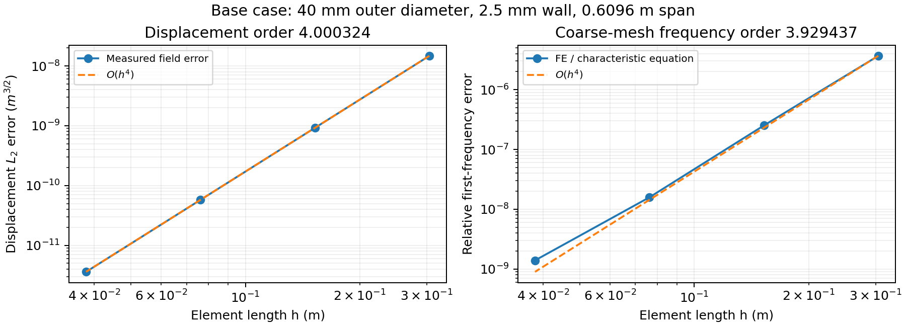
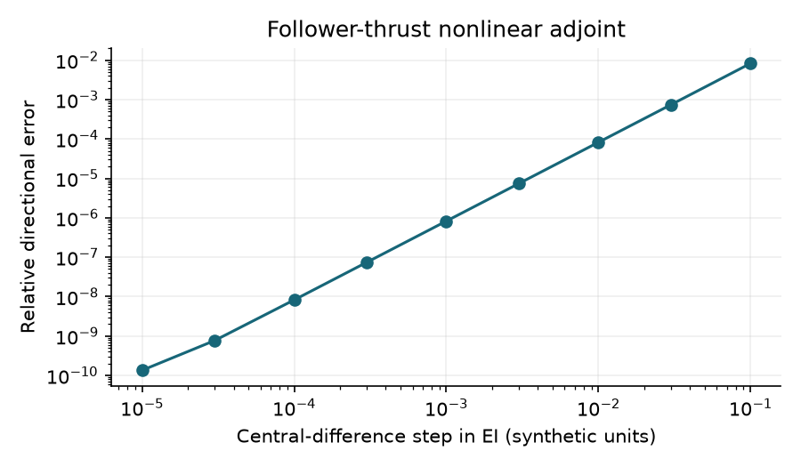
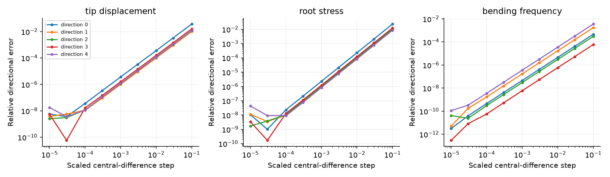
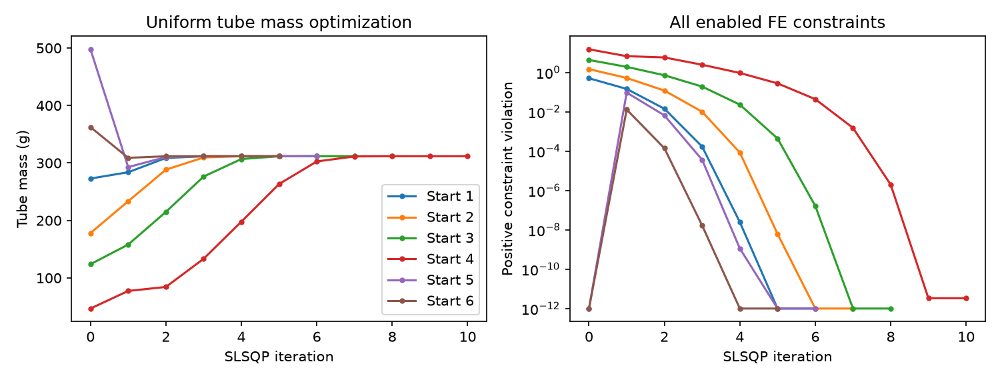
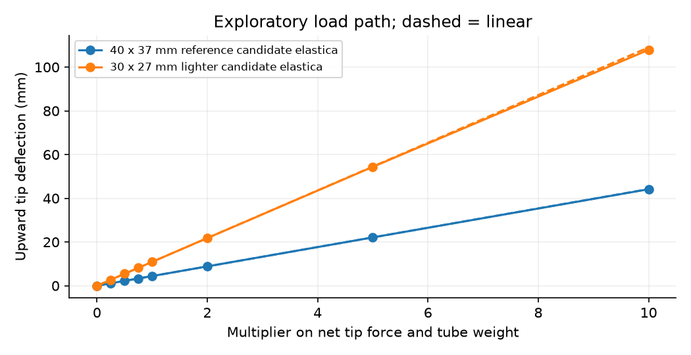

## 1. Summary {#summary}

This study minimizes the mass of a uniform carbon-fiber cantilever that supports two coaxial rotors. The analysis combines a linear Euler–Bernoulli beam model, a bending eigenproblem with concentrated tip mass, and an N2 finite-rotation follower-thrust model.

<div id="report-summary" aria-live="polite"><p>Loading the solver results…</p></div>

<section id="comparison" class="comparison" aria-labelledby="comparison-title">
  <div class="section-heading">
    <h2 id="comparison-title">Initial vs. optimized</h2>
    <p>Drag to rotate both views. Scroll or pinch to zoom. Hover or tap the tube to inspect an element.</p>
  </div>
  <div id="arm-viewer"><p>Loading the 3D comparison…</p></div>
  <noscript><p>Enable JavaScript to view the solver results and 3D comparison.</p></noscript>
</section>

## 2. Structure and formulation {#formulation}

### 2.1 Engineering motivation and physical model

The structure is one arm of a large coaxial multirotor. Reducing structural mass is beneficial because it increases useful payload capacity and reduces vehicle inertial mass; however, removing material also reduces bending stiffness and can move the arm’s natural frequencies closer to rotor-induced excitation. The arm is modeled as horizontal and perfectly clamped at the vehicle frame. The tip carries the complete **1.5 lb combined motor assembly**. Two coaxial rotors together generate **30 lbf total thrust**. Because the coaxial rotors counter-rotate, the mean applied shaft-reaction torque is assumed to cancel and is therefore set to zero in the present structural model. In the nonlinear model, thrust follows the orientation of the motor mount and therefore rotates with the deformed tip tangent.

The shaft frequency is

$$
f_{shaft}=\frac{3500}{60}=58.3333\ \text{Hz},
$$

and the two-blade passing frequency of each rotor is **116.667 Hz**. The vibration limit is derived from the specified 3500 RPM operating speed using the current design criterion that the first bending frequency must be at least one shaft-order frequency.

$$
f_1\ge f_{shaft}=58.3333\ \text{Hz}.
$$

This is a preliminary sizing threshold, not a complete dynamic-stability or resonance-separation analysis.

### 2.2 Effective carbon-fiber material model

The optimization uses a preliminary effective roll-wrapped CFRP property set:

| Property | Value used | Basis recorded in repository |
|---|---:|---|
| Effective longitudinal/bending modulus <span class="math-inline">&#92;&#40;E&#92;&#41;</span> | 64 GPa | Easy Composites CFT-WF typical longitudinal tensile modulus |
| Density <span class="math-inline">&#92;&#40;&#92;rho&#92;&#41;</span> | 1520 <span class="math-inline">&#92;&#40;kg&#47;m&#94;3&#92;&#41;</span> | Graphtek comparison laminate, used as estimate |
| Tensile strength <span class="math-inline">&#92;&#40;X&#95;t&#92;&#41;</span> | 650 MPa | Easy Composites typical tensile strength |
| Compressive strength <span class="math-inline">&#92;&#40;X&#95;c&#92;&#41;</span> | 910.1 MPa | Graphtek comparison laminate, used as estimate |
| Shear strength proxy <span class="math-inline">&#92;&#40;S&#92;&#41;</span> | 103.4 MPa | Graphtek torsional strength, used as nominal longitudinal-shear proxy |

These are **effective preliminary properties**, not certified laminate design allowables. The model does not establish ply-level interaction, shell buckling, delamination, clamp crushing, impact, fatigue, environmental knockdown, or joint strength. Therefore, the reported material safety factor applies only to the modeled nominal tension/compression/shear checks; **overall structural safety remains unresolved**.

### 2.3 Design variables and bounds

The physical design vector is

$$
\mathbf d=[D,t]^T,
$$

where <span class="math-inline">&#92;&#40;D&#92;&#41;</span> is uniform tube outer diameter and <span class="math-inline">&#92;&#40;t&#92;&#41;</span> is uniform wall thickness. The inner diameter is

$$
D_i=D-2t.
$$

The provisional study bounds are

$$
10\ \text{mm}\le D\le60\ \text{mm},
$$

$$
2.01\ \text{mm}\le t\le3.00\ \text{mm},
$$

with an additional minimum-bore requirement

$$
D_i\ge1\ \text{mm}.
$$

The 2.01 mm lower wall bound implements the requirement that wall thickness be strictly greater than 2 mm. The 10–60 mm outer-diameter interval, 3 mm upper wall-thickness bound, and minimum-bore requirement are team-selected study bounds used to define a practical optimization domain rather than validated manufacturing or installation limits. A minimum nominal material safety factor of 2 is also adopted as a team-selected preliminary design requirement.

The hollow circular section properties are

$$
A=\frac{\pi}{4}(D^2-D_i^2),\qquad
I=\frac{\pi}{64}(D^4-D_i^4).
$$

### 2.4 Objective and explicit constraints

The optimization seeks the lightest admissible structural tube while enforcing material-strength, vibration, and geometric requirements. The nonlinear optimization evaluates the same strength requirements using the finite-rotation follower-load state. The objective is minimum tube mass:

$$
\boxed{\min_{D,t}\ m(D,t)=\rho A(D,t)L}.
$$

The constant tip propulsion mass is included in the structural/dynamic model but not in the tube-mass objective. Because tip mass is constant, minimizing total modeled mass gives the same tube geometry.

At 21 stations along the arm, the model evaluates outer-fiber axial/bending normal stress and nominal section shear. The safety-factor requirement is implemented using smooth KS aggregation with <span class="math-inline">&#92;&#40;&#92;rho&#95;&#123;KS&#125;&#61;80&#92;&#41;</span>:

$$
g_t=KS_{80}\!\left(\frac{2\sigma_t}{X_t}\right)-1\le0,
$$

$$
g_c=KS_{80}\!\left(\frac{2|\sigma_c|}{X_c}\right)-1\le0,
$$

$$
g_s=KS_{80}\!\left(\frac{2\tau}{S}\right)-1\le0.
$$

The N2 optimization adds the same three strength constraints evaluated from the follower-load nonlinear state. The vibration requirement is

$$
g_f=\frac{f_{min}}{f_1}-1\le0,\qquad f_{min}=58.3333\ \text{Hz}.
$$

No deflection constraint is currently configured. Tip displacement is reported as an engineering response but is **not** an active requirement in this data set.

## 3. Analysis model {#analysis}

### 3.1 Linear Euler-Bernoulli finite-element model

The loaded bending plane is modeled with

$$
(EIw'')''=q,
$$

where <span class="math-inline">&#92;&#40;q&#61;&#45;&#92;mu g&#92;&#41;</span> is distributed tube self-weight. The fixed root satisfies

$$
w(0)=0,\qquad w'(0)=0.
$$

With net transverse tip force <span class="math-inline">&#92;&#40;P&#61;T&#45;m&#95;tg&#92;&#41;</span>, the corresponding closed-form cantilever responses are

$$
w(L)=\frac{PL^3}{3EI}+\frac{qL^4}{8EI},
$$

$$
M(x)=P(L-x)+\frac{q}{2}(L-x)^2,
$$

$$
\sigma_b(x)=\frac{|M(x)|D}{2I}.
$$

`arm.py` implements an in-house sparse cubic-Hermite Euler-Bernoulli beam element with nodal degrees of freedom <span class="math-inline">&#92;&#40;&#91;w&#44;w&#39;&#93;&#92;&#41;</span>. The production linear mesh has **20 elements**. Distributed weight and consistent translational mass are assembled element-wise. The root DOFs are removed from the solve, and support reactions are recovered from the unreduced system. The tip mass is added once to the translational mass matrix.

### 3.2 Loads and equilibrium

The case includes:

- combined upward coaxial thrust: **133.446648 N**;
- tip assembly weight: <span class="math-inline">&#92;&#40;m&#95;tg&#92;&#41;</span>;
- distributed tube self-weight: <span class="math-inline">&#92;&#40;&#92;mu g&#92;&#41;</span>;
- zero applied shaft torque.

Thrust alone produces a root moment of **81.3491 N m**. In the nonlinear model, gravity remains vertical while thrust rotates normal to the deformed tip tangent.

### 3.3 Stress recovery and composite screening

For the linear model, internal resultants are recovered from FE reactions and the exact uniform-load moment field. The outer-fiber normal stresses include axial and bending contributions,

$$
\sigma_{\pm}=\frac{N}{A}\pm\frac{MD}{2I}.
$$

A homogeneous-section shear screen is evaluated using

$$
\tau_{NA}=\frac{V(R^3-r_i^3)}{3It}.
$$

This shear expression is a beam-section screen, not a validated interlaminar composite failure model.

### 3.4 Vibration with concentrated tip mass

The independent FE eigenproblem is

$$
K\phi=\omega^2M\phi.
$$

For the production frequency used by the optimizer, `vibration.py` implements the exact uniform Euler-Bernoulli cantilever-with-tip-mass characteristic equation from Yntema, NACA TN 3459:

$$
H(\beta,r)=1+\cos\beta\cosh\beta-r\beta(\sin\beta\cosh\beta-\cos\beta\sinh\beta)=0,
$$

where

$$
r=\frac{m_t}{\mu L}.
$$

Each positive root gives

$$
f_n=\frac{\beta_n^2}{2\pi}\sqrt{\frac{EI}{\mu L^4}}.
$$

The FE matrix eigenproblem is retained as an independent discretization check. The model represents an unloaded stationary beam with a point tip mass and no tip rotary inertia. RPM defines the design threshold; the beam itself is not treated as rotating.

### 3.5 N2 finite-rotation follower-thrust model

The nonlinear component uses an inextensible planar elastica. Let <span class="math-inline">&#92;&#40;s&#92;&#41;</span> be undeformed arc length and <span class="math-inline">&#92;&#40;&#92;theta&#40;s&#41;&#92;&#41;</span> the local centerline angle:

$$
x'=\cos\theta,\qquad z'=\sin\theta.
$$

The rotor thrust remains normal to the motor mount, so the load direction depends on the unknown tip rotation <span class="math-inline">&#92;&#40;&#92;theta&#95;L&#92;&#41;</span>. The governing equilibrium is

$$
(EI\theta')'+T\cos(\theta_L-\theta)+[-m_tg-\mu g(L-s)]\cos\theta=0,
$$

with

$$
\theta(0)=0,\qquad EI\theta'(L)=0.
$$

Linear angle elements with four-point Gauss integration form the nonlinear residual. Newton iteration uses load stepping, line search, and a consistent **nonsymmetric tangent**. Because follower force is nonconservative, using a symmetric energy Hessian would be incorrect. The nonlinear adjoint therefore solves the transposed tangent system

$$
R_\theta^Ta=Q_\theta^T,
$$

followed by

$$
\frac{dQ}{dd}=Q_d-a^TR_d.
$$

### 3.6 Modeling assumptions

The principal modeling assumptions are:

- the arm is straight, uniform, and perfectly clamped at the vehicle frame;
- Euler-Bernoulli beam theory is applicable, so transverse shear deformation is neglected in the primary bending model;
- effective homogeneous CFRP properties represent the tube in bending and strength screening;
- the motor assembly is modeled as a concentrated translational tip mass without rotary inertia;
- tube self-weight is uniformly distributed along the arm;
- the two coaxial rotors are represented by their combined thrust, with zero net applied shaft-reaction torque;
- the linear vibration model is evaluated about the unloaded stationary configuration;
- the N2 model is planar and inextensible, with thrust remaining normal to the deformed motor mount; and
- local shell effects, laminate interaction, joints, fatigue, damage, aerodynamic coupling, and control-system coupling are outside the model.

### 3.7 Independent 3D frame comparison

A separate linear 3D Euler-Bernoulli frame implementation (`drone_arm.py` through `compare_drone_arm.py`) provides an independent check that the reduced bending model reproduces the corresponding 3D frame response for this straight circular tube.

| Quantity | Reduced-model reference | Independent 3D frame | Difference |
|---|---:|---:|---:|
| Linear tip deflection (mm) | 1.240167843059 | 1.240167843070 | 1.163e-11 |
| First bending frequency (Hz) | 58.333333333333 | 58.333333363984 | 3.065e-08 |

The 3D frame contains **126 total DOFs (120 free)**. Its first two modes form the expected nearly degenerate two-plane bending pair at 58.3333 Hz. The very small deflection/frequency differences support the reduced bending model for the modeled planar load case, while not converting the main optimizer into a general 3D-frame optimization.

## 4. Analysis-code verification {#verification}

The verification checks in this section use the prescribed base geometry, <span class="math-inline">&#92;&#40;D&#61;40&#92;&#41;</span> mm outer diameter and <span class="math-inline">&#92;&#40;t&#61;2&#46;5&#92;&#41;</span> mm wall thickness. Here <span class="math-inline">&#92;&#40;D&#92;&#41;</span> denotes outer diameter; the inner diameter is 35 mm. The full arm is a horizontal cantilever with combined upward thrust, a concentrated motor/rotor assembly mass and distributed tube self-weight. All calculations below are analysis or derivative checks to validate the finite element model. 

| Base-case input | Value |
|---|---:|
| Outer diameter <span class="math-inline">&#92;&#40;D&#92;&#41;</span> | 40 mm |
| Wall thickness <span class="math-inline">&#92;&#40;t&#92;&#41;</span> | 2.5 mm |
| Inner diameter <span class="math-inline">&#92;&#40;D&#45;2t&#92;&#41;</span> | 35 mm |
| Clamp-to-tip length <span class="math-inline">&#92;&#40;L&#92;&#41;</span> | 0.6096 m |
| Effective bending modulus <span class="math-inline">&#92;&#40;E&#92;&#41;</span> | 64 GPa |
| Effective density <span class="math-inline">&#92;&#40;&#92;rho&#92;&#41;</span> | 1520 <span class="math-inline">&#92;&#40;kg&#47;m&#94;3&#92;&#41;</span> |
| Combined thrust <span class="math-inline">&#92;&#40;T&#92;&#41;</span> | 133.446648457815 N |
| Concentrated tip mass <span class="math-inline">&#92;&#40;m&#95;t&#92;&#41;</span> | 0.680388555 kg |
| Gravity <span class="math-inline">&#92;&#40;g&#92;&#41;</span> | 9.80665 <span class="math-inline">&#92;&#40;m&#47;s&#94;2&#92;&#41;</span> |
| Net upward tip force <span class="math-inline">&#92;&#40;P&#61;T&#45;m&#95;tg&#92;&#41;</span> | 126.7743160349 N |
| Downward tube self-weight <span class="math-inline">&#92;&#40;q&#61;&#45;&#92;rho Ag&#92;&#41;</span> | -4.390211192 N/m |
| Linear FE mesh | 20 elements, 21 nodes, 40 free DOFs |
| Nonlinear verification mesh | 80 angle elements; 40/80/160 refinement also checked |

The isolated V1 and V2 tests deliberately change the active loads or supports to obtain classical closed-form benchmarks while retaining the base-case section, material and span. V3-V7 use the base-case properties and the configurations stated below. The nonlinear model is static; modal frequencies are those of an unloaded stationary beam with point tip mass.

### Verification ladder

| Test | Setup using the 40 mm OD x 2.5 mm wall base case | Exact or independent answer |
|---|---|---|
| **V1 Cantilever tip load** | <span class="math-inline">&#92;&#40;L&#61;0&#46;6096&#92;&#41;</span> m, <span class="math-inline">&#92;&#40;E&#61;64&#92;&#41;</span> GPa, <span class="math-inline">&#92;&#40;P&#61;126&#46;7743160349&#92;&#41;</span> N; suppress distributed self-weight to isolate the tip-load term | <span class="math-inline">&#92;&#40;&#92;delta&#95;L&#61;PL&#94;3&#47;&#40;3EI&#41;&#92;&#41;</span>, <span class="math-inline">&#92;&#40;&#92;theta&#95;L&#61;PL&#94;2&#47;&#40;2EI&#41;&#92;&#41;</span>, <span class="math-inline">&#92;&#40;&#92;lvert M&#95;0&#92;rvert&#61;PL&#92;&#41;</span> |
| **V2 Simply supported beam** | Same section and length; apply only <span class="math-inline">&#92;&#40;q&#61;&#45;&#92;rho Ag&#61;&#45;4&#46;390211192&#92;&#41;</span> N/m; pin both ends and leave rotations free | <span class="math-inline">&#92;&#40;&#92;delta&#95;&#123;mid&#125;&#61;5qL&#94;4&#47;&#40;384EI&#41;&#92;&#41;</span> |
| **V3 Mesh convergence** | Same cantilever with net tip load and tube self-weight; use 2, 4, 8, and 16 cubic-Hermite elements | Fourth-order convergence of the displacement-field <span class="math-inline">&#92;&#40;L&#95;2&#92;&#41;</span> error |
| **V4 Beam frequency** | Same cantilever, <span class="math-inline">&#92;&#40;m&#95;t&#61;0&#46;680388555&#92;&#41;</span> kg, <span class="math-inline">&#92;&#40;&#92;rho&#61;1520&#92;&#41;</span> kg/m<span class="math-inline">&#92;&#40;&#94;3&#92;&#41;</span>; compare the 20-element mass/stiffness eigenproblem with the characteristic equation | Cantilever-with-point-tip-mass characteristic solution |
| **V5 Global checks** | Full base-case cantilever loading for equilibrium; release the supports for a separate planar rigid-mode count | Zero force/moment imbalance and two free-free planar rigid modes |
| **V6 Design gradients** | Evaluate all 18 mass/constraint derivatives at <span class="math-inline">&#92;&#40;&#40;D&#44;t&#41;&#61;&#40;40&#44;2&#46;5&#41;&#92;&#41;</span> mm; use 20 linear and 40 nonlinear elements | Central finite differences; first-order Taylor remainder proportional to <span class="math-inline">&#92;&#40;h&#94;2&#92;&#41;</span> |
| **V7 N2 follower-load benchmark** | Same physical arm, gravity and follower thrust; compare 80 nonlinear angle elements with an independent continuum BVP | Continuum follower-thrust tip displacement under the same loads |

The principal numerical comparisons for this base case are:

| Test | Numerical result | Exact / independent result | Error | Status |
|---|---:|---:|---:|---|
| **V1** Isolated tip-load cantilever displacement | 0.0028763736649 m | 0.0028763736649 m | <span class="math-inline">&#92;&#40;1&#46;1795&#92;times10&#94;&#123;&#45;11&#125;&#92;&#41;</span> | PASS |
| **V2** Simply supported self-weight midspan displacement | -2.3719440104e-06 m | -2.3719440105e-06 m | <span class="math-inline">&#92;&#40;8&#46;0025&#92;times10&#94;&#123;&#45;12&#125;&#92;&#41;</span> | PASS |
| **V3** Displacement convergence order | 4.000323851 | 4.000000000 | <span class="math-inline">&#92;&#40;8&#46;0963&#92;times10&#94;&#123;&#45;5&#125;&#92;&#41;</span> | PASS |
| **V4** First frequency with tip mass | 38.7142512070 Hz | 38.7142507467 Hz | <span class="math-inline">&#92;&#40;1&#46;1889&#92;times10&#94;&#123;&#45;8&#125;&#92;&#41;</span> | PASS |
| **V5** Global force balance | <span class="math-inline">&#92;&#40;1&#46;9408&#92;times10&#94;&#123;&#45;9&#125;&#92;&#41;</span> N residual | 0 N | <span class="math-inline">&#92;&#40;1&#46;9408&#92;times10&#94;&#123;&#45;9&#125;&#92;&#41;</span> N (absolute) | PASS |
| **V6** Maximum normalized derivative discrepancy | <span class="math-inline">&#92;&#40;6&#46;3342&#92;times10&#94;&#123;&#45;8&#125;&#92;&#41;</span> | Central differences, 18 entries | <span class="math-inline">&#92;&#40;6&#46;3342&#92;times10&#94;&#123;&#45;8&#125;&#92;&#41;</span> | PASS |
| **V7** N2 follower-load tip displacement, 80 elements | 0.0028534721428 m | 0.0028535833141 m | <span class="math-inline">&#92;&#40;3&#46;8959&#92;times10&#94;&#123;&#45;5&#125;&#92;&#41;</span> | PASS |

The error column is a dimensionless relative error except for V5, where the exact target is zero and an absolute force residual is reported. For V3, the error is <span class="math-inline">&#92;&#40;&#124;p&#45;4&#124;&#47;4&#92;&#41;</span>. V6 reports the maximum discrepancy across all 18 checked entries, using the derivative checker's normalization. PASS means that the numerical verification tolerance is met.

The displacement checks use relative tolerance <span class="math-inline">&#92;&#40;10&#94;&#123;&#45;9&#125;&#92;&#41;</span>; V3 permits a 1% relative difference from order 4; V4 uses relative tolerance <span class="math-inline">&#92;&#40;2&#92;times10&#94;&#123;&#45;6&#125;&#92;&#41;</span>; V5 requires force and moment imbalance below <span class="math-inline">&#92;&#40;10&#94;&#123;&#45;7&#125;&#92;&#41;</span> in N and N m, respectively, and exactly two planar rigid modes. V6 uses <span class="math-inline">&#92;&#40;3&#92;times10&#94;&#123;&#45;4&#125;&#92;&#41;</span> for constraint derivative discrepancies and <span class="math-inline">&#92;&#40;10&#94;&#123;&#45;6&#125;&#92;&#41;</span> for mass derivatives. V7 uses relative tolerance <span class="math-inline">&#92;&#40;10&#94;&#123;&#45;4&#125;&#92;&#41;</span>. All seven rungs pass these checks.

### 4.1 Classical beam verification and MATLAB comparison

For the annular section, <span class="math-inline">&#92;&#40;A&#61;&#92;pi&#91;D&#94;2&#45;&#40;D&#45;2t&#41;&#94;2&#93;&#47;4&#61;2&#46;9452431127&#92;times10&#94;&#123;&#45;4&#125;&#92;&#41;</span> <span class="math-inline">&#92;&#40;m&#94;2&#92;&#41;</span> and <span class="math-inline">&#92;&#40;I&#61;&#92;pi&#91;D&#94;4&#45;&#40;D&#45;2t&#41;&#94;4&#93;&#47;64&#61;5&#46;2001948709&#92;times10&#94;&#123;&#45;8&#125;&#92;&#41;</span> <span class="math-inline">&#92;&#40;m&#94;4&#92;&#41;</span>. The MATLAB hand calculations and Python model use the same <span class="math-inline">&#92;&#40;E&#92;&#41;</span>, density, length, thrust, tip mass, gravity and exact pound conversion. The tube mass is <span class="math-inline">&#92;&#40;m&#95;b&#61;&#92;rho AL&#61;0&#46;2729038706&#92;&#41;</span> kg and its total weight is <span class="math-inline">&#92;&#40;W&#95;b&#61;m&#95;bg&#61;2&#46;6762727429&#92;&#41;</span> N.

V1 isolates the net tip force by suppressing the tube's distributed gravity load. V2 isolates the tube self-weight and changes the supports to a simply supported beam. Their formulas are listed in the verification ladder. Thus V1's tip-load-only displacement is larger than the displacement of the actual arm, where downward tube self-weight reduces the net upward deflection.

For the actual cantilever under both loads, the MATLAB hand calculations use superposition:

$$
\delta_L=\frac{PL^3}{3EI}-\frac{W_bL^3}{8EI},
\qquad
\theta_L=\frac{PL^2}{2EI}-\frac{W_bL^2}{6EI},
$$

$$
|M_0|=PL-\frac{W_bL}{2},
\qquad
\sigma_{\max}=\frac{|M_0|D}{2I}.
$$

The actual-arm Python solution gives <span class="math-inline">&#92;&#40;&#92;delta&#95;L&#61;2&#46;8536030024&#92;&#41;</span> mm, <span class="math-inline">&#92;&#40;&#92;theta&#95;L&#61;0&#46;0070278865&#92;&#41;</span> rad, <span class="math-inline">&#92;&#40;&#124;M&#95;0&#124;&#61;76&#46;4658951219&#92;&#41;</span> N m and <span class="math-inline">&#92;&#40;&#92;sigma&#95;&#123;&#92;max&#125;&#61;29&#46;4088575601&#92;&#41;</span> MPa. The signed root reaction moment is negative under the chosen convention; the expression above reports its magnitude. These actual-arm results are separate from the isolated V1 and V2 checks.

Errors are computed from the unrounded FE result and the supplied MATLAB number:

$$
\varepsilon_{\%}
=100\frac{\lvert r_{\mathrm{FE}}-r_{\mathrm{MATLAB}}\rvert}
{\lvert r_{\mathrm{MATLAB}}\rvert}
$$

$$
\begin{array}{lrrr}
\hline
\text{Quantity} & \text{Python FEA} & \text{MATLAB output} & \text{Percentage Difference}\\
\hline
\text{Tip deflection (mm)} & 2.8536030024 & 2.8536030024 & 1.6743\times10^{-9} \\
\text{Peak bending stress (MPa)} & 29.4088575601 & 29.4088575604 & 1.1443\times10^{-9} \\
f_{1}\;\text{(Hz)} & 38.7142512070 & 38.7142507467 & 1.1889\times10^{-6} \\
f_{2}\;\text{(Hz)} & 582.6353810913 & 582.6347793544 & 1.0328\times10^{-4} \\
f_{3}\;\text{(Hz)} & 1859.4944976727 & 1859.4744067567 & 1.0805\times10^{-3} \\
f_{4}\;\text{(Hz)} & 3864.2776029757 & 3864.0965664807 & 4.6851\times10^{-3} \\
f_{5}\;\text{(Hz)} & 6598.5039727188 & 6597.6046499335 & 1.3631\times10^{-2} \\
\hline
\end{array}
$$

The static results agree to about <span class="math-inline">&#92;&#40;10&#94;&#123;&#45;9&#125;&#92;&#37;&#92;&#41;</span>. The largest frequency discrepancy is <span class="math-inline">&#92;&#40;0&#46;013631&#92;&#37;&#92;&#41;</span> in mode 5. 

### 4.2 Mesh convergence



The same base-case cantilever is solved with 2, 4, 8 and 16 cubic-Hermite elements. Displacement-field error is integrated against the exact superposed tip-load and uniform-load solution using five-point Gauss quadrature on each element. The error is the unnormalized <span class="math-inline">&#92;&#40;L&#95;2&#92;&#41;</span> norm, <span class="math-inline">&#92;&#40;&#92;sqrt&#123;&#92;int&#95;0&#94;L&#40;w&#95;h&#45;w&#41;&#94;2&#92;&#44;dx&#125;&#92;&#41;</span>, with units <span class="math-inline">&#92;&#40;m&#94;&#123;3&#47;2&#125;&#92;&#41;</span>. The point-load contribution is cubic and exactly representable; the quartic self-weight term drives the interpolation error.

| Linear elements | Displacement-field <span class="math-inline">&#92;&#40;L&#95;2&#92;&#41;</span> error (<span class="math-inline">&#92;&#40;m&#94;&#123;3&#47;2&#125;&#92;&#41;</span>) | FE first frequency (Hz) | Relative frequency error |
|---:|---:|---:|---:|
| 2 | <span class="math-inline">&#92;&#40;1&#46;4757&#92;times10&#94;&#123;&#45;8&#125;&#92;&#41;</span> | 38.7143930749 | <span class="math-inline">&#92;&#40;3&#46;6764&#92;times10&#94;&#123;&#45;6&#125;&#92;&#41;</span> |
| 4 | <span class="math-inline">&#92;&#40;9&#46;2229&#92;times10&#94;&#123;&#45;10&#125;&#92;&#41;</span> | 38.7142604852 | <span class="math-inline">&#92;&#40;2&#46;5155&#92;times10&#94;&#123;&#45;7&#125;&#92;&#41;</span> |
| 8 | <span class="math-inline">&#92;&#40;5&#46;7643&#92;times10&#94;&#123;&#45;11&#125;&#92;&#41;</span> | 38.7142513598 | <span class="math-inline">&#92;&#40;1&#46;5837&#92;times10&#94;&#123;&#45;8&#125;&#92;&#41;</span> |
| 16 | <span class="math-inline">&#92;&#40;3&#46;6000&#92;times10&#94;&#123;&#45;12&#125;&#92;&#41;</span> | 38.7142508007 | <span class="math-inline">&#92;&#40;1&#46;3944&#92;times10&#94;&#123;&#45;9&#125;&#92;&#41;</span> |

The fitted displacement convergence order is **4.000323851**, close to the theoretical value of 4. The first-frequency convergence order, measured from the 2- and 8-element errors to avoid the fine-mesh eigenvalue roundoff floor, is **3.929437419**. These are base-case measurements.

### 4.3 Natural-frequency verification

The uniform cantilever carries a concentrated tip mass but no tip rotary inertia. The independent characteristic equation used by the MATLAB hand calculation is

$$
1+\cos\beta\cosh\beta+
\eta\beta(\cos\beta\sinh\beta-\sin\beta\cosh\beta)=0,
\qquad \eta=\frac{m_t}{\rho AL}=2.4931436605.
$$

The positive roots give

$$
f_n=\frac{\beta_n^2}{2\pi L^2}\sqrt{\frac{EI}{\rho A}}.
$$

For the base case, the 20-element FE model gives <span class="math-inline">&#92;&#40;f&#95;1&#61;38&#46;7142512070&#92;&#41;</span> Hz, compared with the supplied MATLAB result <span class="math-inline">&#92;&#40;38&#46;7142507467&#92;&#41;</span> Hz. The relative difference is approximately <span class="math-inline">&#92;&#40;1&#46;19&#92;times10&#94;&#123;&#45;8&#125;&#92;&#41;</span>, or <span class="math-inline">&#92;&#40;1&#46;19&#92;times10&#94;&#123;&#45;6&#125;&#92;&#37;&#92;&#41;</span>. The five-mode comparison is shown in Section 4.1; the maximum frequency discrepancy is <span class="math-inline">&#92;&#40;0&#46;013631&#92;&#37;&#92;&#41;</span> in mode 5. Both calculations omit load-dependent tangent stiffness, gyroscopic terms and operating follower-force dynamic stability.

### 4.4 Global equilibrium and rigid-body behavior

Releasing the supports of the same reduced planar beam produces exactly **two rigid-body modes**, corresponding to transverse translation and in-plane rotation. The clamped full-load arm is checked independently for force and moment balance using assembled nodal forces and recovered root reactions.

$$
\left|R_z+\sum_i F_{z,i}\right|=1.9408\times10^{-9}\;\mathrm{N},
\qquad
\left|M_R+\sum_i x_iF_{z,i}+\sum_i M_i\right|=9.3303\times10^{-10}\;\mathrm{N\,m}.
$$

Both residuals are below the <span class="math-inline">&#92;&#40;10&#94;&#123;&#45;7&#125;&#92;&#41;</span> absolute verification tolerance. Because the model contains only one bending plane, its free-free nullspace has two rigid modes; a general 3D frame would have six.

### 4.5 Gradient verification

All 18 objective/constraint derivative entries are checked at the base point <span class="math-inline">&#92;&#40;&#40;D&#44;t&#41;&#61;&#40;40&#44;2&#46;5&#41;&#92;&#41;</span> mm using the supplied design-dependent material/mass model, 20 linear beam elements and 40 nonlinear angle elements. This evaluates the derivative code without executing an optimizer. Constraint derivatives have units <span class="math-inline">&#92;&#40;mm&#94;&#123;&#45;1&#125;&#92;&#41;</span> and mass derivatives kg/mm. Central differences use <span class="math-inline">&#92;&#40;&#92;Delta d&#95;j&#61;10&#94;&#123;&#45;4&#125;&#92;max&#40;&#124;d&#95;j&#124;&#44;1&#41;&#92;&#41;</span> in mm. The normalized discrepancy divides by <span class="math-inline">&#92;&#40;&#92;max&#40;&#124;g&#95;&#123;FD&#125;&#124;&#44;&#124;g&#95;&#123;adj&#125;&#124;&#44;10&#94;&#123;&#45;7&#125;&#41;&#92;&#41;</span> for constraint derivatives; the mass check uses its mass-derivative normalization.

| Response | Variable | Analytic / adjoint derivative | Central difference | Normalized relative error |
|---|---|---:|---:|---:|
| linear_tension | OD_mm | -0.00440790410738 | -0.00440790424314 | <span class="math-inline">&#92;&#40;3&#46;0798&#92;times10&#94;&#123;&#45;8&#125;&#92;&#41;</span> |
| linear_compression | OD_mm | -0.00295088435809 | -0.00295088445813 | <span class="math-inline">&#92;&#40;3&#46;3902&#92;times10&#94;&#123;&#45;8&#125;&#92;&#41;</span> |
| linear_shear | OD_mm | -0.00044014558882 | -0.000440145573599 | <span class="math-inline">&#92;&#40;3&#46;4581&#92;times10&#94;&#123;&#45;8&#125;&#92;&#41;</span> |
| nonlinear_tension | OD_mm | -0.00440689171423 | -0.00440689183294 | <span class="math-inline">&#92;&#40;2&#46;6938&#92;times10&#94;&#123;&#45;8&#125;&#92;&#41;</span> |
| nonlinear_compression | OD_mm | -0.0029514929869 | -0.00295149307125 | <span class="math-inline">&#92;&#40;2&#46;8579&#92;times10&#94;&#123;&#45;8&#125;&#92;&#41;</span> |
| nonlinear_shear | OD_mm | -0.000440130793445 | -0.000440130798349 | <span class="math-inline">&#92;&#40;1&#46;1142&#92;times10&#94;&#123;&#45;8&#125;&#92;&#41;</span> |
| bending_frequency | OD_mm | -0.0583495554261 | -0.0583495563762 | <span class="math-inline">&#92;&#40;1&#46;6283&#92;times10&#94;&#123;&#45;8&#125;&#92;&#41;</span> |
| inner_diameter | OD_mm | -0.1 | -0.0999999999999 | <span class="math-inline">&#92;&#40;6&#46;6530&#92;times10&#94;&#123;&#45;13&#125;&#92;&#41;</span> |
| mass | OD_mm | 0.00727743655019 | 0.00727743655018 | <span class="math-inline">&#92;&#40;1&#46;3405&#92;times10&#94;&#123;&#45;12&#125;&#92;&#41;</span> |
| linear_tension | wall_mm | -0.0262272457859 | -0.0262272460227 | <span class="math-inline">&#92;&#40;9&#46;0293&#92;times10&#94;&#123;&#45;9&#125;&#92;&#41;</span> |
| linear_compression | wall_mm | -0.0175539197569 | -0.0175539198606 | <span class="math-inline">&#92;&#40;5&#46;9086&#92;times10&#94;&#123;&#45;9&#125;&#92;&#41;</span> |
| linear_shear | wall_mm | -0.006239459337 | -0.00623945973222 | <span class="math-inline">&#92;&#40;6&#46;3342&#92;times10&#94;&#123;&#45;8&#125;&#92;&#41;</span> |
| nonlinear_tension | wall_mm | -0.0262207744575 | -0.0262207747501 | <span class="math-inline">&#92;&#40;1&#46;1161&#92;times10&#94;&#123;&#45;8&#125;&#92;&#41;</span> |
| nonlinear_compression | wall_mm | -0.0175579170121 | -0.017557917217 | <span class="math-inline">&#92;&#40;1&#46;1670&#92;times10&#94;&#123;&#45;8&#125;&#92;&#41;</span> |
| nonlinear_shear | wall_mm | -0.00623937743334 | -0.00623937749555 | <span class="math-inline">&#92;&#40;9&#46;9717&#92;times10&#94;&#123;&#45;9&#125;&#92;&#41;</span> |
| bending_frequency | wall_mm | -0.219520891001 | -0.219520892593 | <span class="math-inline">&#92;&#40;7&#46;2535&#92;times10&#94;&#123;&#45;9&#125;&#92;&#41;</span> |
| inner_diameter | wall_mm | 0.2 | 0.200000000001 | <span class="math-inline">&#92;&#40;6&#46;5511&#92;times10&#94;&#123;&#45;12&#125;&#92;&#41;</span> |
| mass | wall_mm | 0.101884111703 | 0.101884111703 | <span class="math-inline">&#92;&#40;1&#46;5801&#92;times10&#94;&#123;&#45;13&#125;&#92;&#41;</span> |

The largest normalized discrepancy is **6.334179e-08**. The following directional Taylor test uses <span class="math-inline">&#92;&#40;d&#40;h&#41;&#61;d&#95;0&#43;h&#92;&#44;&#92;mathrm&#123;diag&#125;&#40;40&#44;2&#46;5&#41;&#40;0&#46;6&#44;0&#46;8&#41;&#94;T&#92;&#41;</span> and the combined mass/constraint output vector. Each remainder component is normalized by <span class="math-inline">&#92;&#40;&#92;max&#40;&#124;f&#95;i&#40;d&#95;0&#41;&#124;&#44;1&#41;&#92;&#41;</span> before taking the vector norm.

| Normalized perturbation <span class="math-inline">&#92;&#40;h&#92;&#41;</span> | Normalized first-order Taylor remainder |
|---:|---:|
| <span class="math-inline">&#92;&#40;1&#46;0&#92;times10&#94;&#123;&#45;2&#125;&#92;&#41;</span> | <span class="math-inline">&#92;&#40;1&#46;8130&#92;times10&#94;&#123;&#45;4&#125;&#92;&#41;</span> |
| <span class="math-inline">&#92;&#40;3&#46;0&#92;times10&#94;&#123;&#45;3&#125;&#92;&#41;</span> | <span class="math-inline">&#92;&#40;1&#46;6417&#92;times10&#94;&#123;&#45;5&#125;&#92;&#41;</span> |
| <span class="math-inline">&#92;&#40;1&#46;0&#92;times10&#94;&#123;&#45;3&#125;&#92;&#41;</span> | <span class="math-inline">&#92;&#40;1&#46;8273&#92;times10&#94;&#123;&#45;6&#125;&#92;&#41;</span> |
| <span class="math-inline">&#92;&#40;3&#46;0&#92;times10&#94;&#123;&#45;4&#125;&#92;&#41;</span> | <span class="math-inline">&#92;&#40;1&#46;6456&#92;times10&#94;&#123;&#45;7&#125;&#92;&#41;</span> |

The measured remainder order is **1.997661810**, consistent with the expected quadratic behavior. These tables are the checks at the 40 mm base point; any separately reported study-wide derivative checks in Section 5 retain their own evaluation points.

### 4.6 N2 nonlinear benchmark

The same physical base case is evaluated with finite rotations and follower thrust normal to the deformed tip tangent. Tip mass gravity and tube self-weight retain their global vertical directions. An independent continuum boundary-value problem integrates the angle/curvature equations and deformed coordinates, with fixed root angle, zero free-end bending moment, and the follower direction tied to the unknown tip angle. It does not reuse the nonlinear FE residual.

| Nonlinear angle elements | FE tip displacement (mm) | Continuum tip displacement (mm) | Relative error |
|---:|---:|---:|---:|
| 40 | 2.8531386287 | 2.8535833141 | <span class="math-inline">&#92;&#40;1&#46;5583&#92;times10&#94;&#123;&#45;4&#125;&#92;&#41;</span> |
| 80 | 2.8534721428 | 2.8535833141 | <span class="math-inline">&#92;&#40;3&#46;8959&#92;times10&#94;&#123;&#45;5&#125;&#92;&#41;</span> |
| 160 | 2.8535555213 | 2.8535833141 | <span class="math-inline">&#92;&#40;9&#46;7396&#92;times10&#94;&#123;&#45;6&#125;&#92;&#41;</span> |

The 80-element nonlinear benchmark gives **0.0028534721428 m** tip displacement versus **0.0028535833141 m** from the continuum BVP. Its relative error is **3.895851e-05**, satisfying the <span class="math-inline">&#92;&#40;10&#94;&#123;&#45;4&#125;&#92;&#41;</span> criterion. Refinement from 40 to 80 to 160 elements reduces this error by approximately a factor of four each time, consistent with the linear angle interpolation.

A complex-step check of the 80-element follower-load tangent gives relative discrepancy **1.991757e-16**. Newton residuals for that solve fall from 9.657654e-01 to 2.388773e-05 to 1.080025e-12. This small-rotation base case reaches numerical precision rapidly; a separate large-rotation fixture remains available in `verify.py` for broader nonlinear verification.

The continuum nonlinear displacement differs from the linear result by **-0.000690%**. All seven base-case verification rungs pass, while the base-case first frequency remains below the study's <span class="math-inline">&#92;&#40;3500&#47;60&#61;58&#46;333333&#92;&#41;</span> Hz sizing requirement.

## 5. Sensitivity analysis {#sensitivities}

### 5.1 Linear reduced-space adjoint

For the linear residual

$$
h(d,u)=K(d)u-F(d)=0,
$$

and scalar output <span class="math-inline">&#92;&#40;Q&#40;d&#44;u&#41;&#92;&#41;</span>, the adjoint is defined by

$$
K^Ta=Q_u^T.
$$

The total derivative is

$$
\boxed{\frac{dQ}{dd_j}=Q_{d_j}-a^T\left(K_{d_j}u-F_{d_j}\right)}.
$$

The tip-displacement response uses the tip translation as <span class="math-inline">&#92;&#40;Q&#92;&#41;</span>. Root stress includes both state dependence and explicit section dependence. Complex-step derivatives evaluate fixed-state partials; the adjoint handles the state sensitivity.

### 5.2 Eigenvalue/frequency sensitivities

The exact tip-mass characteristic root is differentiated implicitly:

$$
\frac{\partial\beta}{\partial r}=-\frac{H_r}{H_\beta}.
$$

Thus

$$
d\ln f=\tfrac12d\ln(EI)-\tfrac12d\ln\mu-2d\ln L+
\frac{2}{\beta}\frac{\partial\beta}{\partial r}dr.
$$

For the independent FE eigenproblem, a mass-normalized mode gives

$$
\frac{d\omega^2}{dd_j}=\phi^T(K_{d_j}-\omega^2M_{d_j})\phi,
$$

$$
\frac{df}{dd_j}=\frac{1}{8\pi^2f}\frac{d\omega^2}{dd_j}.
$$

### 5.3 N2 follower-load adjoint

For the converged nonlinear residual <span class="math-inline">&#92;&#40;R&#40;&#92;theta&#44;d&#41;&#61;0&#92;&#41;</span> and scalar response <span class="math-inline">&#92;&#40;Q&#40;&#92;theta&#44;d&#41;&#92;&#41;</span>, the implicit-differentiation adjoint satisfies

$$
R_\theta^T a = Q_\theta^T,
$$

and the total design derivative is

$$
\frac{dQ}{dd}=Q_d-a^T R_d.
$$

Because the follower load is nonconservative, <span class="math-inline">&#92;&#40;R&#95;&#92;theta&#92;&#41;</span> is nonsymmetric and the transposed tangent is required in the adjoint solve.




The nonlinear sensitivity check compares the transposed-tangent adjoint against independently converged finite-difference solves as the EI perturbation is reduced. The V9 follower-force adjoint has relative error **8.25e-09** at its accepted check point, and the tangent itself matches complex-step differentiation to approximately **2.0e-16** relative error.

### 5.4 Gradient checks for every response and design variable



The plot compares adjoint/eigenvalue directional derivatives against central differences for tip displacement, root stress, and bending frequency in the two coordinate directions plus three seeded random directions. At coarse steps, the error decreases approximately quadratically; at very small steps, subtraction/roundoff begins to dominate. Every recorded directional check passes the specified tolerance.


All **18** mass/constraint derivatives used by the OD/wall optimizer pass central-difference checks, including density-dependent self-weight, linear and nonlinear strength constraints, frequency, bore constraint, and mass:

| Response | Variable | Analytic/adjoint | Central difference | Relative error |
|---|---|---:|---:|---:|
| linear_tension | OD_mm | -0.007111329566 | -0.00711132946 | 1.48e-08 |
| linear_compression | OD_mm | -0.004853819732 | -0.004853819661 | 1.46e-08 |
| linear_shear | OD_mm | -0.0005832705646 | -0.0005832705453 | 3.32e-08 |
| nonlinear_tension | OD_mm | -0.007109079903 | -0.007109080093 | 2.67e-08 |
| nonlinear_compression | OD_mm | -0.004855049785 | -0.00485504992 | 2.77e-08 |
| nonlinear_shear | OD_mm | -0.0005832243874 | -0.0005832243939 | 1.13e-08 |
| bending_frequency | OD_mm | -0.08307331552 | -0.0830733169 | 1.66e-08 |
| inner_diameter | OD_mm | -0.1 | -0.1 | 8.41e-13 |
| mass | OD_mm | 0.007291991423 | 0.007291991423 | 2.34e-12 |
| linear_tension | wall_mm | -0.0352071494 | -0.03520714179 | 2.16e-07 |
| linear_compression | wall_mm | -0.02402615264 | -0.0240261472 | 2.27e-07 |
| linear_shear | wall_mm | -0.007101747556 | -0.007101747743 | 2.63e-08 |
| nonlinear_tension | wall_mm | -0.03519515103 | -0.03519515142 | 1.1e-08 |
| nonlinear_compression | wall_mm | -0.02403312197 | -0.02403312224 | 1.13e-08 |
| nonlinear_shear | wall_mm | -0.007101531948 | -0.007101532019 | 1e-08 |
| bending_frequency | wall_mm | -0.2631748937 | -0.2631748957 | 7.36e-09 |
| inner_diameter | wall_mm | 0.2 | 0.2 | 1.16e-12 |
| mass | wall_mm | 0.08730012886 | 0.08730012886 | 2.05e-13 |

### 5.5 First-order Taylor remainder

A separate first-order Taylor test uses the same verified synthetic two-variable beam fixture. For a direction <span class="math-inline">&#92;&#40;v&#92;&#41;</span>,

$$
R(h)=|Q(d+hv)-Q(d)-h\nabla Q(d)^Tv|.
$$

For a correct first derivative, <span class="math-inline">&#92;&#40;R&#40;h&#41;&#61;O&#40;h&#94;2&#41;&#92;&#41;</span>. The figure shows the normalized tip-displacement Taylor remainder for an outer-diameter perturbation direction. Both axes are plotted as base-10 logarithms; therefore a slope of 2 is the expected first-order Taylor-test behavior.

<figure id="taylor-figure" class="taylor-figure">
<svg viewBox="0 0 640 320" role="img" aria-label="Log-log Taylor remainder falls with an approximately quadratic slope as the perturbation gets smaller" xmlns="http://www.w3.org/2000/svg">
<g font-family="system-ui, sans-serif" font-size="14" fill="#2c4651" text-anchor="middle">
<path d="M80.00 32V262" stroke="#dbe5e8"/><text x="80.00" y="283">-5</text>
<path d="M210.00 32V262" stroke="#dbe5e8"/><text x="210.00" y="283">-4</text>
<path d="M340.00 32V262" stroke="#dbe5e8"/><text x="340.00" y="283">-3</text>
<path d="M470.00 32V262" stroke="#dbe5e8"/><text x="470.00" y="283">-2</text>
<path d="M600.00 32V262" stroke="#dbe5e8"/><text x="600.00" y="283">-1</text>
<path d="M80 262.00H600" stroke="#dbe5e8"/><text x="61" y="266">-10</text>
<path d="M80 216.00H600" stroke="#dbe5e8"/><text x="61" y="220">-8</text>
<path d="M80 170.00H600" stroke="#dbe5e8"/><text x="61" y="174">-6</text>
<path d="M80 124.00H600" stroke="#dbe5e8"/><text x="61" y="128">-4</text>
<path d="M80 78.00H600" stroke="#dbe5e8"/><text x="61" y="82">-2</text>
<path d="M80 32.00H600" stroke="#dbe5e8"/><text x="61" y="36">0</text>
<path d="M80 32V262H600" fill="none" stroke="#5b7580"/>
<text x="340" y="308">log₁₀(perturbation)</text><text transform="translate(21 147) rotate(-90)">log₁₀(normalized remainder)</text>
<path d="M80.00 243.11 L142.03 221.17 L210.00 197.12 L272.03 175.18 L340.00 151.14 L402.03 129.22 L470.00 105.29 L532.03 83.69 L600.00 60.75" fill="none" stroke="#14637a" stroke-width="3"/>
<circle cx="80.00" cy="243.11" r="4" fill="#14637a"/>
<circle cx="142.03" cy="221.17" r="4" fill="#14637a"/>
<circle cx="210.00" cy="197.12" r="4" fill="#14637a"/>
<circle cx="272.03" cy="175.18" r="4" fill="#14637a"/>
<circle cx="340.00" cy="151.14" r="4" fill="#14637a"/>
<circle cx="402.03" cy="129.22" r="4" fill="#14637a"/>
<circle cx="470.00" cy="105.29" r="4" fill="#14637a"/>
<circle cx="532.03" cy="83.69" r="4" fill="#14637a"/>
<circle cx="600.00" cy="60.75" r="4" fill="#14637a"/>
</g></svg>
<figcaption>First-order Taylor remainder for tip displacement. The underlying values are tabulated below.</figcaption></figure>

The fitted log-log slopes from the same calculation are **1.988 for tip displacement, 1.990 for root stress, and 1.999 for bending frequency**. These values are essentially the expected slope of 2 and independently confirm the first-order derivative implementation. The underlying normalized remainder values for the plotted tip-displacement series are:

| <span class="math-inline">&#92;&#40;h&#92;&#41;</span> | Normalized Taylor remainder |
|---:|---:|
| <span class="math-inline">&#92;&#40;1&#46;0&#92;times10&#94;&#123;&#45;5&#125;&#92;&#41;</span> | <span class="math-inline">&#92;&#40;6&#46;625&#92;times10&#94;&#123;&#45;10&#125;&#92;&#41;</span> |
| <span class="math-inline">&#92;&#40;3&#46;0&#92;times10&#94;&#123;&#45;5&#125;&#92;&#41;</span> | <span class="math-inline">&#92;&#40;5&#46;958&#92;times10&#94;&#123;&#45;9&#125;&#92;&#41;</span> |
| <span class="math-inline">&#92;&#40;1&#46;0&#92;times10&#94;&#123;&#45;4&#125;&#92;&#41;</span> | <span class="math-inline">&#92;&#40;6&#46;620&#92;times10&#94;&#123;&#45;8&#125;&#92;&#41;</span> |
| <span class="math-inline">&#92;&#40;3&#46;0&#92;times10&#94;&#123;&#45;4&#125;&#92;&#41;</span> | <span class="math-inline">&#92;&#40;5&#46;955&#92;times10&#94;&#123;&#45;7&#125;&#92;&#41;</span> |
| <span class="math-inline">&#92;&#40;1&#46;0&#92;times10&#94;&#123;&#45;3&#125;&#92;&#41;</span> | <span class="math-inline">&#92;&#40;6&#46;609&#92;times10&#94;&#123;&#45;6&#125;&#92;&#41;</span> |
| <span class="math-inline">&#92;&#40;3&#46;0&#92;times10&#94;&#123;&#45;3&#125;&#92;&#41;</span> | <span class="math-inline">&#92;&#40;5&#46;927&#92;times10&#94;&#123;&#45;5&#125;&#92;&#41;</span> |
| <span class="math-inline">&#92;&#40;1&#46;0&#92;times10&#94;&#123;&#45;2&#125;&#92;&#41;</span> | <span class="math-inline">&#92;&#40;6&#46;507&#92;times10&#94;&#123;&#45;4&#125;&#92;&#41;</span> |
| <span class="math-inline">&#92;&#40;3&#46;0&#92;times10&#94;&#123;&#45;2&#125;&#92;&#41;</span> | <span class="math-inline">&#92;&#40;5&#46;660&#92;times10&#94;&#123;&#45;3&#125;&#92;&#41;</span> |
| <span class="math-inline">&#92;&#40;1&#46;0&#92;times10&#94;&#123;&#45;1&#125;&#92;&#41;</span> | <span class="math-inline">&#92;&#40;5&#46;621&#92;times10&#94;&#123;&#45;2&#125;&#92;&#41;</span> |

### 5.6 Cost comparison with finite differences

The computational cost was measured on the production drone-arm model at the optimizer gradient-check point, <span class="math-inline">&#92;&#40;D&#61;35&#46;000&#92;&#41;</span> mm and <span class="math-inline">&#92;&#40;t&#61;2&#46;505&#92;&#41;</span> mm. The production discretization uses **20 linear beam elements** and **40 nonlinear follower-load elements**. The analytic/adjoint evaluation computes the complete objective and constraint Jacobian for all eight enabled constraints, while the central-difference calculation perturbs both physical design variables and reruns the production analyses.

| Method | Median measured time |
|---|---:|
| Full analytic/adjoint Jacobian | 119.980 ms |
| Central-difference Jacobian, two variables | 319.529 ms |
| Measured speedup | 2.663x |

The two methods also produce essentially identical derivatives. The maximum relative discrepancy among the constraint gradients is <span class="math-inline">&#92;&#40;7&#46;09&#92;times10&#94;&#123;&#45;8&#125;&#92;&#41;</span>, while the maximum relative discrepancy in the mass gradient is <span class="math-inline">&#92;&#40;2&#46;34&#92;times10&#94;&#123;&#45;12&#125;&#92;&#41;</span>.

Because the current uniform-tube optimization has only two physical design variables, the measured computational advantage of the adjoint method is modest but still significant: the complete analytic/adjoint Jacobian is approximately **2.66 times faster** than central differences on the production model. Central differences require separate perturbed production analyses for each design variable, whereas the adjoint formulation scales primarily with the number of scalar responses rather than the number of design variables. The computational advantage would therefore become more significant for higher-dimensional sizing or shape parameterizations.
## 6. Optimization {#optimization}

### 6.1 Algorithm, scaling, and starting designs

The design is optimized with **SciPy SLSQP**. Objective mass is normalized by the reference mass, and outer diameter and wall thickness are scaled by their reference values so that the optimizer works with dimensionless quantities of comparable magnitude. A candidate is accepted only if the solver reports success and the final point passes feasibility, stationarity, dual-feasibility, and complementarity checks.

The same problem was solved from six deliberately different starting geometries spanning the design space. The table below shows the starts for the N2 optimization; the linear-only optimization was run from the same six geometries and converged to the same final design.

| Start | Initial OD (mm) | Initial wall (mm) | Initial tube mass (g) | Iterations | Final tube mass (g) | Result |
|---|---:|---:|---:|---:|---:|---|
| Reference design | 40.0 | 2.50 | 272.904 | 6 | 311.714 | PASS |
| Configured start 2 | 30.0 | 2.20 | 178.035 | 7 | 311.714 | PASS |
| Configured start 3 | 18.0 | 2.80 | 123.891 | 8 | 311.714 | PASS |
| Small design-box corner | 10.0 | 2.01 | 46.750 | 10 | 311.714 | PASS |
| Large design-box corner | 60.0 | 3.00 | 497.777 | 6 | 311.714 | PASS |
| Feasible fixed-wall reference | 52.3 | 2.50 | 362.416 | 5 | 311.714 | PASS |

All six starts converge to the same accepted optimum, providing evidence that the reported solution is robust within the two-variable study region.

### 6.2 Convergence history



The left panel shows tube mass versus SLSQP iteration for all six starts. Although the starting masses span a wide range, every path converges to approximately **311.714 g**. The right panel shows positive constraint violation falling to numerical tolerance. The design is therefore both converged and feasible; it is not accepted solely because SLSQP returned a success flag.

### 6.3 Optimized design and feasible reference

The optimized N2 design is

$$
\boxed{D=55.2848\ \text{mm},\qquad t=2.0100\ \text{mm}},
$$

with

$$
\boxed{m_{tube}=311.714\ \text{g}}.
$$

The baseline 40mm x 2.5mm tube is infeasible because <span class="math-inline">&#92;&#40;f&#95;1&#61;38&#46;714&#92;&#41;</span> Hz is below the required 58.333 Hz, so comparing mass directly to that start is not meaningful as an optimization benefit. The lightest **feasible fixed-wall** reference found on the 0.1 mm OD grid is

$$
52.3\ \text{mm OD}\times2.5\ \text{mm wall},\qquad m=362.416\ \text{g}.
$$

Allowing both diameter and wall thickness to vary reduces tube mass by 13.990% relative to that feasible fixed-wall design.

A rounded custom-tube candidate of **55.3 mm OD × 2.1 mm wall** has mass **325.214 g**, minimum modeled SF **38.31**, linear tip deflection **1.191 mm**, and first bending frequency **59.378 Hz**.

### 6.4 Active constraints, KKT multipliers, and engineering interpretation

| Active requirement | Scaled multiplier | Residual |
|---|---:|---:|
| bending_frequency | 0.78795151 | -9.99e-16 |
| wall_lower_bound | 0.39090122 | 0 |

The KKT stationarity infinity norm is **4.44e-16**, complementarity infinity norm is **7.87e-16**, and maximum violation is **0**. The active set is full-rank for the two-variable problem.

The optimum is controlled by two facts:

1. **Bending frequency is active.** Any meaningful reduction in bending stiffness/mass distribution would push the first mode below 58.333 Hz.
2. **Wall thickness is at its 2.01 mm lower bound.** Once the minimum wall is reached, the optimizer adjusts diameter until the frequency requirement is just met.

Material strength is therefore not controlling the current optimum. The design is governed by the interaction between the minimum permitted wall thickness and the required bending frequency.

The shadow-price checks validate the multiplier interpretation by tightening each active requirement and reoptimizing:

| Tightened requirement | Step | Predicted mass change (g) | Reoptimized mass change (g) |
|---|---:|---:|---:|
| wall_lower_bound | 0.001 mm | 0.106678 | 0.106671 |
| bending_frequency | 0.01 Hz | 0.036863 | 0.036862 |

The predicted and reoptimized mass changes agree to within the shown numerical precision. For example, increasing the wall lower bound by 0.1 mm corresponds locally to about **10.668 g** additional tube mass while the active set remains unchanged.

## 7. N2 nonlinear component {#nonlinear}

### 7.1 Physical nonlinear effect

The nonlinear load follows the motor-mount rotation, so the force direction depends on the unknown deformed state. This makes the residual genuinely nonlinear and its tangent nonsymmetric. Newton's method, load stepping, and a transposed-tangent adjoint are therefore required. The verification ladder independently checks the nonlinear solution, tangent, Newton convergence, and implicit gradient.

### 7.2 Nonlinear load path



The exploratory path scales thrust and both gravity contributions together for two retained reference geometries used only to illustrate nonlinear load-response behavior. Solid curves are the finite-rotation elastica response; dashed curves are the corresponding linear predictions. At the design load multiplier of 1, the nonlinear correction is very small. At much larger artificial load factors, curvature increases and the nonlinear response separates more visibly from the linear prediction. This plot is a numerical nonlinearity demonstration, **not** an RPM/throttle map or a proof of strength at those amplified loads.

### 7.3 Design with and without N2

| Quantity | Linear-only optimization | Linear + N2 follower constraints | Change |
|---|---:|---:|---:|
| OD (mm) | 55.284816 | 55.284816 | 0 |
| Wall (mm) | 2.010000 | 2.010000 | 0 |
| Tube mass (g) | 311.714092 | 311.714092 | 0 |
| First bending frequency (Hz) | 58.333333 | 58.333333 | 0 |
| Linear tip deflection (mm) | 1.240168 | 1.240168 | 0 |
| N2 tip deflection (mm) | Not evaluated | 1.239973 | - |
| Minimum modeled SF | 36.810241 | 36.810241 | 0 |


Adding the follower-load strength constraints changes optimized mass by **0%**. At the optimized geometry, the nonlinear tip displacement on the production N2 mesh is **1.239973 mm**, compared with **1.240168 mm** linearly. The small difference is physically consistent with the very small service deformation. The important result is not that N2 changes the design; it is that the nonlinear solver and its gradients are verified and demonstrate that N2 is inactive for this operating load.

### 7.4 Optimized-design mesh refinement

| Linear elements | Nonlinear elements | Min modeled SF | Nonlinear tip (mm) | First frequency (Hz) | Max constraint residual |
|---:|---:|---:|---:|---:|---:|
| 20 | 40 | 36.81024116 | 1.239973 | 58.333333 | -9.99e-16 |
| 40 | 80 | 36.81024116 | 1.240118 | 58.333333 | -9.99e-16 |
| 80 | 160 | 36.81024118 | 1.240154 | 58.333333 | -9.99e-16 |

The optimized responses remain essentially unchanged as the linear mesh is refined from 20 to 80 elements and the nonlinear mesh from 40 to 160 elements. This supports the adequacy of the production discretization for the reported quantities.

## 8. Initial-versus-optimized results {#results}

The tables use the same solver export as the viewer. The nominal mode and strength checks use the preliminary effective material model. The detailed discussion of the active constraints and the feasible reference is in [Section 6](#optimization).

<div id="report-results"><p>Loading objective and constraints…</p></div>

## 9. Fully nonlinear N2 extension {#extension}

The follower-load analysis uses a genuinely nonlinear state equation rather than a linearized post-processing correction. The equilibrium equations are solved with Newton iteration, load stepping, and line search; the converged nonlinear state is differentiated implicitly with the transposed tangent; and the implementation is checked against an independently formulated nonlinear continuum boundary-value problem. The resulting optimization is therefore supported by a verified nonlinear solve and verified nonlinear sensitivities. At the design load, the N2 response is close to the linear response and does not change the optimum, which is itself an engineering result rather than a failure of the nonlinear model.

## 10. Reproducibility {#reproducibility}

From an installed repository environment, the numerical analysis and optimization pipeline can be rerun with one command:

```bash
python optimize_arm.py --update-report
```

The command reruns the optimizer gradient checks, the linear-only and linear-plus-N2 optimization cases, shadow-price checks, optimized-design mesh refinement, and the automated verification calculations. It also regenerates the optimization outputs and `assets/results.json`.

The retained unit-test suite can be run independently with

```bash
python -m unittest test_optimize test_vibration -v
```

On the uploaded repository copy, **18/18 retained unit tests passed**: 11 optimizer/model tests and 7 dedicated vibration tests. The separate automated verification routine contains **42 passing checks**, including the detailed beam, vibration, equilibrium, gradient, nonlinear-solution, tangent, and adjoint checks that support the seven-rung verification summary presented in Section 4.

Run the commands in [Project 4 Luc](https://github.com/LucAAndreassi/Max-imum-Speed/tree/main/Project%204%20Luc). To refresh the deployed summary, comparison and results tables, copy the regenerated `assets/results.json` into `docs/assets/`. The verification and optimization narrative is retained from the submitted report and describes this solver snapshot. Refresh its figures and update the narrative if you rerun with different inputs.

## 11. Limitations and AI-use statement {#limitations}

### 11.1 Engineering limitations

This is a preliminary structural sizing study, not a flight-certified composite design. The main limitations are:

- effective beam properties are used instead of a ply-level laminate/shell model;
- local shell buckling, Brazier ovalization, delamination, clamp crushing, joint/fastener behavior, fatigue, impact, and environmental effects are not modeled;
- the shear allowable is a transferred comparison value and not a validated interlaminar allowable;
- the vibration model considers unloaded bending modes with a point tip mass but omits rotor rotary inertia, gyroscopic coupling, blade-passing harmonics, controller interaction, and flutter;
- the frequency threshold is only <span class="math-inline">&#92;&#40;1&#92;times&#92;&#41;</span> shaft frequency and has no additional separation margin;
- no deflection/serviceability limit is currently configured;
- the main optimizer is a reduced planar bending/N2 model rather than a general 3D-frame optimization.

### 11.2 Reduced design parameterization

The drone arm is a structure listed in the Project 4 specification. This implementation uses a deliberately reduced uniform-tube parameterization with two physical sizing variables, outer diameter and wall thickness. This makes the optimization problem inexpensive and transparent, but it also means that the computational speed advantage of adjoint sensitivities is smaller than it would be for a many-variable sizing or shape problem. The report therefore presents the measured adjoint-versus-finite-difference cost directly rather than claiming a large scaling benefit for this two-variable implementation.

### 11.3 AI-use statement

A coding agent researched the linked sources and drafted the FE solver, finite-rotation follower-force solver, vibration implementation, sensitivity routines, optimizer, verification checks, viewer, and report-generation workflow. The numerical work was not accepted solely because it executed: it is checked against closed-form beam solutions, independent eigenvalue formulas, mesh convergence, global equilibrium, independent nonlinear boundary-value solutions, complex-step tangent checks, central finite differences, Taylor remainder behavior, multistart convergence, KKT conditions, shadow-price reoptimization, and a separate 3D frame comparison. Additionally, classical theory implemented by hand confirmed the original base case and all optimized results concurred with the finite element model. This script was written independent of any coding agent and can be found [MATLAB hand calculations](https://github.com/LucAAndreassi/Max-imum-Speed/blob/main/Project%204%20Luc/hand_calcs_prj4.m) in the repository.  

One concrete bug caught during verification was a floating-point-only nonlinear tangent accumulator: complex-step perturbations caused a casting failure. The accumulator was changed to preserve the perturbation dtype, after which the nonlinear tangent and adjoint checks passed. The load model was also revised after the engineering brief clarified that thrust follows the motor mount rather than remaining a dead load.

## References {#references}

1. [Course Project 4 specification](https://designinformaticslab.github.io/DesignOptimization2025/project4.html).
2. [Easy Composites, *CFT-WF Carbon Fibre Woven Finish Tube* technical data sheet](https://media.easycomposites.co.uk/datasheets/EC-TDS-Carbon-Fibre-Woven-Finish-Tube.pdf)
3. [Graphtek / GraphiteStore, roll-wrapped CFRP comparison property sheet](https://www.graphitestore.com/core/media/media.nl?c=4343521&h=22DqRe5XcXtOFJUqMtPHOuVeC4o8PE9P-gnJuKBYWPrJ3COD&id=9929)
4. [Yntema, NACA TN 3459, uniform cantilever with concentrated tip mass, equations (13)-(14)](https://ntrs.nasa.gov/api/citations/19930084187/downloads/19930084187.pdf)
5. [NIST, SI conversion factors](https://www.nist.gov/pml/special-publication-811/nist-guide-si-appendix-b-conversion-factors/nist-guide-si-appendix-b8)
6. [Abaqus nonlinear cantilever benchmarks](https://docs.software.vt.edu/abaqusv2025/English/SIMACAEBMKRefMap/simabmk-c-nlgeocantilever.htm)
7. [Jönköping University mechanics beam-deflection reference](https://mechanics.ju.se/SolidMechanics/EnergyMethods.html)
