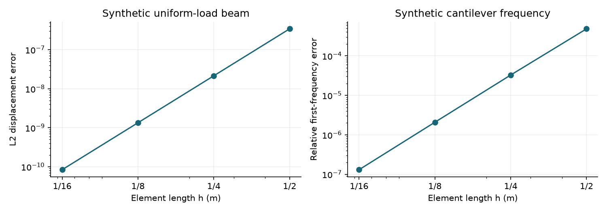
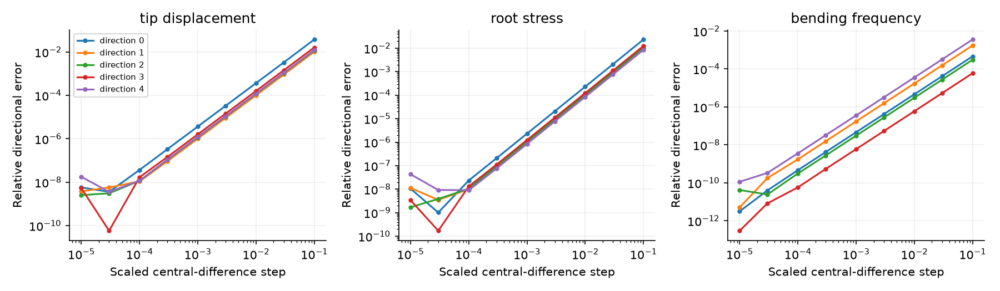
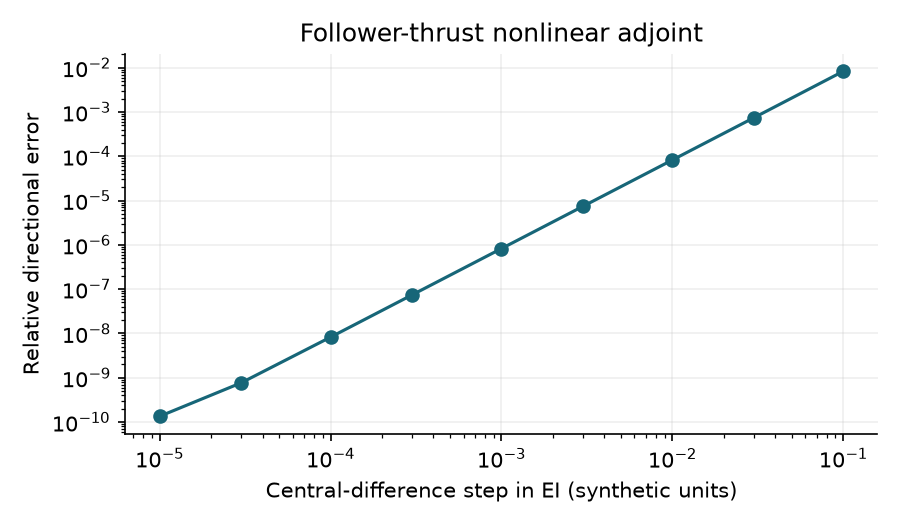
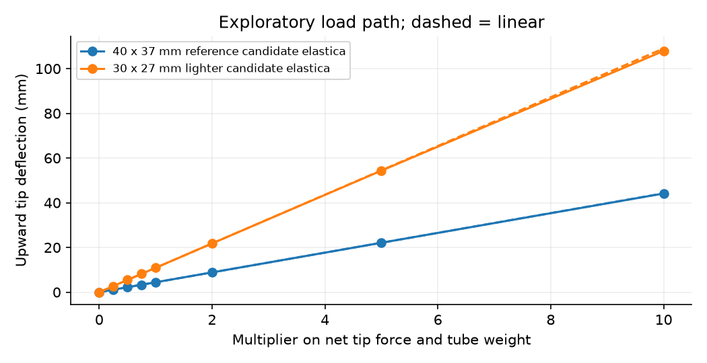
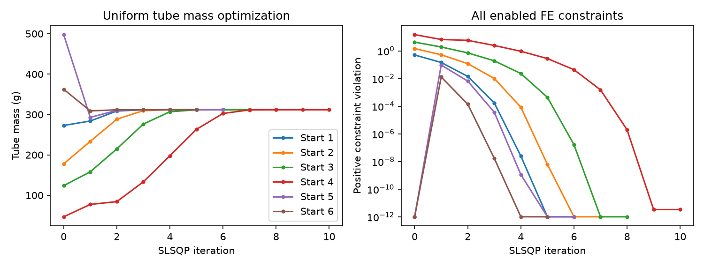

# A uniform carbon-fiber arm for coaxial rotors

**Working engineering report, 23 November 2026.** Core numerical verification: **42/42 checks passed**. The current uniform-tube optimizer uses an explicitly estimated effective material profile. Its safety-factor claim applies to nominal material-strength checks; shell failure, joints, laminate interaction and dynamic stability remain unverified.

The preliminary optimizer selects a **55.285 mm OD, 2.01 mm wall** uniform tube weighing **311.71 g**. Its minimum modeled nominal strength SF is **36.81024**. It has **1.2 mm linear tip deflection** and a **58.33 Hz** unloaded bending frequency. The configured minimum bending frequency is **58.33 Hz**; this does not establish operating dynamic stability.

All numerical tables and the viewer are generated from `assets/results.json`. The legacy 30/40 mm stock comparison is retained below as source-backed preliminary analysis. Both stock examples have 1.5 mm walls and **do not meet the user's updated wall > 2 mm requirement**.

## 1. Design brief and evidence

The team specified a uniform hollow circular carbon-fiber tube, 2 ft long, supporting 30 lbf **combined** coaxial thrust and a 1.5 lb combined motor assembly. Both rotors operate at 3,500 RPM with two blades each. Applied torque is zero. Thrust rotates with the motor mount. The objective is minimum total weight while maintaining safety factor 2, with **wall thickness strictly greater than 2 mm**. The arm is represented as horizontal with an ideal fixed root. The listed 1.5 lb is used once as the tip mass; any uncounted propeller, mount, wiring, or fitting mass must be added.

Using SI units, $L=0.6096\,\mathrm{m}$, $T=133.446648\,\mathrm{N}$, $m_t=0.680388555\,\mathrm{kg}$ and $g=9.80665\,\mathrm{m/s^2}$. Thrust alone produces a root bending moment of **81.349077 N m**, despite zero applied torque. The motor weight and tube self-weight oppose the upward thrust. [NIST conversion reference](https://www.nist.gov/pml/special-publication-811/nist-guide-si-appendix-b-conversion-factors/nist-guide-si-appendix-b8).

The shaft frequency is **58.333333 Hz** and each rotor's two-blade passing frequency is **116.666667 Hz**. Two coaxial rotors do not automatically double either frequency; their relative phase and aerodynamic interaction determine additional forcing. The supplied `optimize_arm.py` explicitly requires the first bending frequency to reach the 1x shaft rate; the integrated study retains this as an editable rotor multiple. No additional frequency separation margin or deflection limit is assumed. Meeting an unloaded frequency threshold does not establish operating dynamic stability.

### Proposed commercial material

The Easy Composites CFT-WF family uses roll-wrapped 0/90 reinforcement with a woven outer finish. Its datasheet reports **typical** longitudinal tensile modulus 64 GPa and tensile strength 650 MPa. We use that modulus as a preliminary effective bending modulus. This is an assumption about $EI$, not a ply-level laminate calculation. The sheet explicitly disallows treating its typical values as specification limits. [CFT-WF datasheet](https://media.easycomposites.co.uk/datasheets/EC-TDS-Carbon-Fibre-Woven-Finish-Tube.pdf).

The reference is 40 mm OD / 37 mm ID, published line mass 275.6 g/m; the lighter comparison is 30 mm OD / 27 mm ID, 193.8 g/m. Both have 1.5 mm nominal walls. Published line masses are used directly, without inventing one common density. [40 mm product](https://www.easycomposites.co.uk/40mm-woven-finish-carbon-fibre-tube), [30 mm product](https://www.easycomposites.co.uk/30mm-woven-finish-carbon-fibre-tube).

Comparable roll-wrapped products provide **comparison data**. ACP publishes compressive strength 132 ksi (about 910 MPa), but its modulus and laminate differ. Graphtek's GR-CFRWT sheet lists compression 910.1 MPa and torsional strength 103.4 MPa. Torsional strength is not automatically a transverse or interlaminar shear allowable. ACP's web page prints a strength in modulus units for its torsional entry; that ambiguous entry was excluded. The user authorized estimated properties for optimization: `optimizer_inputs.json` records their transfer assumptions explicitly, while `inputs.json` preserves the original material-data gaps. [ACP technical data](https://acpcomposites.com/shop/tubes-rods/roll-wrapped-tubing/carbon-fiber-uni-roll-wrapped-tubes), [Graphtek sheet](https://www.graphitestore.com/core/media/media.nl?c=4343521&h=22DqRe5XcXtOFJUqMtPHOuVeC4o8PE9P-gnJuKBYWPrJ3COD&id=9929).

## 2. Formulation and unresolved requirements

For a uniform tube the physical sizing variables are $d=(D,t)$, with inner diameter $D_i=D-2t$ and $D>2t>0$. The section formulas are

$$A=\frac{\pi}{4}(D^2-D_i^2),\qquad I=\frac{\pi}{64}(D^4-D_i^4).$$

For stock tubes the objective is $\min_j g(m_t+\mu_j L)$ over an explicitly documented catalogue. For a custom uniform laminate with validated density and manufacturing bounds it becomes $\min_{D,t} g[m_t+\rho A(D,t)L]$. These are different optimization problems: a continuously optimized dimension is not automatically an available stock tube.

The intended nominal strength constraints are

$$g_t=2\sigma_{t,\max}/X_t-1\le0,\qquad g_c=2|\sigma_{c,\max}|/X_c-1\le0,\qquad g_s=2\tau_{\max}/S-1\le0.$$

Here $X_t,X_c,S$ must be applicable laminate/tube allowables. This maximum-stress screen alone does not cover interaction, delamination, crushing at clamps, ovalization, or local buckling. A full safety factor is the smallest valid reserve factor across the relevant failure modes. Von Mises yield stress is not a carbon-fiber failure criterion. The reported $650\,\mathrm{MPa}/\sigma_b$ is only a typical tensile-property ratio.

Configurable constraints are $|w(L)|/w_{allow}-1\le0$, $f_{min}/f_1-1\le0$ and $|z_{NL}(L)|/w_{allow}-1\le0$. The integrated default study enables $f_{min}=\mathrm{RPM}/60$ from the supplied script; displacement limits remain unset. No limits are inferred from the bridge example. Explicit preliminary geometry bounds are recorded in the optimization section. Using twice the loads and also halving the allowable would double-count the requested factor.

Diameter and wall bounds are mathematically necessary for a strength-only continuous study. In the thin-wall limit, $A\approx\pi Dt$ and the bending section modulus is $Z\approx\pi D^2t/4$. Holding bending strength fixed permits $t\propto D^{-2}$, so tube mass decreases as $D^{-1}$. Without a diameter bound, minimum wall, restricted stock catalogue, or a validated local-failure constraint, that model has no finite minimum-mass tube. A numerical optimizer reaching an arbitrary search boundary would not resolve this modeling issue.

The [course assignment](https://designinformaticslab.github.io/DesignOptimization2025/project4.html) expects a substantial differentiable design problem and a nonlinear-design comparison. The chosen uniform tube has **two** physical sizing variables. The team should confirm this scope with the instructor; adding artificial independent dimensions to the mesh would contradict the uniform-tube brief. The current work includes a two-variable constrained optimizer, KKT checks and a with/without-N2 comparison. The general 3D-frame and laminate-analysis expectations still need scope agreement.

## 3. Linear analysis model

In the loaded bending plane, the Euler-Bernoulli equation is $(EIw'')''=q$, where $q=-\mu g$. The root has $w(0)=w'(0)=0$. The initial net transverse tip force is $P=T-m_tg$ and the applied tip bending moment is zero. With $+z$ upward,

$$w(L)=\frac{PL^3}{3EI}+\frac{qL^4}{8EI},\qquad M(x)=P(L-x)+\frac{q}{2}(L-x)^2,\qquad \sigma_b(x)=\frac{|M(x)|D}{2I}.$$

`arm.py` assembles an original sparse cubic-Hermite bending FE solver, with consistent distributed loading and consistent translational mass, using $[w,w']$ at each node. The production linear mesh contains 20 elements. The fixed root is removed from the solve; support reactions are recovered from the unmodified system. A point tip mass enters the translational mass matrix exactly once. The independent FE modal comparison solves $K\phi=\omega^2M\phi$. Default vibration frequencies and shapes now use the uniform cantilever with a tip mass in Yntema, NACA TN 3459, printed page 17, equations (13)-(14), implemented in `vibration.py`.

Define $r=m_t/(\mu L)$ and take each positive root $\beta_n$ of

$$H(\beta,r)=1+\cos\beta\cosh\beta-r\beta(\sin\beta\cosh\beta-\cos\beta\sinh\beta)=0.$$

Then $f_n=\beta_n^2\sqrt{EI/(\mu L^4)}/(2\pi)$. Equation (14) supplies mode shapes and slopes sampled at the FE nodes; normalization uses $\int_0^L\mu y_n^2\,dx+m_t y_n(L)^2=1$. These samples are continuum shapes, not exact eigenvectors of the discrete matrices. The implementation divides $H$ by $\cosh\beta$ for stable root finding. This is the paper's **nonrotating** beam case: the arm is fixed, while motor RPM sets only the sizing target. No rotating-blade centrifugal stiffening is inferred. [NACA TN 3459, equations (13)-(14)](https://ntrs.nasa.gov/api/citations/19930084187/downloads/19930084187.pdf#page=21).

This reduced model is suitable for preliminary bending of a straight circular tube under planar loads. It does not include axial stretch, transverse shear deformation, torsional modes, rotor inertia, gyroscopic effects, clamp compliance, laminate coupling, or shell deformation. The displayed frequency is a **bending frequency**, not a verified lowest frequency of every possible aircraft-arm mode. Out-of-plane bending is degenerate only under the assumed circumferentially uniform effective stiffness. Zero net torque does not remove possible torsional dynamics.

The homogeneous-section shear screen uses $\tau_{NA}=V(R^3-r_i^3)/(3It)$, derived from $VQ/(Ib)$ with $Q=2(R^3-r_i^3)/3$ and $b=2t$. It is reported to expose a missing failure check, not as a validated composite shear prediction.

## 4. Legacy stock-tube comparison (1.5 mm walls, excluded from new design)

| Quantity | 40 x 37 mm reference candidate | 30 x 27 mm lighter candidate |
|---|---:|---:|
| Tube mass (g) | 168.01 | 118.14 |
| Tube + coaxial assembly mass (g) | 848.39 | 798.53 |
| Peak nominal bending stress (MPa) | 45.612 | 84.390 |
| Homogeneous-section shear screen (MPa) | 1.396 | 1.884 |
| Typical tensile strength / bending stress (NOT overall SF) | 14.25 | 7.70 |
| Comparable-product compression / bending stress (estimate only) | 19.95 | 10.78 |
| Minimum axial tensile AND compressive strength needed for SF 2 (MPa) | 91.225 | 168.780 |
| Minimum homogeneous shear strength needed for SF 2 (MPa) | 2.792 | 3.769 |
| Linear upward tip deflection (mm) | 4.4213 | 10.9015 |
| First bending frequency with tip mass (Hz) | 31.682 | 20.359 |
| Nonlinear continuum reference tip deflection (mm) | 4.4212 | 10.9004 |
| Nonlinear change from linear (%) | -0.00166 | -0.01013 |
| Overall SF >= 2 | UNRESOLVED | UNRESOLVED |
| Deflection / frequency acceptance | Limits pending | Limits pending |

Dimensions and material values are nominal. No tolerance, damage, fatigue, environmental or joint knockdown has been applied. The candidates were chosen to compare two sourced uniform products; the catalogue has not been exhaustively searched. Neither is designated a final selection.

The comparison compression ratios use the separately sourced 910.1 MPa value only as an explicit estimate. The required-strength rows invert the SF 2 screen: they state what applicable material strengths would have to exceed, before other failure modes are considered. They do not establish those strengths for the selected tube. This makes new test data easy to assess without changing the structural calculation.

## 5. Numerical verification

`verify.py` uses deliberately synthetic beam properties: $L=1$ m, $E=70$ GPa, $D=40$ mm, $t=2$ mm, $\mu=0.4$ kg/m and a 100 N tip-force fixture. These are numerical fixtures, not claimed carbon-fiber material data. Closed-form targets are separate from the FE assembly. The nonlinear reference is an independently implemented continuum boundary-value solve; it is a numerical reference, not an exact closed-form value.

For a cantilever, integrating the bending equation gives $w(L)=PL^3/(3EI)$ and $w'(L)=PL^2/(2EI)$; uniform load gives $qL^4/(8EI)$. The simply supported uniform-load midpoint is $5qL^4/(384EI)$. [University mechanics derivation](https://mechanics.ju.se/SolidMechanics/EnergyMethods.html).

The zero-tip-mass limit recovers $1+\cos\beta\cosh\beta=0$. The independent FE eigenproblem is compared with the analytical roots both with and without a tip mass, including the first three modes of the tip-mass fixture. The FE modal refinement plot retains the matrix eigensolver so that it measures discretization error; the default analytical frequencies are independent of mesh size.

| Check | Unit | Computed | Reference | Error | Acceptance |
|---|---|---:|---:|---:|---|
| V1 tip force: displacement | m | 0.011018911 | 0.011018911 | 1.74e-13 (relative) | PASS; <= 1e-09 |
| V1 tip force: slope | rad | 0.016528366 | 0.016528366 | 1.64e-13 (relative) | PASS; <= 1e-09 |
| V1 root moment magnitude | N m | 100 | 100 | 1.49e-13 (relative) | PASS; <= 1e-09 |
| V2 uniform load: tip | m | -0.00041320915 | -0.00041320915 | 1.81e-13 (relative) | PASS; <= 1e-09 |
| V2 simply supported midspan | m | -4.304262e-05 | -4.304262e-05 | 7.87e-16 (relative) | PASS; <= 1e-09 |
| V3 displacement L2 convergence order | 1 | 3.9999989 | 4 | 2.77e-07 (relative) | PASS; <= 0.01 |
| V4 cantilever frequency | Hz | 48.664357 | 48.66435 | 1.31e-07 (relative) | PASS; <= 2e-06 |
| V4 frequency convergence order | 1 | 3.9292664 | 4 | 0.0177 (relative) | PASS; <= 0.035 |
| V4 frequency including tip mass | Hz | 16.030337 | 16.030337 | 1.42e-09 (relative) | PASS; <= 2e-06 |
| V4 NACA eq13 zero tip mass | Hz | 48.66435 | 48.66435 | 0 (relative) | PASS; <= 1e-12 |
| V4 NACA eq13 including tip mass | Hz | 16.030337 | 16.030337 | 1.55e-15 (relative) | PASS; <= 1e-12 |
| V4 NACA versus FE mode 1 | Hz | 16.030337 | 16.030337 | 2.47e-09 (relative) | PASS; <= 1e-05 |
| V4 NACA versus FE mode 2 | Hz | 219.527 | 219.52689 | 4.99e-07 (relative) | PASS; <= 1e-05 |
| V4 NACA versus FE mode 3 | Hz | 698.2377 | 698.23406 | 5.22e-06 (relative) | PASS; <= 1e-05 |
| V5 free-free bending rigid modes | 1 | 2 | 2 | 0 (relative) | PASS; <= 0 |
| V5 consistent mass translation | kg | 0.4 | 0.4 | 0 (relative) | PASS; <= 1e-12 |
| V5 force balance residual | N | 6.5085715e-12 | 0 | 6.51e-12 (absolute) | PASS; <= 1e-07 |
| V5 moment balance residual | N m | -2.3874236e-11 | 0 | 2.39e-11 (absolute) | PASS; <= 1e-07 |
| V6 tip_displacement gradient direction 0 | m | -0.032688823 | -0.032688823 | 3.6e-09 (relative) | PASS; <= 2e-05 |
| V6 tip_displacement gradient direction 1 | m | -0.0087934139 | -0.0087934139 | 3.8e-09 (relative) | PASS; <= 2e-05 |
| V6 tip_displacement gradient direction 2 | m | -0.017099831 | -0.017099831 | 2.54e-09 (relative) | PASS; <= 2e-05 |
| V6 tip_displacement gradient direction 3 | m | -0.022518873 | -0.022518873 | 5.79e-11 (relative) | PASS; <= 2e-05 |
| V6 tip_displacement gradient direction 4 | m | -0.011418653 | -0.011418653 | 3.57e-09 (relative) | PASS; <= 2e-05 |
| V6 root_stress gradient direction 0 | Pa | 93248350 | 93248350 | 1.01e-09 (relative) | PASS; <= 2e-05 |
| V6 root_stress gradient direction 1 | Pa | 36739926 | 36739926 | 3.51e-09 (relative) | PASS; <= 2e-05 |
| V6 root_stress gradient direction 2 | Pa | 60022557 | 60022557 | 1.7e-09 (relative) | PASS; <= 2e-05 |
| V6 root_stress gradient direction 3 | Pa | 74655520 | 74655520 | 1.7e-10 (relative) | PASS; <= 2e-05 |
| V6 root_stress gradient direction 4 | Pa | 22998329 | 22998329 | 9.02e-09 (relative) | PASS; <= 2e-05 |
| V6 bending_frequency gradient direction 0 | Hz | 32.375386 | 32.375386 | 3.15e-12 (relative) | PASS; <= 2e-05 |
| V6 bending_frequency gradient direction 1 | Hz | 8.7090983 | 8.7090983 | 5.06e-12 (relative) | PASS; <= 2e-05 |
| V6 bending_frequency gradient direction 2 | Hz | 16.93587 | 16.93587 | 2.43e-11 (relative) | PASS; <= 2e-05 |
| V6 bending_frequency gradient direction 3 | Hz | 22.302951 | 22.302951 | 2.97e-13 (relative) | PASS; <= 2e-05 |
| V6 bending_frequency gradient direction 4 | Hz | 11.309165 | 11.309165 | 1.13e-10 (relative) | PASS; <= 2e-05 |
| V7 nonlinear tip vs independent BVP | m | 0.71377253 | 0.71379152 | 2.66e-05 (relative) | PASS; <= 0.0001 |
| V7 pure moment circle x | m | 0.58333224 | 0.58333224 | 3.81e-16 (relative) | PASS; <= 1e-11 |
| V7 pure moment circle z | m | 0.66402617 | 0.66402617 | 3.34e-16 (relative) | PASS; <= 1e-11 |
| V7 consistent tangent relative error | 1 | 1.9539947e-16 | 0 | 1.95e-16 (absolute) | PASS; <= 1e-12 |
| V8 nonlinear implicit EI gradient | m / (N m2) | -0.18089454 | -0.18089454 | 2.91e-11 (relative) | PASS; <= 1e-06 |
| V9 follower tip vs independent BVP | m | 0.28690538 | 0.28691646 | 3.86e-05 (relative) | PASS; <= 0.0001 |
| V9 follower nonsymmetric tangent | 1 | 2.0188919e-16 | 0 | 2.02e-16 (absolute) | PASS; <= 1e-12 |
| V9 follower transposed adjoint | m / (N m2) | -0.2732302 | -0.27323021 | 8.25e-09 (relative) | PASS; <= 1e-06 |
| V7 Newton convergence order | 1 | 1.8462876 | 2 | 0.0769 (relative) | PASS; <= 0.2 |

The free-free check correctly has two rigid modes in the scalar bending subspace; it is not claimed to demonstrate six rigid modes of a 3D frame. This model does not use coordinate transformation matrices, so a 3D rotation-invariance test remains necessary if the solver is extended to a 3D frame. A team member still needs to derive or independently review the benchmark targets, as the assignment asks; these agent-written checks do not substitute for that human review.

The uniform-load displacement is quartic, so the cubic FE field has nonzero interpolation error even when nodal deflections are exact. The observed field convergence is approximately fourth order. The modal refinement also approaches fourth order; neither check relies on a tip value that is already exact.

## 6. Adjoint and eigenvalue sensitivities

With $h(d,u)=K(d)u-F(d)=0$, any scalar output $Q(d,u)$ has

$$K^Ta=Q_u^T,\qquad \frac{dQ}{dd_j}=Q_{d_j}-a^T(K_{d_j}u-F_{d_j}).$$

The tip-displacement output selects the tip translation. The root-stress output also differentiates its section and element-force dependence. Complex-step calculations supply partial derivatives with the state held fixed; the state dependence is handled by the transposed linear solve, not by differencing converged states. The original solver fixtures hold line mass fixed. The new optimizer instead uses $\mu=\rho(t)A(D,t)$, differentiating mass, self-weight, inertia, section stiffness and any tabulated properties. Its separate gradient checks and unit tests cover those dependencies, including nonlinear adjoints and optional frequency/deflection constraints.

The default vibration sensitivities differentiate the characteristic root implicitly: $\partial\beta/\partial r=-H_r/H_\beta$. Hence

$$d\ln f=\tfrac12d\ln(EI)-\tfrac12d\ln\mu-2d\ln L+\frac{2}{\beta}\frac{\partial\beta}{\partial r}\,dr,\qquad r=\frac{m_t}{\mu L}.$$

The optimizer includes both section/material stiffness changes and the density-dependent line-mass changes in this expression. Central-difference checks include tabulated thickness-dependent modulus and density. For comparison, a mass-normalized FE bending eigenvector obeys

$$\frac{d\omega^2}{dd_j}=\phi^T(K_{d_j}-\omega^2 M_{d_j})\phi,\qquad \frac{df}{dd_j}=\frac{1}{8\pi^2 f}\frac{d\omega^2}{dd_j}.$$

The check sweeps central-difference step sizes in two coordinate directions and three seeded random directions for displacement, stress, and frequency. Coarse-step errors fall approximately quadratically; cancellation appears at small steps, especially for eigenvalues. The table records the best step for each direction, while the plot exposes the whole sweep.

For the synthetic eight-element, two-variable fixture, measured tip-gradient time is **1.718 ms** with the adjoint and **2.832 ms** with central differences. This small problem does not demonstrate the large-variable advantage required in a substantial adjoint study. Timings are machine-dependent and are regenerated on each run.

## 7. N2: large rotation with motor-following thrust

Let $s$ be undeformed arc length, $\theta(s)$ the centerline angle, $x'=\cos\theta$ and $z'=\sin\theta$. The thrust vector is $T[-\sin\theta_L,\cos\theta_L]$, normal to the tip tangent. Gravity remains vertical. The inextensible planar equilibrium is

$$ (EI\theta')'+T\cos(\theta_L-\theta)+[-m_tg-\mu g(L-s)]\cos\theta=0,\quad \theta(0)=0,\quad EI\theta'(L)=0.$$

Linear angle elements and four-point Gauss integration produce the residual. Newton iteration uses load stepping, residual line search and the consistent **nonsymmetric** tangent. A follower force has no general potential energy; a symmetric energy Hessian would omit its dependence on the unknown tip angle. The nonlinear adjoint therefore solves $R_\theta^Ta=Q_\theta^T$, then $dQ/dd=Q_d-a^TR_d$. The ladder checks this transposed solve and the full follower tangent.

A pure end-moment fixture has the exact circular solution $x(L)=L\sin\alpha/\alpha$, $z(L)=L(1-\cos\alpha)/\alpha$, $\alpha=ML/EI$. Dead transverse-load and follower-load solutions are also compared with separate continuum BVP implementations. The [Abaqus nonlinear cantilever benchmarks](https://docs.software.vt.edu/abaqusv2025/English/SIMACAEBMKRefMap/simabmk-c-nlgeocantilever.htm) motivate the dead-load and pure-moment checks; they do not validate this code's follower-force implementation by themselves.

| Tube | Elements | Nonlinear FE tip (mm) | Relative difference from continuum BVP |
|---|---:|---:|---:|
| 40 x 37 mm reference candidate | 40 | 4.420548 | 0.000156 |
| 40 x 37 mm reference candidate | 80 | 4.421066 | 3.9e-05 |
| 40 x 37 mm reference candidate | 160 | 4.421195 | 9.75e-06 |
| 30 x 27 mm lighter candidate | 40 | 10.898712 | 0.000156 |
| 30 x 27 mm lighter candidate | 80 | 10.899988 | 3.9e-05 |
| 30 x 27 mm lighter candidate | 160 | 10.900306 | 9.75e-06 |

The nonlinear EI-sensitivity step sweep checks the transposed tangent adjoint against separate converged solves. The optimization section adds complete OD/wall geometry-variable checks with density-dependent mass and loading.

The results table compares the linear solution with the continuum nonlinear reference to separate physical nonlinearity from the lower-order angle-element error. The final nonlinear FE mesh has 160 elements. The exploratory path below multiplies thrust **and both gravity contributions** together; it is a numerical load-factor experiment, not an RPM/throttle prediction or a proof of strength at increased loads.

The 3D linear state is sampled with cubic Hermite interpolation including nodal slopes. The nonlinear state is drawn from the 160-element FE angle field, integrated within each element; the independent BVP curve is retained separately in the results file. The table distinguishes the continuum reference from the FE values.

Nonconservative follower-force systems can require a dynamic flutter analysis. A converged static solution does not prove dynamic stability. Local shell buckling and Brazier ovalization are also absent. The next section reports optimized designs with and without the follower-force constraints under the stated estimated material and preliminary bounds.

## 8. Constrained mass optimization and KKT checks

The constrained sizing search in `optimize_arm.py` uses the existing `optimize.TubeModel`, `arm.Beam` and `arm.Elastica` FEM and adjoints. Edit `optimizer_inputs.json` and run `python optimize_arm.py --update-report`; `optimize.py` remains a compatible entry point.

The user now requires **wall thickness strictly greater than 2 mm**. The numerical lower bound is 2.01 mm; a 0.01 mm difference is not a manufacturing allowance. The OD interval is 10-60 mm and the wall upper bound is 3 mm, both explicit provisional study bounds. The reference 40 mm OD / 2.5 mm wall tube is an analyst-selected starting design under the same mass/material model. The original 1.5 mm stock candidates are excluded by the updated wall requirement.

The effective material profile uses $E=64$ GPa, $\rho=1520$ kg/m3, $X_t=650$ MPa, $X_c=910.1$ MPa and $S=103.4$ MPa. The modulus/tensile value comes from CFT-WF typical data; density/compression are comparison estimates. The torsional strength is used as an **unverified longitudinal-shear proxy**, not an interlaminar allowable. These are explicit cross-product estimates authorized for this preliminary study, not measured properties of a new laminate. No interpolation endpoints were invented: the default profile is constant; an optional property table supports piecewise-linear thickness interpolation inside its data range only.

[CFT-WF source](https://media.easycomposites.co.uk/datasheets/EC-TDS-Carbon-Fibre-Woven-Finish-Tube.pdf), [Graphtek comparison source](https://www.graphitestore.com/core/media/media.nl?c=4343521&h=22DqRe5XcXtOFJUqMtPHOuVeC4o8PE9P-gnJuKBYWPrJ3COD&id=9929).

The objective is tube mass $m=\rho A L$. The configured tip assembly mass is constant within each sizing run, so minimizing total modeled mass gives the same geometry. SLSQP minimizes mass divided by reference mass, with design variables scaled by reference OD and wall. At 21 fixed arc-length stations, both outer-fiber normal stresses $N/A\pm MD/(2I)$ and nominal section shear are evaluated. Each failure family uses the smooth upper bound $\mathrm{KS}_{80}(2\sigma/X)-1\le0$ (and the corresponding shear ratio). Thus a feasible aggregate implies every sampled nominal stress has SF at least 2. Linear stresses recover the exact uniform-load moment field from FE reactions; nonlinear resultants come from equilibrium on the deformed FE centerline, including tip-following thrust and vertical gravity.

The study with N2 retains the three linear strength constraints and adds three follower-load strength constraints. A minimum bore of 1 mm keeps a hollow section. The reported SF is the minimum unaggregated reserve factor across linear/nonlinear tension, compression and shear.

The supplied script's frequency requirement is retained: the configured minimum is **58.333333 Hz**. The default rotor multiple is 1, so this is recalculated from the operating RPM divided by 60. It is a preliminary sizing criterion; rotor harmonics, gyroscopic coupling and flutter are not assessed.

No deflection limit is configured. The supplied file's stiffness/travel defaults were in missing dependency modules and have not been guessed.

The starting 40 mm / 2.5 mm tube fails an enabled constraint; use the feasible fixed-wall reference below for a like-for-like mass saving.

| Quantity | Starting design | Linear constraints | Linear + follower constraints | Rounded candidate |
|---|---:|---:|---:|---:|
| OD (mm) | 40.00000 | 55.28482 | 55.28482 | 55.30000 |
| Wall (mm) | 2.50000 | 2.01000 | 2.01000 | 2.10000 |
| Tube mass (g) | 272.9039 | 311.7141 | 311.7141 | 325.2141 |
| Minimum modeled SF | 22.102185 | 36.810241 | 36.810241 | 38.311545 |
| Linear tip deflection (mm) | 2.854 | 1.240 | 1.240 | 1.191 |
| Nonlinear FE tip deflection (mm) | 2.853 | Not evaluated | 1.240 | 1.191 |
| First unloaded bending frequency (Hz) | 38.714 | 58.333 | 58.333 | 59.378 |

The rounded geometry is a checked custom-tube candidate, not a verified stock product or a manufacturing tolerance analysis. Its nominal reserve must still cover any real geometric tolerance and property knockdown.

### Optimizer verification and convergence

All **18** mass/constraint partial-and-adjoint checks passed against central differences, including the density-dependent self-weight. Optimizer unit tests separately check the closed-form static solution, optional deflection/frequency gradients, tabulated properties, the follower tangent, an independent exact strength-only lower bound, infeasibility handling, the strict wall rule, rejection of nonstationary solver successes, recovery from failed starts, frequency-reference crossings, and shadow prices against reoptimization.

| Response | Variable | Adjoint/direct analytic | Central difference | Relative error |
|---|---|---:|---:|---:|
| linear_tension | OD_mm | -0.0071113296 | -0.0071113295 | 1.48e-08 |
| linear_compression | OD_mm | -0.0048538197 | -0.0048538197 | 1.46e-08 |
| linear_shear | OD_mm | -0.00058327056 | -0.00058327055 | 3.32e-08 |
| nonlinear_tension | OD_mm | -0.0071090799 | -0.0071090801 | 2.67e-08 |
| nonlinear_compression | OD_mm | -0.0048550498 | -0.0048550499 | 2.77e-08 |
| nonlinear_shear | OD_mm | -0.00058322439 | -0.00058322439 | 1.13e-08 |
| bending_frequency | OD_mm | -0.083073316 | -0.083073317 | 1.66e-08 |
| inner_diameter | OD_mm | -0.1 | -0.1 | 8.41e-13 |
| mass | OD_mm | 0.0072919914 | 0.0072919914 | 2.34e-12 |
| linear_tension | wall_mm | -0.035207149 | -0.035207142 | 2.16e-07 |
| linear_compression | wall_mm | -0.024026153 | -0.024026147 | 2.27e-07 |
| linear_shear | wall_mm | -0.0071017476 | -0.0071017477 | 2.63e-08 |
| nonlinear_tension | wall_mm | -0.035195151 | -0.035195151 | 1.1e-08 |
| nonlinear_compression | wall_mm | -0.024033122 | -0.024033122 | 1.13e-08 |
| nonlinear_shear | wall_mm | -0.0071015319 | -0.007101532 | 1e-08 |
| bending_frequency | wall_mm | -0.26317489 | -0.2631749 | 7.36e-09 |
| inner_diameter | wall_mm | 0.2 | 0.2 | 1.16e-12 |
| mass | wall_mm | 0.087300129 | 0.087300129 | 2.05e-13 |

| Case | Start | Solver success | Accepted (incl. KKT) | Tube mass (g) | Solver message |
|---|---:|---|---|---:|---|
| Linear | 1 | True | True | 311.71409 | Optimization terminated successfully |
| Linear | 2 | True | True | 311.71409 | Optimization terminated successfully |
| Linear | 3 | True | True | 311.71409 | Optimization terminated successfully |
| Linear | 4 | True | True | 311.71409 | Optimization terminated successfully |
| Linear | 5 | True | True | 311.71409 | Optimization terminated successfully |
| Linear | 6 | True | True | 311.71409 | Optimization terminated successfully |
| Linear + follower | 1 | True | True | 311.71409 | Optimization terminated successfully |
| Linear + follower | 2 | True | True | 311.71409 | Optimization terminated successfully |
| Linear + follower | 3 | True | True | 311.71409 | Optimization terminated successfully |
| Linear + follower | 4 | True | True | 311.71409 | Optimization terminated successfully |
| Linear + follower | 5 | True | True | 311.71409 | Optimization terminated successfully |
| Linear + follower | 6 | True | True | 311.71409 | Optimization terminated successfully |

Configured starts, both bounding-box corners, and a feasible fixed-wall reference are searched, with duplicate starts removed. Only solver-successful, feasible runs passing primal, dual, stationarity and complementarity tolerances are eligible. A failed start is recorded and the remaining starts continue.

The fixed-wall nominal reference uses **52.300 mm OD / 2.500 mm wall**, at **362.416 g**. Its OD is screened on a 0.1 mm grid and it passes all enabled constraints.

Optimizing both dimensions saves **13.990%** tube mass relative to this feasible fixed-wall reference.

### KKT interpretation

| Active requirement | Scaled multiplier | Residual |
|---|---:|---:|
| bending_frequency | 0.78795151 | -9.99e-16 |
| wall_lower_bound | 0.39090122 | 0 |

Stationarity infinity norm: **4.44e-16**; complementarity infinity norm: **7.87e-16**; maximum violation: **0**. Multipliers are reconstructed by nonnegative least squares using mass/reference-mass and dimensions/reference-dimensions. The table converts bound multipliers back to the mm convention; JSON also records kg/mm, active-set rank and all four acceptance checks. This is local optimality evidence, not proof of a global optimum.

The wall lower bound is active: increasing it by 0.1 mm has a local predicted mass cost of approximately **10.668 g**, while the active set remains unchanged.

| Tightened active requirement | Step | Predicted mass change (g) | Reoptimized mass change (g) |
|---|---:|---:|---:|
| wall_lower_bound | 0.001 mm | 0.106678 | 0.106671 |
| bending_frequency | 0.01 Hz | 0.036863 | 0.036862 |

These perturbations check local multiplier predictions; their sizes are numerical steps, not manufacturing tolerances.

### Nonlinear and mesh comparison

Adding follower-load constraints changes the optimized mass by **0%**. The selected active requirements are **bending_frequency, wall_lower_bound**. This comparison applies to the configured load, frequency and strength limits; it does not establish dynamic stability.

| Linear elements | Nonlinear elements | Minimum modeled SF | Nonlinear tip (mm) | First frequency (Hz) | Max constraint residual |
|---:|---:|---:|---:|---:|---:|
| 20 | 40 | 36.81024116 | 1.239973 | 58.333333 | -9.99e-16 |
| 40 | 80 | 36.81024116 | 1.240118 | 58.333333 | -9.99e-16 |
| 80 | 160 | 36.81024118 | 1.240154 | 58.333333 | -9.99e-16 |

The continuous optimum passes the refined nominal strength checks. Section shear remains a homogeneous-section screen. Shell buckling, joints, laminate interaction, damage and dynamic follower-force stability are unassessed. Therefore the **overall structural SF remains unresolved**, even though the specified nominal material-strength model meets SF 2.

## 9. Limitations and work remaining

- Obtain applicable compression, shear, local shell-failure and joint data; retain comparison estimates as estimates.
- Set stiffness/deflection and resonance-separation requirements; confirm provisional OD and upper-wall bounds and actual manufacturing tolerances.
- Confirm the two-variable uniform-tube scope and reduced bending model with the instructor. The present model is not a general 3D frame.
- Check rotational/translational inertia and actual support stiffness. Verify the included 1.5 lb covers every carried item.
- Extend the preliminary nominal-strength optimum to a validated laminate/shell/joint design before treating it as a safe physical arm.
- Publish the team repository and enable GitHub Pages. No Git remote or deployment was provided, so no public submission has been made.

## 10. Reproduction and AI use

Run `python optimize_arm.py --update-report` in an environment installed from `requirements.txt` to rerun sizing and regenerate the report. The optimizer verifies its gradients before using them. The report step runs the core verification ladder and refuses regeneration on failure. Optimizer results are imported only when source/input fingerprints match. Edit `report_template.md` for prose; `index.md` is generated. Edit `inputs.json` for the original loads and `optimizer_inputs.json` for optimizer bounds, estimated properties, and optional limits. `README.md` gives Windows commands. `python -m unittest test_optimize test_vibration -v` runs eleven optimizer tests and seven dedicated vibration tests, including limiting cases, four-mode FE comparisons, continuum mass orthogonality and implicit-root derivatives.

The coding agent researched the linked sources, wrote the reduced FE solver, nonlinear solver, sensitivity routines, checks, viewer and report generator. The team supplied the engineering brief and clarified follower thrust. No human derivation or physical validation is claimed. A real defect caught during verification was a floating-point-only nonlinear tangent accumulator: complex-step perturbations caused a casting failure. The accumulator now preserves the perturbation dtype and the nonlinear tangent and adjoint checks pass. The dead-load formulation was also revised when the team clarified that thrust follows the motor mount; the old assumption is not used for the drone results.
