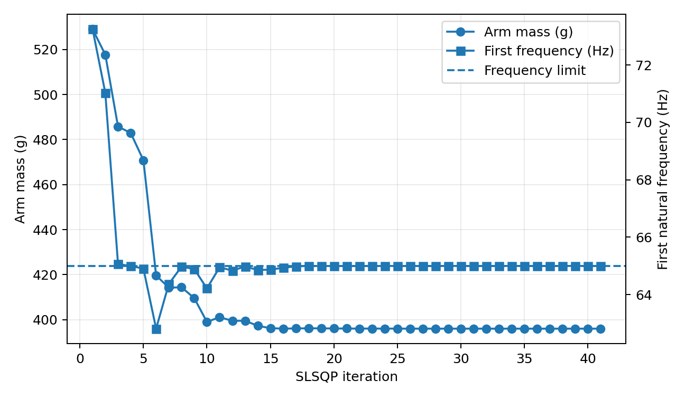
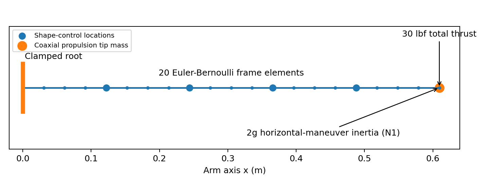
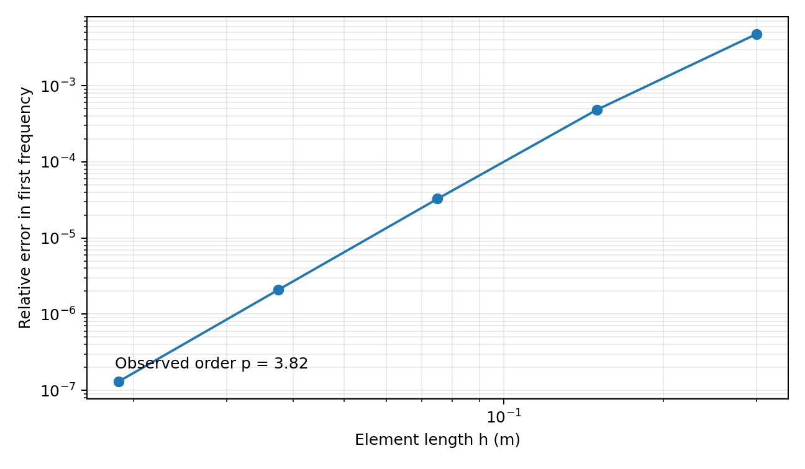
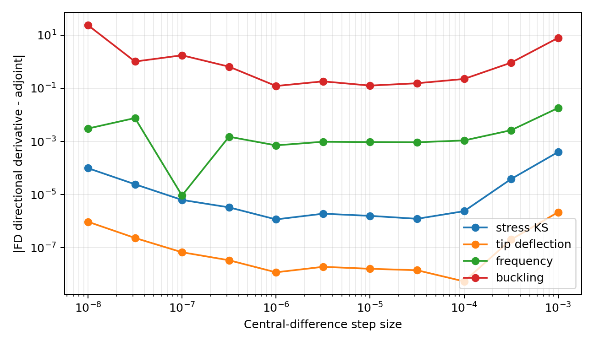
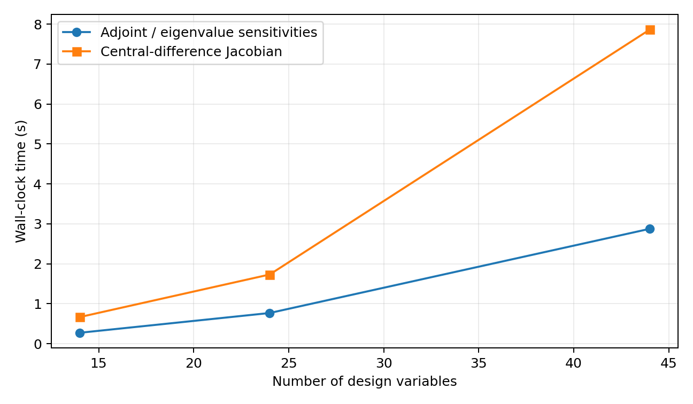
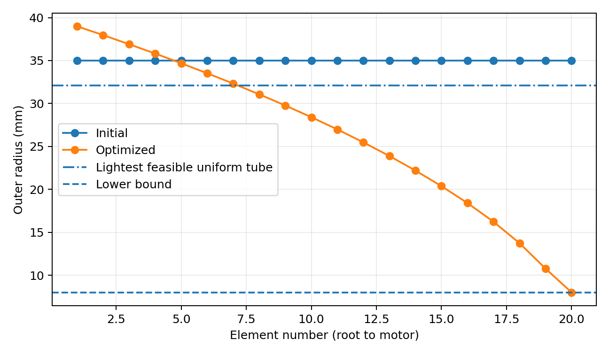
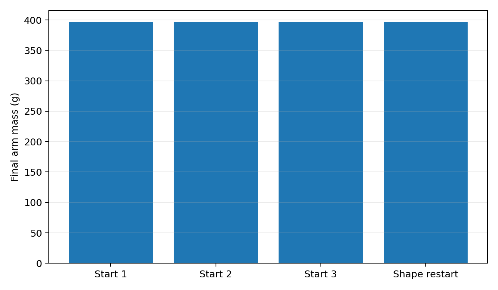
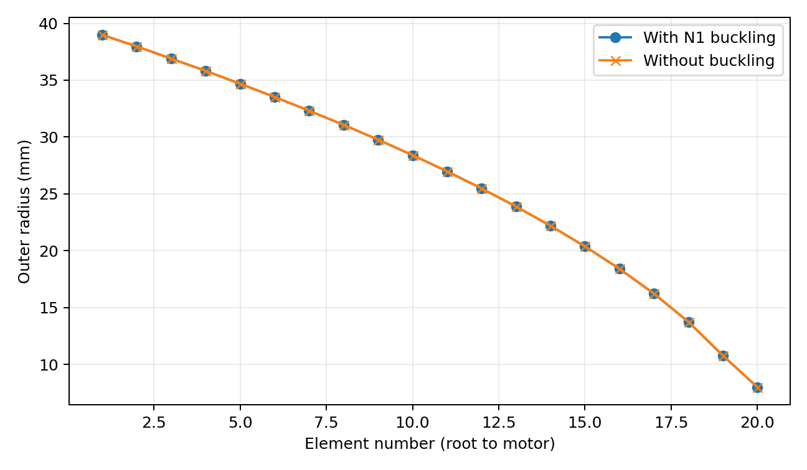

# PDE-Constrained Optimization of a Tubular Drone Arm

## 1. Summary

This project minimizes the structural mass of a **0.6096 m (2 ft) cantilevered industrial multirotor arm** using a custom three-dimensional finite-element solver and gradient-based PDE-constrained optimization. The model contains 20 Euler-Bernoulli frame elements, one independent tube-radius variable per element, and four centerline shape-control variables, giving **24 design variables**. The design must satisfy strength, tip-deflection, vibration, and N1 linear-buckling requirements.

The baseline arm has a mass of **531.30 g**. The converged design has a mass of **395.98 g**, a **25.5% reduction**, while satisfying every requirement. The active system-level constraint is the first natural frequency at **65.000 Hz**; stress, static displacement, and buckling retain substantial margin. The optimization converged from multiple radius profiles, and a separate shape-perturbation restart returned to essentially the same design basin.

<div id="viewer" style="height:560px"></div>
<div id="viewer-controls"></div>
<div id="viewer-metrics"></div>
<script type="module" src="assets/viewer.js"></script>

The viewer defaults to the **first vibration-mode amplitude**, because vibration is the governing constraint. Stress utilization remains available as a selectable field.



## 2. Structure and formulation

### 2.1 Engineering motivation and physical model

A multirotor arm should be light because structural mass reduces payload and endurance, but excessive mass reduction can lower stiffness, shift structural modes toward rotor excitation, increase deflection, or create instability. The case study represents a heavy-lift or professional-filming multirotor with six coaxial propulsion stations. One representative arm extends **2 ft (0.6096 m)** from the main frame to a coaxial motor pair and is fully fixed at the frame attachment. Each motor produces **15 lbf** maximum thrust, giving **30 lbf (133.4 N) total thrust per arm**. The combined motors, propellers, and mounting hardware are represented by a **1.5 lb (0.680 kg)** point mass at the arm tip.

The two counter-rotating motors are assumed to cancel net reaction torque to first order. The primary load is therefore transverse thrust plus gravity. A secondary stability load case represents a **2g horizontal maneuver with vehicle acceleration aligned with the representative arm axis**. The 0.680 kg propulsion assembly therefore produces **13.345 N** of compressive inertia along the arm. This is treated as a team-selected worst-case stability case rather than a certified flight-envelope requirement.



### 2.2 Material

The baseline material is isotropic 6061-T6 aluminum with $E=68.9$ GPa, $\nu=0.33$, $\rho=2700$ kg/m$^3$, and tensile yield strength $S_y=276$ MPa. The strength limit uses a design factor of 2:

$$
\sigma_{allow}=\frac{S_y}{2}=138\ \text{MPa}.
$$

**Material source:** MatWeb, "Aluminum 6061-T6; 6061-T651."

### 2.3 Design variables

The design vector is

$$
\mathbf d=[r_1,\ldots,r_{20},z_1,z_2,z_3,z_4]^T.
$$

Each element has an independent outer radius $r_i$ and a fixed wall thickness $t=1.5$ mm:

$$
8\ \text{mm}\le r_i\le40\ \text{mm}.
$$

The four shape variables move centerline control points at normalized arm locations $x/L=0.2,0.4,0.6,0.8$:

$$
-20\ \text{mm}\le z_j\le20\ \text{mm}.
$$

Piecewise-linear interpolation defines all intermediate nodal $z$ coordinates, while the clamped root and motor location remain fixed. The size bounds are team-selected geometric/manufacturing bounds: with the fixed wall thickness they prevent invalid or vanishing tubes while allowing a broad range of 16-80 mm outside diameters. The shape bounds prevent extreme centerline curvature and very short elements.

### 2.4 Objective and requirements

The objective is structural arm mass; the motor is included in the vibration mass matrix but not in the arm-mass objective:

$$
\min_{\mathbf d}\;m(\mathbf d)=\sum_{e=1}^{20}\rho A_eL_e,
\qquad
A_e=\pi\left[r_e^2-(r_e-t)^2\right].
$$

| Requirement | Explicit mathematical constraint | Limit | Basis for the limit |
|---|---|---:|---|
| Strength | $KS_\rho(\sigma_{vM}/\sigma_{allow})\le1$ | $\sigma_{allow}=138$ MPa | 6061-T6 yield divided by design factor 2 |
| Tip displacement | $\|\mathbf u_{tip}\|\le\delta_{max}$ | $\delta_{max}=6.10$ mm | Team-selected serviceability limit equal to 1% of the 2 ft arm span |
| Vibration | $f_1\ge f_{min}$ | $f_{min}=65$ Hz | 3500 RPM = 58.3 Hz shaft frequency; 65 Hz gives a 11.4% separation margin |
| Stability (N1) | $\alpha_{cr}\ge\alpha_{min}$ | $\alpha_{min}=3$ | Team-selected stability factor following the course project's worked-example convention |
| Geometry | bounds on $r_i$ and $z_j$ | above | Prevent invalid tubes and extreme geometry |

The reduced problem is therefore

$$
\begin{aligned}
\min_{\mathbf d}\quad &m(\mathbf d)\\
\text{s.t.}\quad
&\mathbf K(\mathbf d)\mathbf u-\mathbf F(\mathbf d)=0,\\
&KS_\rho(\sigma_{vM}/\sigma_{allow})-1\le0,\\
&\|\mathbf u_{tip}\|/\delta_{max}-1\le0,\\
&1-f_1/f_{min}\le0,\\
&1-\alpha_{cr}/\alpha_{min}\le0,\\
&\mathbf d_{min}\le\mathbf d\le\mathbf d_{max}.
\end{aligned}
$$

## 3. Analysis model

### 3.1 Governing PDE reduction, finite elements, mesh, and boundary conditions

The arm is governed by small-strain three-dimensional elasticity. Euler-Bernoulli frame theory reduces that continuum problem to beam equations along the arm centerline, and the finite-element discretization produces

$$
\mathbf K(\mathbf d)\mathbf u=\mathbf F(\mathbf d).
$$

Each node has six degrees of freedom: three translations and three rotations. The 0.6096 m (2 ft) arm is discretized with 20 frame elements. The root node is fully clamped ($u_x=u_y=u_z=\theta_x=\theta_y=\theta_z=0$). Element orientation is handled with a three-dimensional local-to-global transformation matrix, and the global matrices are assembled from the element matrices. The global stiffness and mass matrices are assembled as SciPy sparse matrices; sparse direct solves are used for the static and adjoint equations, and a sparse symmetric generalized eigensolver is used for vibration modes. The small reduced buckling pencil is converted to dense form only for the generalized buckling eigenvalue extraction.

For a circular hollow section with inner radius $r_i=r-t$,

$$
A=\pi(r^2-r_i^2),\qquad
I_y=I_z=\frac{\pi}{4}(r^4-r_i^4),\qquad
J=2I.
$$

The mass model uses the consistent Euler-Bernoulli beam mass matrix plus a 0.680 kg (1.5 lb) translational point mass at the coaxial propulsion node.

### 3.2 Loads

The static load vector contains:

- distributed arm self-weight;
- motor weight $m_mg$ at the tip;
- maximum combined coaxial thrust $T=133.4$ N (30 lbf) at the tip; and
- an inward axial maneuver inertia load $F_x=-m_m(2g)=-13.345$ N.

Thus the tip translational components are

$$
F_x=-m_ma_x,\qquad F_z=T-m_mg,\qquad a_x=2g.
$$

Net motor reaction torque is set to zero because the two coaxial motors counter-rotate and are assumed to cancel their shaft-reaction torques to first order.

### 3.3 Stress recovery and KS aggregation

Element local end forces provide axial force $N$, torsion $T_q$, and bending moments $M_y,M_z$. At eight perimeter locations at both ends of every element,

$$
\sigma(\theta)=\frac{N}{A}-\frac{M_zy}{I_z}+\frac{M_yz}{I_y},
\qquad
\tau=\frac{T_qr}{J},
$$

and

$$
\sigma_{vM}=\sqrt{\sigma^2+3\tau^2}.
$$

The many local stress constraints are replaced by a smooth Kreisselmeier-Steinhauser (KS) upper bound. With $a_i=\sigma_{vM,i}/\sigma_{allow}$,

$$
KS_\rho(\mathbf a)=a_{max}+\frac{1}{\rho}\ln\left(\sum_i e^{\rho(a_i-a_{max})}\right),\qquad \rho=50.
$$

The true maximum stress is always reported beside the KS quantity.

### 3.4 Vibration

Free vibration is obtained from

$$
\mathbf K\boldsymbol\phi=\omega^2\mathbf M\boldsymbol\phi,
\qquad
f=\frac{\omega}{2\pi}.
$$

The constraint uses the lowest eigenfrequency of any mode, avoiding a discrete mode-classification rule that can become nonsmooth when modes exchange order.

### 3.5 Linear buckling: N1 component

Axial forces from the computed static state are used to assemble the geometric stiffness $\mathbf K_G(\mathbf u,\mathbf d)$. Linearized buckling is defined by

$$
(\mathbf K+\alpha\mathbf K_G)\boldsymbol\phi_b=0.
$$

The smallest positive $\alpha$ is the critical load factor $\alpha_{cr}$. Because $\mathbf K_G$ depends on the static stress state, this is an N1 component: an eigenvalue problem linearized about a computed PDE state.

### 3.6 Modeling assumptions

The model assumes isotropic 6061-T6 aluminum, a circular hollow-tube arm, rigid joints, small strains and rotations at the service load, a perfectly clamped root, and the combined coaxial propulsion assembly represented as a point mass. It neglects local shell buckling, fastener/root-joint compliance, propeller gyroscopic effects, motor electromagnetic excitation, motor torque, aerodynamic distributed loads, manufacturing tolerances, and composite anisotropy. The secondary 2g horizontal-maneuver case is aligned with the arm axis to create a conservative compressive stability check; it is a team-selected worst-case case, not a certified multirotor flight envelope.

## 4. Analysis-code verification

Verification was completed before interpreting the optimization. The ladder deliberately covers exact solutions, mesh convergence, 3D invariance, rigid-body behavior, global equilibrium, stability, vibration, and gradient verification. The largest ladder discrepancy, including the directional gradient rung, is **2.18e-04**.

| Test | Numerical | Exact/target | Error |
|---|---:|---:|---:|
| V1 cantilever tip deflection | 0.00019382 | 0.00019382 | 2.322e-11 |
| V2 cantilever torsion | 0.000429634 | 0.000429634 | 2.524e-15 |
| V3 frequency mesh convergence (p=3.82) | 250.413 | 250.413 | 1.308e-07 |
| V4 arbitrary 3D rotation invariance | 0.00019382 | 0.00019382 | 3.835e-13 |
| V5 free-free rigid-body modes | 6 | 6 | 0.000e+00 |
| V6 cantilever first frequency | 250.413 | 250.413 | 7.511e-09 |
| V7 Euler cantilever buckling | 12730.4 | 12730.4 | 2.492e-08 |
| V8 global force and moment balance | 1.32554e-11 | 0 | 1.326e-11 |
| V9 adjoint directional gradients | 0.000217523 | 0 | 2.175e-04 |

### 4.1 Independent hand check for the industrial arm

As a case-specific check independent of the finite-element assembly, the uniform starting tube is evaluated with elementary beam theory using $L=0.6096$ m, $r_o=35.0$ mm, $t=1.5$ mm, and the 30 lbf transverse thrust. The resulting section and response quantities are

| Quantity | Independent analytical value |
|---|---:|
| Cross-sectional area | 322.80 mm$^2$ |
| Second moment of area | 189422.3 mm$^4$ |
| Uniform arm structural mass | 531.30 g |
| Root thrust bending moment | 81.35 N m |
| Root bending stress from thrust | 15.03 MPa |
| Tip deflection from thrust | 0.772 mm |
| Beam-only first bending frequency | 184.27 Hz |
| Euler cantilever buckling load | 86.66 kN |

The hand stress and deflection use $M=FL$, $\sigma=Mc/I$, and $\delta=FL^3/(3EI)$. The beam-only frequency deliberately excludes the 1.5 lb propulsion tip mass, so it is a verification target for the uniform beam formulation rather than the final vehicle frequency. The optimized model includes that tip mass and therefore has a much lower first natural frequency.

### 4.2 Exact-solution formulas

The primary analytical checks are

$$
\delta_{tip}=\frac{PL^3}{3EI},\qquad
\phi_{tip}=\frac{T_qL}{GJ},
$$

$$
f_1=\frac{\beta_1^2}{2\pi L^2}\sqrt{\frac{EI}{\rho A}},\qquad \beta_1=1.875104\ldots,
$$

and for a cantilever column,

$$
P_{cr}=\frac{\pi^2EI}{4L^2}.
$$

These formulas were evaluated independently of the assembled drone-arm model and used as the targets in the ladder.

### 4.3 Mesh convergence

The first-frequency convergence study gives an observed error order of **$p=3.82$**, close to the expected fourth-order eigenvalue/frequency convergence for this cubic bending interpolation.

| Elements | Element length (m) | First frequency (Hz) | Relative error |
|---:|---:|---:|---:|
| 1 | 0.300000 | 251.603381 | 4.754e-03 |
| 2 | 0.150000 | 250.533896 | 4.834e-04 |
| 4 | 0.075000 | 250.421028 | 3.271e-05 |
| 8 | 0.037500 | 250.413359 | 2.083e-06 |
| 16 | 0.018750 | 250.412870 | 1.308e-07 |



### 4.4 Invariance, rigid-body modes, and global balance

Rotating the complete beam and its load by arbitrary 3D angles $(23^\circ,-31^\circ,17^\circ)$ changes the computed tip-deflection magnitude by only **3.83e-13** relative error. The free-free beam produces exactly **6** near-zero modes, as required for a three-dimensional rigid body. On the actual drone-arm load case, the normalized force-balance error is **1.33e-11** and the normalized moment-balance error is **8.42e-12**.

## 5. Sensitivity analysis

### 5.1 General reduced-space adjoint

For a scalar response $g(\mathbf d,\mathbf u)$ and residual

$$
\mathbf h(\mathbf d,\mathbf u)=\mathbf K(\mathbf d)\mathbf u-\mathbf F(\mathbf d)=0,
$$

total differentiation gives

$$
\frac{d\mathbf u}{dd_j}=-\mathbf K^{-1}\left(\frac{\partial\mathbf K}{\partial d_j}\mathbf u-\frac{\partial\mathbf F}{\partial d_j}\right).
$$

Substitution into $dg/dd_j$ would require one state-sensitivity solve per design variable. Instead define the adjoint by

$$
\mathbf K^T\boldsymbol\lambda=-\left(\frac{\partial g}{\partial\mathbf u}\right)^T.
$$

Then

$$
\boxed{
\frac{dg}{dd_j}=\frac{\partial g}{\partial d_j}+
\boldsymbol\lambda^T\left(\frac{\partial\mathbf K}{\partial d_j}\mathbf u-\frac{\partial\mathbf F}{\partial d_j}\right)
}.
$$

The objective mass is explicit in the design variables and therefore requires no state adjoint.

### 5.2 KS-stress constraint derivative

For the KS stress response,

$$
w_i=\frac{e^{\rho(a_i-a_{max})}}{\sum_k e^{\rho(a_k-a_{max})}},
\qquad
\frac{\partial KS}{\partial a_i}=w_i.
$$

At each stress sample,

$$
\frac{\partial\sigma_{vM}}{\partial\sigma}=\frac{\sigma}{\sigma_{vM}},
\qquad
\frac{\partial\sigma_{vM}}{\partial\tau}=\frac{3\tau}{\sigma_{vM}}.
$$

Because the element end-force vector is $\mathbf q_e=\mathbf k_e\mathbf T_e\mathbf u_e$, these local derivatives are mapped back to nodal DOFs to obtain the analytical $\partial KS/\partial\mathbf u$. One static adjoint then accounts for the state dependence of all 24 design variables. Explicit geometry/section partials are evaluated at fixed state at the element/model level.

### 5.3 Tip-displacement constraint derivative

Let $\mathbf P_t$ select the three translational DOFs at the motor node and define

$$
g_\delta=\frac{\|\mathbf P_t\mathbf u\|}{\delta_{max}}-1.
$$

Then

$$
\frac{\partial g_\delta}{\partial\mathbf u}=
\frac{1}{\delta_{max}}\mathbf P_t^T
\frac{\mathbf P_t\mathbf u}{\|\mathbf P_t\mathbf u\|}.
$$

This vector becomes the right-hand side of the static adjoint equation above.

### 5.4 Frequency constraint derivative

With $\lambda=\omega^2$ and mass normalization $\boldsymbol\phi^T\mathbf M\boldsymbol\phi=1$,

$$
\frac{d\lambda}{dd_j}=\boldsymbol\phi^T
\left(\frac{\partial\mathbf K}{\partial d_j}-\lambda\frac{\partial\mathbf M}{\partial d_j}\right)\boldsymbol\phi.
$$

Since $f=\sqrt{\lambda}/(2\pi)$,

$$
\boxed{
\frac{df}{dd_j}=\frac{1}{4\pi\sqrt{\lambda}}
\frac{d\lambda}{dd_j}
}.
$$

For the normalized inequality $g_f=1-f/f_{min}\le0$,

$$
\frac{dg_f}{dd_j}=-\frac{1}{f_{min}}\frac{df}{dd_j}.
$$

No differentiation through the eigensolver iterations is required.

### 5.5 Buckling/N1 derivative including the state adjoint

Write the buckling problem as

$$
\mathbf K\boldsymbol\psi=\alpha\mathbf B\boldsymbol\psi,
\qquad \mathbf B=-\mathbf K_G,
$$

and let $D=\boldsymbol\psi^T\mathbf B\boldsymbol\psi$. At fixed static state,

$$
\left.\frac{\partial\alpha}{\partial d_j}\right|_{\mathbf u}=
\frac{\boldsymbol\psi^T\left(\frac{\partial\mathbf K}{\partial d_j}+
\alpha\frac{\partial\mathbf K_G}{\partial d_j}\right)\boldsymbol\psi}{D}.
$$

However, $\mathbf K_G$ is assembled from element axial forces $N_e(\mathbf u,\mathbf d)$, so the eigenvalue also depends on the static state. Define

$$
\mathbf q_u=\frac{\partial\alpha}{\partial\mathbf u}
=\frac{\alpha}{D}
\left[\boldsymbol\psi^T\frac{\partial\mathbf K_G}{\partial\mathbf u}\boldsymbol\psi\right].
$$

The buckling-state adjoint is

$$
\mathbf K^T\boldsymbol\lambda_b=-\mathbf q_u^T,
$$

and the complete reduced gradient is

$$
\boxed{
\frac{d\alpha}{dd_j}=
\left.\frac{\partial\alpha}{\partial d_j}\right|_{\mathbf u}+
\boldsymbol\lambda_b^T
\left(\frac{\partial\mathbf K}{\partial d_j}\mathbf u-\frac{\partial\mathbf F}{\partial d_j}\right)
}.
$$

This is the required N1 eigenvalue sensitivity plus the adjoint through the pre-buckling state.

### 5.6 Gradient checks for every constraint and variable type

The gradient check uses two independent directional perturbations: one supported only on the 20 radius variables and one supported only on the four shape variables. Every PDE-based constraint is checked in both directions.

| Response | Variable kind | Adjoint directional derivative | Central difference | Relative error |
|---|---|---:|---:|---:|
| stress_ks | radius | 1.07135 | 1.07136 | 4.169e-06 |
| stress_ks | shape | -0.00336631 | -0.00336704 | 2.175e-04 |
| tip_deflection | radius | 0.0121382 | 0.0121382 | 1.452e-06 |
| tip_deflection | shape | 0.00016666 | 0.000166653 | 4.077e-05 |
| frequency | radius | -688.741 | -688.74 | 1.892e-06 |
| frequency | shape | -17.8761 | -17.8771 | 5.617e-05 |
| buckling | radius | -89792.9 | -89792.7 | 2.268e-06 |
| buckling | shape | -12715.4 | -12715.3 | 5.918e-06 |

The maximum discrepancy is **2.18e-04**. The step-size sweep below shows the expected decrease in central-difference error before truncation/roundoff effects dominate.



### 5.7 Cost comparison with finite differences

The current 24-variable model requires **48** full static reanalyses, **48** vibration eigensolves, and **48** buckling eigensolves for a central-difference Jacobian. The reduced-gradient implementation uses three static solves and one vibration plus one buckling eigensolve after the shared matrix-partial assembly. On the current model this is **2.25x** faster in measured wall time.

| Design variables | Adjoint/eigenvalue sensitivities (s) | Central-difference Jacobian (s) | Measured speedup |
|---:|---:|---:|---:|
| 14 | 0.274 | 0.667 | 2.43x |
| 24 | 0.769 | 1.733 | 2.25x |
| 44 | 2.876 | 7.863 | 2.73x |



The scaling experiment intentionally increases the number of beam-size variables. The measured speedup grows with design dimension because central differences repeatedly resolve the PDE/eigenproblems, while the adjoint solve count is controlled primarily by the number of scalar outputs. Local matrix derivatives are still evaluated element/model-wise numerically in this implementation, so the timing does not represent the maximum speedup available from fully analytical element derivatives.

## 6. Optimization

### 6.1 Algorithm, scaling, and convergence

The design is optimized with SciPy SLSQP. Design variables are scaled by 0.01 m,

$$
\mathbf y=\mathbf d/(0.01\ \text{m}),
$$

and the objective is normalized by the baseline arm mass $m_0$. Each physical constraint is likewise expressed in dimensionless form. This prevents the optimizer from simultaneously handling raw quantities ranging from millimeters to hertz to kilograms.

Every physical constraint and its verified reduced gradient are evaluated at every optimization point. No constraint-gradient screening is used: SLSQP receives the stress, displacement, frequency, and buckling gradients throughout the run, including when a constraint is far from active. This keeps the optimization formulation identical to the independently verified sensitivity model in Section 5.6.

The reference convergence history contains **41 iterations** and ended with status **"Optimization terminated successfully"**. After the optimizer implementation was changed to evaluate all four verified constraint gradients at every point, a full-gradient stationarity restart from the converged design terminated in **1 iteration** with **0.000000 mm** maximum design change and **0.000000 g** mass change. The final optimum and active frequency multiplier are therefore unchanged by removal of gradient screening.


The final radius distribution is strongly tapered: material is retained near the clamped root, where it contributes most efficiently to bending stiffness and the first natural frequency, while **1 radius variable** reaches the 8 mm lower bound.



### 6.2 Comparison with the lightest feasible uniform tube

To separate the value of optimization from the arbitrary choice of starting radius, a one-parameter reference design was also solved in which all 20 elements were constrained to have the same outer radius. The smallest uniform radius that satisfies every requirement is **32.11 mm** (64.22 mm OD), with a structural mass of **486.48 g**. The fully optimized tapered arm has a mass of **395.98 g**, which is **18.6% lighter than the best feasible uniform tube**. This comparison shows that the benefit comes from redistributing material along the arm rather than merely selecting a smaller stock tube.

| Design | Uniform outer radius | Mass | First frequency | Feasible? |
|---|---:|---:|---:|---|
| Starting design | 35.00 mm | 531.30 g | 73.69 Hz | Yes |
| Lightest feasible uniform tube | 32.11 mm | 486.48 g | 65.00 Hz | Yes |
| Optimized tapered design | varies by element | 395.98 g | 65.00 Hz | Yes |

### 6.3 Multiple starting designs

Because shape optimization makes the problem nonconvex, the solution was checked from several starts. The first three use different radius distributions. A fourth restart perturbs all four shape variables from the converged radius profile to probe the shape basin directly.

| Start | Description | Initial mass (g) | Initial $f_1$ (Hz) | Final mass (g) | Final $f_1$ (Hz) | Iterations | Result |
|---:|---|---:|---:|---:|---:|---:|---|
| 1 | Uniform 35 mm, straight | 531.30 | 73.69 | 395.97710 | 65.00000 | 41 | PASS |
| 2 | Uniform 32 mm, straight | 484.76 | 64.67 | 395.97710 | 65.00000 | 41 | PASS |
| 3 | 38-to-30 mm taper, straight | 515.79 | 77.67 | 395.97716 | 65.00000 | 36 | PASS |
| 4 | Converged radii + curved shape perturbation | 395.98 | 65.00 | 395.97710 | 65.00000 | 10 | PASS |



All successful starts converge to essentially the same mass and frequency. Across the restart set, the maximum RMS distance from the reference design is **0.0094 mm** in the 24-dimensional design vector. The optimized shape controls themselves are at most **0.0000 mm**, so the straight centerline is locally preferred for this load model.

### 6.4 Active constraints, multipliers, and KKT interpretation

The final normalized slacks and SLSQP inequality multipliers are:

| Constraint | Final physical value | Normalized slack | Multiplier | Active? |
|---|---|---:|---:|---|
| KS stress | 0.186465 <= 1 | 0.813535 | 0.000000 | No |
| Tip displacement | 1.055424 mm <= 6.1 mm | 0.826866 | 0.000000 | No |
| First frequency | 64.999999 Hz >= 65.0 Hz | -9.307e-09 | 0.501414 | Yes |
| Buckling factor | 3265.918 >= 3.0 | 1087.639 | 0.000000 | No |

The vibration constraint is the only active system-level inequality. Its normalized multiplier is **0.501414**. Using the objective normalization $m/m_0$ and $f_1/f_{min}-1\ge0$, this corresponds to a local mass penalty of approximately **4.098 g per additional hertz** of required minimum frequency. In other words, near the optimum a modest relaxation of the frequency requirement buys measurable mass reduction, whereas relaxing stress, deflection, or buckling has no first-order value because those constraints are inactive.

1 radius variable is on the lower bound. SciPy's reported `multipliers` array covers the nonlinear inequality constraints but not simple variable-bound multipliers, so bound activity is reported separately rather than inventing bound multipliers.

## 7. Nonlinear/stability component: N1 with and without buckling

The required N1 study re-optimizes the same problem with the buckling constraint removed. This isolates the design effect of stability rather than merely evaluating buckling after the fact.

| Quantity | Without N1 buckling constraint | With N1 buckling constraint | Change |
|---|---:|---:|---:|
| Arm mass | 395.977104 g | 395.977101 g | -0.000003 g |
| Peak von Mises stress | 17.5808 MPa | 17.5774 MPa | -0.0035 MPa |
| Tip displacement | 1.055426 mm | 1.055424 mm | -0.000002 mm |
| First natural frequency | 65.000001 Hz | 64.999999 Hz | -0.000001 Hz |
| Buckling factor | 3265.854 | 3265.918 | +0.064 |

The maximum tube-radius difference between the two optimized designs is **0.001401 mm**, and the RMS difference over all 24 design variables is **0.000444 mm**.



The result is physically clear: $\alpha_{cr}=3265.9$ at the optimum, compared with a required value of 3. The arm is therefore vibration-dominated, not stability-dominated. The secondary axial maneuver load is small compared with the bending/vibration stiffness demanded by the 65 Hz requirement, and the lower tube-size bounds also prevent the tip members from vanishing. The N1 component is correctly implemented and differentiated, but it does not alter this optimum. The first buckling mode remains available in the interactive viewer to show the instability pattern that the N1 analysis predicts.

## 8. Initial-versus-optimized results

| Metric | Initial | Optimized | Requirement | Status |
|---|---:|---:|---:|---|
| Arm mass | 531.30 g | 395.98 g | Minimize | - |
| True max von Mises stress | 14.027 MPa | 17.577 MPa | <= 138 MPa | PASS |
| KS stress utilization | 0.1669 | 0.1865 | <= 1 | PASS |
| Tip displacement | 0.7222 mm | 1.0554 mm | <= 6.10 mm | PASS |
| First natural frequency | 73.692 Hz | 65.000 Hz | >= 65 Hz | PASS |
| Buckling factor | 6493.7 | 3265.9 | >= 3 | PASS |

The optimized arm is **25.5% lighter** while the governing frequency is driven directly to its allowable boundary. The very low stress and deflection utilization values explain why adding material solely for static strength or stiffness would be inefficient for this particular requirement set.

## 9. Website and live 3D comparison

The GitHub Pages viewer is designed explicitly around the eight project requirements:

| Viewer requirement | Implementation |
|---|---|
| 1. Initial and optimized comparison | Both designs are shown simultaneously under one linked camera |
| 2. True 3D geometry | Tube geometry uses the actual optimized radii and 3D centerline |
| 3. Field behind the most important constraint | First-mode amplitude is the default sequential field because vibration governs; stress utilization is available as a toggle with over-limit markers |
| 4. State on geometry | Static deformation uses beam-interpolated curves and an exaggeration slider |
| 5. Explanatory animation | First vibration mode is the default animation; the first buckling mode is also available |
| 6. Hover/click inspection | Hover reports design, element, radius, mode amplitude, and stress utilization |
| 7. Metrics panel | Objective and every constraint are shown for both designs with PASS/FAIL status |
| 8. Data/responsiveness | The viewer reads `assets/results.json`, uses relative paths, and the layout collapses for phone width |

Math is rendered with MathJax on the same GitHub Pages report page as the Three.js viewer.

## 10. Reproducibility

From a clean repository environment, the full numerical report can be regenerated with

```bash
python -m pip install -r requirements.txt
python run_all.py
```

That command regenerates the verification ladder, detailed convergence data, gradient checks, Taylor test, adjoint-scaling benchmark, multiple-start study, optimization history, N1 comparison, every plotted figure, `assets/results.json`, `REPORT.md`, and the GitHub Pages `index.md`. The calculations are deterministic; no random starting design or unrecorded manual number is required.

## 11. Limitations and AI-use statement

### 11.1 Limitations

The model is a design study rather than flight certification. Important omissions include composite anisotropy, root-joint/fastener compliance, local tube-shell buckling, motor torque, rotor gyroscopic effects, blade-passing and motor electromagnetic excitation, aerodynamic distributed loads, controller coupling, manufacturing tolerances, and multiple flight/load cases. The 2g horizontal-maneuver stability case and 1%-of-span serviceability requirement are team-selected design requirements rather than externally certified limits. The frequency constraint considers the 3500 RPM (58.3 Hz) shaft frequency but not blade-passing harmonics, so a hardware design would require a broader excitation map and Campbell-style separation study.

### 11.2 AI-use statement

A coding assistant was used to draft and revise the 3D frame solver, sensitivity implementation, optimization workflow, verification scripts, Three.js viewer, and report structure. The code was not accepted solely because it executed: independent analytical targets are shown in Section 4; the solver is checked for exact bending, torsion, vibration and Euler buckling behavior; mesh convergence, arbitrary 3D rotation invariance, six free-free rigid-body modes, and global force/moment balance are checked; and every PDE-based constraint gradient is compared with central differences for both radius and shape variables.

One concrete bug/improvement was exposed by gradient verification. An early stress-adjoint implementation numerically perturbed every displacement DOF, which produced an avoidable sensitivity discrepancy and obscured the computational advantage of the adjoint method. The stress and tip-displacement state derivatives were replaced by analytical response derivatives, after which the worst directional gradient error is **2.18e-04** and the measured adjoint advantage increases with design dimension as shown in Section 5.7.

**Team-action before submission:** the course specification asks the team to state which derivations/checks were performed by the students themselves. The analytical formulas and verification evidence are included above, but the team should independently reproduce/check those formulas and replace this sentence with an accurate description of each member's human contribution. This report intentionally does not invent human work that has not been documented.

## References

1. Course Project 4 specification, *PDE-Constrained Design Optimization - An Introduction to Optimization for Mechanical Engineers*.
2. MatWeb. *Aluminum 6061-T6; 6061-T651*, material-property database.
