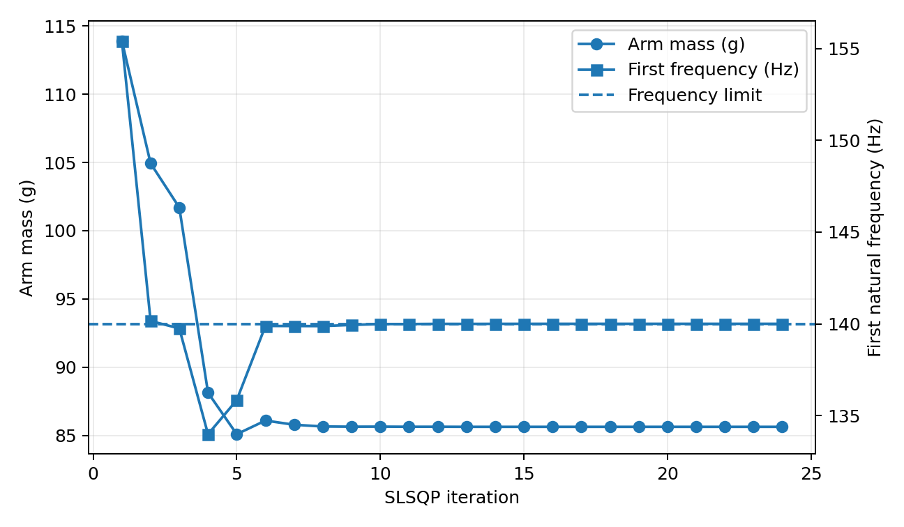
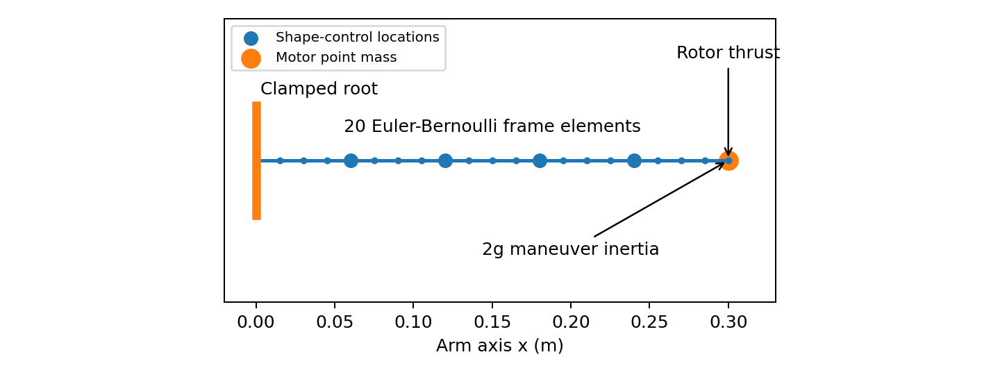
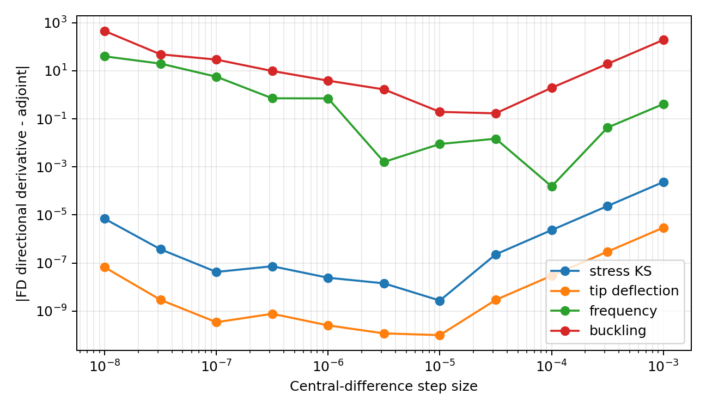
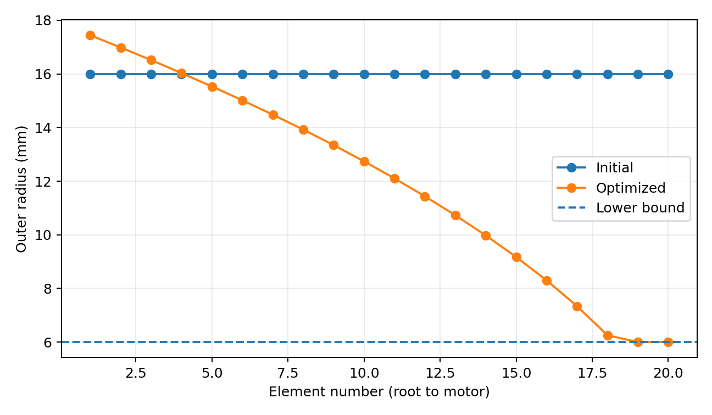

# PDE-Constrained Optimization of a Tubular Drone Arm

## 1. Summary

This project minimizes the structural mass of a **0.30 m cantilevered multirotor arm** using a custom three-dimensional finite-element solver and gradient-based PDE-constrained optimization. The model contains 20 Euler-Bernoulli frame elements, one independent tube-radius variable per element, and four centerline shape-control variables, giving **24 design variables**. The design must satisfy strength, tip-deflection, vibration, and N1 linear-buckling requirements.

The baseline arm has a mass of **116.42 g**. The converged design has a mass of **85.63 g**, a **26.5% reduction**, while satisfying every requirement. The active system-level constraint is the first natural frequency at **140.000 Hz**; stress, static displacement, and buckling retain substantial margin. The optimization converged from multiple radius profiles, and a separate shape-perturbation restart returned to essentially the same design basin.

<div id="viewer" style="height:560px"></div>
<div id="viewer-controls"></div>
<div id="viewer-metrics"></div>
<script type="module" src="assets/viewer.js"></script>



The viewer defaults to the **first vibration-mode amplitude**, because vibration is the governing constraint. Stress utilization remains available as a selectable field.

## 2. Structure and formulation

### 2.1 Engineering motivation and physical model

A multirotor arm should be light because structural mass reduces payload and endurance, but excessive mass reduction can lower stiffness, shift structural modes toward rotor excitation, increase deflection, or create instability. The reference propulsion unit is the T-MOTOR MN3110 KV700. The manufacturer's test table lists a **99 g motor mass** and **1290 g thrust at 7600 RPM** for the 14.8 V / 12x4 propeller test point. These values define the motor point mass and full-throttle rotor thrust used in the model.

Rather than artificially tilting the thrust vector relative to the arm, the static design load separates two physical effects: (1) vertical rotor thrust and gravity, and (2) a team-selected **2g axial maneuver acceleration** of the motor mass. The latter produces an inward compressive inertia load of **1.942 N**, allowing the N1 stability model to be exercised without implying that vehicle bank angle changes the rotor-thrust direction relative to its own arm.

**Propulsion source:** T-MOTOR, "MN3110 Multirotor Fixed Wing UAV Motor KV470/KV700/KV780," manufacturer product/test data.



### 2.2 Material

The baseline material is isotropic 6061-T6 aluminum with $E=68.9$ GPa, $\nu=0.33$, $\rho=2700$ kg/m$^3$, and tensile yield strength $S_y=276$ MPa. The strength limit uses a design factor of 2:

$$
\sigma_{allow}=\frac{S_y}{2}=138\ \text{MPa}.
$$

**Material source:** MatWeb, "Aluminum 6061-T6; 6061-T651."

### 2.3 Design variables

The design vector is

$$
\mathbf d=[r_1,\ldots,r_{20},z_1,z_2,z_3,z_4]^T.
$$

Each element has an independent outer radius $r_i$ and a fixed wall thickness $t=1.5$ mm:

$$
6\ \text{mm}\le r_i\le18\ \text{mm}.
$$

The four shape variables move centerline control points at normalized arm locations $x/L=0.2,0.4,0.6,0.8$:

$$
-20\ \text{mm}\le z_j\le20\ \text{mm}.
$$

Piecewise-linear interpolation defines all intermediate nodal $z$ coordinates, while the clamped root and motor location remain fixed. The size bounds are team-selected geometric/manufacturing bounds: with the fixed wall thickness they prevent invalid or vanishing tubes while allowing a broad range of 12-36 mm outside diameters. The shape bounds prevent extreme centerline curvature and very short elements.

### 2.4 Objective and requirements

The objective is structural arm mass; the motor is included in the vibration mass matrix but not in the arm-mass objective:

$$
\min_{\mathbf d}\;m(\mathbf d)=\sum_{e=1}^{20}\rho A_eL_e,
\qquad
A_e=\pi\left[r_e^2-(r_e-t)^2\right].
$$

| Requirement | Explicit mathematical constraint | Limit | Basis for the limit |
|---|---|---:|---|
| Strength | $KS_\rho(\sigma_{vM}/\sigma_{allow})\le1$ | $\sigma_{allow}=138$ MPa | 6061-T6 yield divided by design factor 2 |
| Tip displacement | $\|\mathbf u_{tip}\|\le\delta_{max}$ | $\delta_{max}=3$ mm | Team-selected serviceability limit equal to 1% of arm span |
| Vibration | $f_1\ge f_{min}$ | $f_{min}=140$ Hz | 7600 RPM = 126.7 Hz shaft frequency; 140 Hz gives a 10.5% separation margin |
| Stability (N1) | $\alpha_{cr}\ge\alpha_{min}$ | $\alpha_{min}=3$ | Team-selected stability factor following the course project's worked-example convention |
| Geometry | bounds on $r_i$ and $z_j$ | above | Prevent invalid tubes and extreme geometry |

The reduced problem is therefore

$$
\begin{aligned}
\min_{\mathbf d}\quad &m(\mathbf d)\\
\text{s.t.}\quad
&\mathbf K(\mathbf d)\mathbf u-\mathbf F(\mathbf d)=0,\\
&KS_\rho(\sigma_{vM}/\sigma_{allow})-1\le0,\\
&\|\mathbf u_{tip}\|/\delta_{max}-1\le0,\\
&1-f_1/f_{min}\le0,\\
&1-\alpha_{cr}/\alpha_{min}\le0,\\
&\mathbf d_{min}\le\mathbf d\le\mathbf d_{max}.
\end{aligned}
$$

## 3. Analysis model

### 3.1 Governing PDE reduction, finite elements, mesh, and boundary conditions

The arm is governed by small-strain three-dimensional elasticity. Euler-Bernoulli frame theory reduces that continuum problem to beam equations along the arm centerline, and the finite-element discretization produces

$$
\mathbf K(\mathbf d)\mathbf u=\mathbf F(\mathbf d).
$$

Each node has six degrees of freedom: three translations and three rotations. The 0.30 m arm is discretized with 20 frame elements. The root node is fully clamped ($u_x=u_y=u_z=\theta_x=\theta_y=\theta_z=0$). Element orientation is handled with a three-dimensional local-to-global transformation matrix, and the global matrices are assembled from the element matrices.

For a circular hollow section with inner radius $r_i=r-t$,

$$
A=\pi(r^2-r_i^2),\qquad
I_y=I_z=\frac{\pi}{4}(r^4-r_i^4),\qquad
J=2I.
$$

The mass model uses the consistent Euler-Bernoulli beam mass matrix plus a 99 g translational point mass at the motor node..

### 3.2 Loads

The static load vector contains:

- distributed arm self-weight;
- motor weight $m_mg$ at the tip;
- vertical rotor thrust $T=12.65$ N at the tip; and
- an inward axial maneuver inertia load $F_x=-m_m(2g)=-1.942$ N.

Thus the tip translational components are

$$
F_x=-m_ma_x,\qquad F_z=T-m_mg,\qquad a_x=2g.
$$

Motor reaction torque is omitted because the selected manufacturer test table does not report shaft torque. This omission is retained as a stated model limitation rather than inserting an unsupported value.


### 3.3 Stress recovery and KS aggregation

Element local end forces provide axial force $N$, torsion $T_q$, and bending moments $M_y,M_z$. At eight perimeter locations at both ends of every element,

$$
\sigma(\theta)=\frac{N}{A}-\frac{M_zy}{I_z}+\frac{M_yz}{I_y},
\qquad
\tau=\frac{T_qr}{J},
$$

and

$$
\sigma_{vM}=\sqrt{\sigma^2+3\tau^2}.
$$

The many local stress constraints are replaced by a smooth Kreisselmeier-Steinhauser (KS) upper bound. With $a_i=\sigma_{vM,i}/\sigma_{allow}$,

$$
KS_\rho(\mathbf a)=a_{max}+\frac{1}{\rho}\ln\left(\sum_i e^{\rho(a_i-a_{max})}\right),\qquad \rho=50.
$$

The true maximum stress is always reported beside the KS quantity.

### 3.4 Vibration

Free vibration is obtained from

$$
\mathbf K\boldsymbol\phi=\omega^2\mathbf M\boldsymbol\phi,
\qquad
f=\frac{\omega}{2\pi}.
$$

The constraint uses the lowest eigenfrequency of any mode, avoiding a discrete mode-classification rule that can become nonsmooth when modes exchange order.

### 3.5 Linear buckling: N1 component

Axial forces from the computed static state are used to assemble the geometric stiffness $\mathbf K_G(\mathbf u,\mathbf d)$. Linearized buckling is defined by

$$
(\mathbf K+\alpha\mathbf K_G)\boldsymbol\phi_b=0.
$$

The smallest positive $\alpha$ is the critical load factor $\alpha_{cr}$. Because $\mathbf K_G$ depends on the static stress state, this is an N1 component: an eigenvalue problem linearized about a computed PDE state.

### 3.5 Assumptions

The arm is isotropic 6061-T6 aluminum; joints are rigid; strains and rotations are small in the service load case; aerodynamic distributed loads are neglected; the motor is a point mass; rotor gyroscopic effects and motor torque are neglected; the root attachment is perfectly clamped; manufacturing tolerances and local shell buckling are not included; and the 25 degree thrust tilt is a representative maneuver case rather than a certified flight envelope.

## 4. Verification

The solver was verified before optimization with exact beam, torsion, vibration, buckling, equilibrium, and gradient tests. The first five tests have maximum relative error **2.49e-08**. The gradient ladder uses a mildly curved valid arm so first-order shape sensitivities are nonzero.

| Test | Numerical | Exact/target | Relative error |
|---|---:|---:|---:|
| V1 cantilever tip deflection | 0.00019382 | 0.00019382 | 2.322e-11 |
| V2 cantilever torsion | 0.000429634 | 0.000429634 | 2.524e-15 |
| V3 cantilever first frequency | 250.413 | 250.413 | 7.511e-09 |
| V4 Euler cantilever buckling | 12730.4 | 12730.4 | 2.492e-08 |
| V5 global force balance | 5.26042e-12 | 0 | 5.260e-12 |
| V6 adjoint directional gradients | 0.000156848 | 0 | 1.568e-04 |

### 4.1 Gradient checks

| Response | Variable kind | Adjoint directional derivative | Central difference | Relative error |
|---|---|---:|---:|---:|
| stress_ks | radius | 0.168609 | 0.168596 | 7.785e-05 |
| stress_ks | shape | -0.00230754 | -0.0023079 | 1.568e-04 |
| tip_deflection | radius | 0.00291554 | 0.00291558 | 1.263e-05 |
| tip_deflection | shape | 5.45305e-05 | 5.45307e-05 | 2.572e-06 |
| frequency | radius | -3472.19 | -3472.19 | 5.088e-07 |
| frequency | shape | -161.971 | -161.973 | 1.160e-05 |
| buckling | radius | -182173 | -182172 | 5.689e-06 |
| buckling | shape | -9705.7 | -9705.7 | 5.797e-08 |

The largest directional-gradient error is **1.57e-04**. A Taylor step-size sweep is shown below; the central-difference error decreases until roundoff/truncation limits dominate.



## 5. Sensitivity analysis

For a scalar response $g(\mathbf d,\mathbf u)$ with residual

$$\mathbf h(\mathbf d,\mathbf u)=\mathbf K(\mathbf d)\mathbf u-\mathbf F(\mathbf d)=0,$$

the adjoint satisfies

$$
\mathbf K^T\boldsymbol\lambda=-\left(\frac{\partial g}{\partial\mathbf u}\right)^T,
$$

and the reduced gradient is

$$
\frac{dg}{dd_j}=\frac{\partial g}{\partial d_j}+
\boldsymbol\lambda^T\left(\frac{\partial\mathbf K}{\partial d_j}\mathbf u-\frac{\partial\mathbf F}{\partial d_j}\right).
$$

This form is used for the stress and tip-displacement responses. Matrix and response partial derivatives are evaluated locally/numerically while holding the state fixed; the expensive state dependence requires only one adjoint linear solve per scalar response, not one equilibrium solve per design variable.

For vibration, with $\boldsymbol\phi^T\mathbf M\boldsymbol\phi=1$,

$$
\frac{d(\omega^2)}{dd_j}=\boldsymbol\phi^T
\left(\frac{\partial\mathbf K}{\partial d_j}-\omega^2\frac{\partial\mathbf M}{\partial d_j}\right)\boldsymbol\phi.
$$

For buckling, write the generalized eigenproblem as $\mathbf K\boldsymbol\psi=\alpha\mathbf B\boldsymbol\psi$ with $\mathbf B=-\mathbf K_G$ and normalize $\boldsymbol\psi^T\mathbf B\boldsymbol\psi=1$. Its direct sensitivity is

$$
\frac{d\alpha}{dd_j}=\boldsymbol\psi^T\left(\frac{\partial\mathbf K}{\partial d_j}-\alpha\frac{\partial\mathbf B}{\partial d_j}\right)\boldsymbol\psi
=\boldsymbol\psi^T\left(\frac{\partial\mathbf K}{\partial d_j}+\alpha\frac{\partial\mathbf K_G}{\partial d_j}\right)\boldsymbol\psi.
$$

Because $\mathbf K_G$ also depends on the static axial forces and therefore on $\mathbf u(\mathbf d)$, a static adjoint adds the state-dependent term. The code checks stress, displacement, vibration, and buckling gradients in both radius and shape directions against central differences.

### 5.1 Computational cost

The generated timing data are stored in `results/benchmark.json`. On the verification design, computing all four reduced gradients with the adjoint/eigenvalue formulas took **1.321 s**, while a central-difference Jacobian requiring two full analyses per design variable took **1.355 s**, a measured speedup of approximately **1.0x**. The advantage grows with the number of design variables because the adjoint solve count scales with outputs rather than design dimension.

## 6. Optimization

SciPy SLSQP is used with normalized design variables and normalized constraints. The starting design has uniform 16 mm outer radii and zero centerline offsets. Clearly inactive constraints are screened from gradient evaluation while still being evaluated as explicit SLSQP constraints; if their margin falls below the screening threshold, the full adjoint gradient is restored. This avoids spending most runtime differentiating constraints with zero KKT multipliers.

The optimization converged in **23 iterations** with status: **Optimization terminated successfully**.



The radius tapers from approximately **17.44 mm** near the root to the 6 mm lower bound near the tip. **2 elements** are exactly at the lower radius bound. This is physically consistent with a cantilever dominated by bending/vibration: stiffness is most valuable near the clamped root.

### 6.1 Active constraints and KKT interpretation

The frequency constraint is active at **140.000000 Hz**. The SLSQP multiplier for the normalized frequency constraint is approximately **0.4837**; the stress, displacement, and buckling multipliers are zero to numerical precision. Interpreted locally, tightening the frequency requirement by 1 Hz costs approximately **0.402 g** of arm mass at this optimum. Radius lower bounds at the tip are also active.

## 7. Nonlinear/stability component: with and without buckling

The N1 buckling constraint was removed and the design was re-optimized from the same starting point. The resulting mass changed by only **0.000000 g**. With buckling included, the optimized load factor is **2876.9**, far above the required value of 3. Therefore buckling is inactive for this particular load case and geometry; the vibration requirement and minimum tube-size bounds prevent the design from approaching instability.

This is still an engineering result: adding the N1 physics does not alter the optimum because another requirement governs first. A future load case with greater in-plane thrust, a longer arm, or a thinner-wall tube could make the stability constraint relevant.

## 8. Results

| Metric | Initial | Optimized | Requirement | Status |
|---|---:|---:|---:|---|
| Arm mass | 116.42 g | 85.63 g | Minimize | - |
| True max von Mises stress | 2.880 MPa | 3.783 MPa | <= 138 MPa | PASS |
| KS stress utilization | 0.1226 | 0.1275 | <= 1 | PASS |
| Tip displacement | 0.0785 mm | 0.1240 mm | <= 3 mm | PASS |
| First natural frequency | 160.183 Hz | 140.000 Hz | >= 140 Hz | PASS |
| Buckling factor | 5919.4 | 2876.9 | >= 3 | PASS |

## 9. Website and 3D comparison

The GitHub Pages viewer reads `assets/results.json` and presents the initial and optimized arms side by side under one linked camera. It renders the actual tube radii in 3D; uses a single-hue stress-utilization scale with a color bar and black over-limit markers; applies beam-interpolated static deformation with an exaggeration slider; animates both the first vibration mode and the first buckling mode; identifies members and key values on hover; displays the objective and every constraint with PASS/FAIL status for both designs; draws the applied thrust direction; and uses a responsive layout for narrow screens. Geometry is exported from the beam shape functions rather than drawn as straight lines between displaced nodes.

## 10. Reproducibility

From the repository root:

```bash
python -m pip install -r requirements.txt
python run_all.py
```

This regenerates verification results, optimization history, `assets/results.json`, all figures, `REPORT.md`, and `index.md`. The solver source is entirely in `src/`.

## 11. Limitations and AI-use statement

### Limitations

The largest modeling limitation is the use of isotropic aluminum rather than a composite layup typical of many production drone arms. The root is idealized as perfectly clamped, local shell buckling and fastener stresses are omitted, and the load model uses a single tilted full-thrust case. The rotor-frequency constraint considers shaft rotational frequency but not blade-passing harmonics, motor electromagnetic forcing, gyroscopic coupling, or controller-induced excitation. Motor reaction torque is omitted because the selected test table does not provide a shaft-torque value. These effects should be added before treating the design as flight hardware.

### AI-use statement

A coding assistant was used to draft the finite-element implementation, optimization workflow, verification scripts, website viewer, and report structure. The physics was not accepted solely because the code executed: the frame implementation was checked against exact cantilever bending, torsion, natural-frequency, and Euler-buckling solutions; global force balance was checked; and adjoint directional derivatives were independently compared against central finite differences for both radius and shape variables. One important issue caught during verification was an initially inaccurate stress sensitivity caused by an overly large state-perturbation step in the numerical partial derivative. Reducing that local perturbation and re-running the independent directional checks reduced the worst gradient discrepancy to approximately **1.57e-04**.

## References

1. Project 4: PDE-Constrained Design Optimization, course project specification.
2. T-MOTOR. "MN3110 Multirotor Fixed Wing UAV Motor KV470/KV700/KV780." https://store.tmotor.com/product/mn3110-motor-navigator-type.html
3. MatWeb. "Aluminum 6061-T6; 6061-T651." https://asm.matweb.com/search/SpecificMaterial.asp?bassnum=MA6061T6
